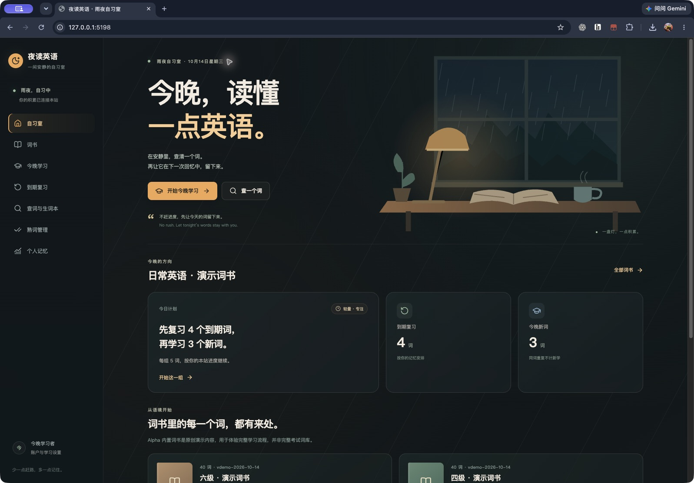

# NightStudy · 夜读英语

[](https://github.com/wudi000888-svg/nightstudy/actions/workflows/ci.yml)
[](LICENSE)

雨夜里的语境背词与间隔复习。NightStudy 是可自行部署的多用户英语学习应用，围绕语境词书、FSRS 复习、熟词测试、记忆曲线、用户中心与基本管理后台建设。

**在线使用：[english.minminlove.top](https://english.minminlove.top)**



[查看个人记忆页面](docs/media/memory-preview.png) · [开发路线与问题](https://github.com/wudi000888-svg/nightstudy/issues) · [部署指南](docs/DEPLOYMENT.md)

**当前线上版本：[`0.6.0-alpha.4`](https://github.com/wudi000888-svg/nightstudy/releases/tag/v0.6.0-alpha.4)。** 星星和钉子悬停立即显示功能名称，修复收藏时按钮位移导致点击失效的问题；成功后显示生词本入口，已保存的词可直接移除。生词本增加「已巩固」分类，个人中心也可直接进入。后台「AI 设置」可加密保存DeepSeek密钥并独立启用水平测试智能分析；用户明确选择后，按目标和本次答题生成薄弱点、逐词建议及可手动采用的计划。每份测试最多请求一次，失败仍提供基础报告；不自动改变成绩、熟词或复习证据。详细规则见 [AI配置](docs/AI_CONFIGURATION.md) 和 [CHANGELOG](CHANGELOG.md)。

本版代码 `4a7f4e5` 已通过52文件396项测试、类型/格式/构建和真实双PostgreSQL 17、完整隔离Compose安装验证：[CI](https://github.com/wudi000888-svg/nightstudy/actions/runs/38639404852)、[镜像发行](https://github.com/wudi000888-svg/nightstudy/actions/runs/38639482010)。公开amd64镜像已匿名拉取到VPS并按固定摘要部署，HTTPS健康返回alpha.4。升级前后全部40张业务表的原有字段逐行摘要一致，新增AI字段保持默认值；本次升级前备份在独立测试库实际恢复并完成同样的40表核对，临时库已清理，未恢复覆盖在线数据库。现有管理员密码和会话保持，生产浏览器确认新版AI设置与星星、钉子提示。

隔离本机浏览器实际验证收藏成功、已保存状态、取消固定、390×844仿真尺寸的词卡边界与分析报告；AI诊断使用受控模拟响应，选择关闭分析时不调用模型，手动采用计划后才更新每日目标。临时测试账户、数据库和独立运行目录已精确清理。未提供真实API密钥，本次付费推理请求为0；不将模拟结果描述为DeepSeek在线质量或更高准确率的证明，未进行容量压测或专家语义认证。

五书8,798词的独立中英文解释、8,786词的真实配对或原创用法，以及437词组的学习与英美音源保持安装。学习正文保留词性、解释、例句和两个发音选项，来源许可单独查看；日常复习不会触发付费请求。详细范围见 [双语内容](docs/BILINGUAL_CONTENT.md) 和 [内容包](docs/CONTENT.md)。此前alpha.3的363项测试、45项HTTPS/只读数据库混合检查和旧任务快照验收记录属于 [alpha.3发行](https://github.com/wudi000888-svg/nightstudy/releases/tag/v0.6.0-alpha.3)。

[线上双语词卡](docs/media/bilingual-card-preview.jpg) · [DeepSeek 配置页面](docs/media/deepseek-preview.jpg)。IPA包覆盖统计按实测词条刷新，原始账号、词书与学习数据保持；词库完整收录不代表每个冷门词已有双语例句，五书覆盖范围及12个待核对词见内容文档。

**每日学习计划：** 桌面悬停英文立即打开清晰背景词卡，英美喇叭各在对应IPA前。每日计划按“复习 + 新学”的不同词总数安排：先预留到期复习，再补本书新词。选书先确认计划，支持暂停、延期、跨端继续、完成历史与七天复习负担。具体规则见 [每日任务](docs/DAILY_TASKS.md)、[个性化计划](docs/architecture/PERSONALIZATION.md) 和 [CHANGELOG](CHANGELOG.md)。0.5历史验收见 [0.5.0-alpha.2](https://github.com/wudi000888-svg/nightstudy/releases/tag/v0.5.0-alpha.2)。

[线上悬停词卡](docs/media/hover-card-preview.png) · [手机任务实测（本机可丢弃账户）](docs/media/daily-tasks-mobile-preview.png)

**已验收历史基线：[`0.4.0-alpha.1`](https://github.com/wudi000888-svg/nightstudy/releases/tag/v0.4.0-alpha.1)。** 英文点词卡、精确查词、私有标准文档词书导入，以及区分真人录音、服务器合成与设备备用的英美发音已在该版本交付。五本源词书的8,798个词均有两种口音音源；下文已有验证记录仅属于标注的历史版本。

[移动单词卡实测](docs/media/word-card-mobile-preview.png) · [TXT模板](docs/templates/nightstudy-wordbook-template.txt) · [Word模板](docs/templates/nightstudy-wordbook-template.docx) · [PDF模板](docs/templates/nightstudy-wordbook-template.pdf)

默认首次安装创建用户名admin和独立随机密码，私密文件交付初始凭据；既有管理员不被重置。群站使用10分钟单次配对票据与独立长期授权，可读取状态、按批准的权限管理用户/注册/公告并检测更新。版本检测只访问固定GitHub Release，不执行shell安装。这些功能在0.3代码 `86afefa` 的86项测试及VPS42项真实HTTPS管理员/双站检查中验收，0.4回归保留对应测试。

[系统与更新预览](docs/media/admin-system-preview.png) · [群站管理预览](docs/media/admin-fleet-preview.png)

系统截图采集于0.3 Release发布前，显示no-release；0.4线上实际检测为up-to-date。

0.5 [发行流水线](https://github.com/wudi000888-svg/nightstudy/actions/runs/38517674566) 成功，公开amd64容器经匿名manifest及VPS空认证配置实际拉取验收。固定摘要部署见 [指南](docs/DEPLOYMENT.md#ci-与镜像发行)。

## 产品与边界

- 保留雨夜背景、专注卡片和简洁学习节奏，支持桌面与手机。
- 普通用户拥有本站词书选择、学习进度、复习记录、熟词声明、生词本及设置。
- 桌面悬停英文释义或例句中的词立即打开词卡，移入保持、离开短延时关闭、点击固定；键盘和手机点击也可打开。卡片正文不递归生成另一张卡，来源与音源说明单独查看。精确查词未命中显示空态；已保存的词显示状态，未揭晓的学习内容保持遮蔽。
- 自定义词书只对本人可见。标准TXT、DOCX、纯文本PDF先预览合格/失败/重复行，再确认合格词；提供失败原因导出、词书选择、编辑及归档。
- 固定会话先回忆、再评价、再拼写；动作去重与版本冲突保护避免重复评价。个人曲线使用真实 FSRS 状态，无数据时显示空态。
- 每日总目标为复习与新学的不同词数，先预留今日到期复习，再用余量学本书新词；复习覆盖本站全部已学词。未安排逾期、待巩固、待拼写与等待同步各自可见。
- 学习日按计划时区当地04:00交接，时区更改从下个学习日生效。切书、降低总目标或跨日均保留已签发任务；暂停、页面24小时延期、恢复与完成历史按本人账户保存，API延期上限七天。
- 同词巩固须等真实FSRS到期再评分，当天只计一个不同词，拼写不额外写FSRS。主动额外复习可超出主目标；七天负担明确假设后续尚未复习，不伪造完成预测。
- 生词本重复保存不新建条目。处于FSRS复习状态、stability至少14天且最近一次Again后已有3个不同学习日的真实Good/Easy复习时软毕业；至少90天、5个不同学习日时自动进入熟词本。再次Again撤回自动熟词并恢复生词本，自己标记的熟词保留；首学、拼写、同日重复及回执重试不凑复习天数。这是产品分层规则，不是掌握证书。
- 离线冲突可先读取服务器任务，再逐条确认放弃未接受的本地操作；不泛清队列，不删除服务器已接受记录。
- 管理员维护本站用户和学习内容；部署 operator 管理站点域名与数据库映射。
- 独立部署的站点可由各自管理员生成单次票据，授权另一站点管理；各站账号、数据库与学习记录仍独立，远端操作受明确scope和白名单限制。
- 同一份源码可独立部署多站，也可由共享后端按可信 host 选择每站独立 Postgres/认证 Realm。
- 真租户默认使用独立域名或子域名。同域子路径只用于同一信任域内的共存，不能作为浏览器强隔离。

统一技术栈：React + TypeScript + Vite、Fastify、Prisma 7、Better Auth、Postgres 17、Node.js 24 与 pnpm 11 workspace。同一 Node 容器提供 Web/API；默认学习体验无需付费 AI、OAuth 或对象存储。

完整初次安装下载固定版本的独立内容包，校验 SHA-256，再在各站数据库事务内发布。词典有 770,611 条词目、768,739 条上游中文释义和 160,884 条英文释义；0.2/0.3本机/VPS查询现代美音 IPA 匹配 83,424 个词、英音匹配 64,321 个词，至少一种匹配 104,261 个词。原音标保真保留，原词典地区IPA优先。0.4仅为五书范围的缺失字段补充147个美式、719个英式算法音标，并标记Piper/eSpeak-NG来源；不是专家逐词审核，不等于覆盖全词典。0.6五书例句准备采用ManyThings的4,128个词级英中原句对与4,658个原创用法；12个源词形保留待校对警告和空例句。中英文释义可以来自同词的独立义项，不宣称全770,611词已有成对释义或例句。

五本新词书：常用英语 3,277 词、高考方向 3,677 词、四级方向 3,849 词、六级方向 5,407 词、雅思方向 5,040 词。它们完整导入固定源的对应频率规则或标签，不宣称等于当前官方考试大纲。0.4生产内容准备归档旧演示词书，公开词书页面不再展示它们；原40词ID、原创例句、用户进度与既有会话快照保留。

0.6另提供四级方向236、六级方向201个常用词组，共437个，配874条英美Piper合成音源。这是独立编选的练习书，不是官方完整考试词组大纲；词组继续使用原canonical身份，音源类型和许可如实保留。例句与原创补充均待校对。

继续使用0.4的独立音频包：五书去重联合范围为8,798个词，包包含17,596条英美音源：其中3条已核验来源与许可的真人录音，17,593条采用Piper 1.8.0开源合成并明确标注。音频包已生成并逐文件校验，本机、PG17/Compose CI和VPS完整安装；可播放数量以各部署的就绪元数据与文件校验为准。网页优先就绪的本站音源；设备语音是单独选择的备用，不冒充真人或标准录音。登录用户可在服务可用且IPA齐全时显式补齐缺失合成音源，完成后再次点击播放。

私有词书每批最多10,000项，TXT限UTF-8和256 KiB；DOCX/PDF限2 MiB，PDF最多250页。首行使用标准版本标记，之后每行一个词或短语；不做OCR，不支持旧版DOC、任意表格或释义拼接。缺中文释义、英美IPA或任一口音的就绪音源会列入失败清单。归档保留已学进度。详细格式、失败处理与来源许可见 [内容包](docs/CONTENT.md)、[音标与音源](docs/PHONETICS.md) 和 [API](docs/API.md)。

在线翻译保留Google官方网页入口与私密VPS备用网关，暂不接入收费Cloud API；原文不写数据库。网关使用非官方网页兼容接口，本机和目标VPS真实请求均遇到上游429，不能宣称站内翻译已可用或实现加速。错误显示给用户，并提供带原文的官方网页链接；Google网页不支持直接iframe。部署与验证范围见 [在线翻译](docs/TRANSLATION.md)。

## 构建与部署

Docker Compose首次安装可使用脚本生成私有配置并启动。已有 `.env` 会保留；自定义域名须先配置自己的HTTPS入口，并在首次执行前设置PUBLIC_URL：

```sh
bash scripts/install.sh
```

默认访问 `http://127.0.0.1:5198`。新站用户名为admin，密码为本站随机值；脚本将初始凭据从仅init挂载的私密卷导出到服务器 `.local/admin/credentials.json`（目录0700、文件0600），只由部署者读取和保管。文件不会通过Web下载，不放入Git。它记录创建时的初始密码，之后改密不会更新此明文记录。既有管理员继续使用原登录方式；`ADMIN_BOOTSTRAP=manual` 保留初始化口令/setup流程。`init` 负责迁移、种子、首次管理员与完整内容安装，PG/内容缓存/音频缓存/私密凭据分别持久化。默认完整配置准备源词典、IPA、词组、词级双语内容和预生成音频；缓存中的Piper模型仅用于语音合成，不是翻译模型。`CONTENT_PACK=demo` 可显式选40词最小体验。完整变量、凭据备份、HTTPS与多站见 [部署文档](docs/DEPLOYMENT.md)。不要对需保留数据的安装使用 `down --volumes`。

Native 开发使用 Node 24、pnpm 11.25.0和Python 3.11以上，并自行准备可访问的 PG 数据库；完整音频安装需在隔离venv中安装scripts/audio-requirements.txt，并将私有.env的AUDIO_PYTHON指向该venv的python。在 `.env` 填入真实 DATABASE_URL 与两个随机密钥后：

```sh
pnpm install --frozen-lockfile
pnpm db:prepare
pnpm build
pnpm dev
```

Native的db:prepare也默认创建首次admin，将私密初始记录写到 `.local/admin/<siteId>.credentials.json`；已有账号不重置。Web开发地址 `http://127.0.0.1:5173`，API为 `http://127.0.0.1:5198`。生产同进程启动用 `pnpm start`；app自带PG lease维护，额外worker可用 `pnpm worker`。检查命令与隔离测试库要求见 [贡献指南](CONTRIBUTING.md)，测试准备显式manual/demo，不能指向生产库。

[在 Render 审阅部署配置](https://render.com/deploy?repo=https://github.com/wudi000888-svg/nightstudy) 使用 `render.yaml` 的首站Web/PG描述，采用付费规格。首次管理员密码由平台INITIAL_ADMIN_PASSWORD的generateValue独立生成，部署者从自己的Render私有环境保管；不是共用默认密码，也不依赖临时容器文件恢复。render-public仅适用于平台受控公网入口。Render实际创建、首装与恢复尚未实测，不自动创建无限租户。

架构约定见 [架构](docs/architecture/ARCHITECTURE.md)、[多站与并发方案](docs/architecture/MULTISITE_AND_SCALING.md)。PgBouncer、Redis provider、跨主机 HA 和实测高并发容量仍待完成。当前 API 契约见 [API.md](docs/API.md)。词典/词书分页和学习选词不再被前 500/1,000 词截断；熟词导出以游标分批流式输出全部记录。

## 验证记录

0.5代码 `2918aa9` 的25文件162项测试、9项Python提取器回归及格式、类型、生产构建通过。[main CI](https://github.com/wudi000888-svg/nightstudy/actions/runs/38517645764) 与 [发行CI](https://github.com/wudi000888-svg/nightstudy/actions/runs/38517674566) 均通过双PG17和完整Compose安装。新增覆盖04:00/DST、首次设置8路并发、跨端任务、真实FSRS巩固去重、跨日旧组直接评分、延期不改到期时间，以及5项IndexedDB冲突隔离与单条恢复回归。

本机浏览器验证即时鼠标悬停、移入保持、离开关闭、清晰背景、词卡生词本和两种口音播放；390×844完成选书确认、三词目标、暂停恢复、回忆、拼写、两组完成及3/3去重进度。生产浏览器另验证rain英美真人录音、water悬停卡及两种服务器合成的实际播放完成事件。

历史0.5验收时，VPS运行 `nightstudy-english:0.5.0-alpha.2-2918aa9`，init退出0、app/PG/网关健康。完整词库770,611词及五书8798词/17596音源保留，8条媒体样本通过。165项真实HTTPS检查验证两账户隔离、私有书与确认幂等、共享任务额度、降目标/切书保留原组、暂停恢复、任务历史和7日负担；真实首学3词、评分4次含一次实际到期复习，仍只占3个不同词。2个临时用户、1书、1导入、2计划、3任务、4评分及相关回执已精确清理，其他用户和公共内容受事务保护。更新检测实际返回up-to-date及0.5.0-alpha.2链接。

生产HTTP验收未跨自然04:00边界，跨日与DST由隔离PG/单元回归覆盖；未实测高并发容量、异机灾备或逐词专家听辨。以下保留0.4及更早版本的对应证据。

0.4代码 `b784133` 的20文件133项测试、9项Python提取器回归及格式、类型、生产构建通过。[CI](https://github.com/wudi000888-svg/nightstudy/actions/runs/38508645895) 完成真实双PG17回归、完整Compose默认安装、随机管理员登录和闭合翻译网关检查；私有词书包含1001词确认不截断、真实损坏音频失败及账户隔离用例。

0.4本机浏览器实际完成Word模板上传、10词预览与确认、私有词书选择学习，以及390×844点词卡、生词本状态和英美合成播放。生产浏览器验证0.4查询、rain英美真人录音与water点词卡合成播放。实际播放事件和文件校验不等于逐条专家听辨。VPS运行 `nightstudy-english:0.4.0-alpha.1-b784133`，init退出0，app/PG/网关健康，770,611词及原管理员保留；5书8798词/17596音源完整性与8媒体样本检查通过。78项真实HTTPS断言验证三格式模板/上传、失败导出、确认幂等、精确生词本与私有词书权限和初始学习状态。临时用户、私有书、导入和会话精确清理，原管理员、其他用户和公共词库不变；实际更新检测返回up-to-date及0.4发布链接。以下0.3及更早记录保留为对应版本证据。

2026-10-14，0.3代码基线 `86afefa` 的13文件86项测试、格式/类型/生产构建通过。本机PG18.4与 [PG17/Compose CI](https://github.com/wudi000888-svg/nightstudy/actions/runs/38491439614) 分别执行真实双数据库回归，覆盖一次性票并发兑换、权限、撤销、幂等、离线解绑、本地忘记与重配、历史长昵称及更新缓存。CI另完成770,611词默认全量安装，实际用私密导出的随机密码登录admin，并验证网关健康/未鉴权401。

历史0.3 VPS运行 `nightstudy-english:0.3.0-alpha.1-86afefa`：init退出0、app/PG/网关健康、原770,611词和3包保留；自动生成admin的私密文件权限600。42项HTTPS检查使用真实公网TLS连接临时独立子站，验证管理员登录、配对/撤销、用户启停、注册开关、分页和公告去重；临时记录、子站、数据库与入口已清理。Release发布后另验证更新检测返回up-to-date及正确发布链接。本机桌面浏览器完成新版登录、系统信息/真实更新检测与群站界面检查；未执行新版手机或生产浏览器完整流程，也未进行容量压测。

以下表格为0.1/0.2历史基线，保留各版本原始验证范围。

| 验证项                | 结果与范围                                                                                                           |
| --------------------- | -------------------------------------------------------------------------------------------------------------------- |
| 格式与类型            | format:check、typecheck 全部通过，包含 API 测试与工具脚本                                                            |
| 真实数据库与 provider | PG18.4 核心集成、provider、网关和内容 parser 检查；包括 11,001 条熟词完整导出、学习跨过首 1,000 词、鉴权及错误处理   |
| 完整内容              | 实际安装 770,611 词、1,113,723 条新增源词义、五本源词书及独立英美音标包；原 40 词 ID 和学习历史保留                  |
| 首版桌面基线          | 0.1本机完成注册、管理员/普通用户、两组学习与拼写、刷新恢复、复习、生词本、熟词批次、目标报告/计划和个人曲线          |
| 0.2桌面实测           | 本机词典分页、完整词义/来源、英美设备语音播放事件和Google错误展示已验证；VPS另完成生产HTTP检查，不替代浏览器live验收 |
| 手机尺寸范围          | 0.1本机390×844布局与学习流程通过；0.2只完成静态CSS检查，尚未新版手机/生产live验收                                    |
| 断网恢复实测          | 揭晓动作本地暂存后恢复，PG 确认回执恰好 1 条，无 Review；只验证该场景                                                |
| PG17 / 容器 / Compose | 577f48b的CI55项通过；PG17/Compose完整安装，明确核对installedDictionary/declaredEntryCount=770611及网关健康/401       |
| 目标VPS               | 0.2镜像、独立PG17、私密网关与内容缓存运行；22项HTTPS生产HTTP检查通过，临时学习账号已删除                             |
| 发布与容器重建        | 577f48b含HEAD SPA修复，本机与CI55项通过；VPS镜像发布成功，app/gateway健康、init退出0、770,611词/3包保留              |
| 数据库备份/恢复       | 首份归档140,510,271字节，实际恢复到独立临时DB并核对770,611词/3包/SiteState一致；临时DB已清理，不代表完整灾备         |
| Google上游            | 本机和目标VPS真实请求均遇到429；保留官方网页入口和备用网关，暂不接入收费API，不宣称加速可用                          |
| Render                | Blueprint 已准备，实际创建/部署/恢复未执行                                                                           |
| 容量与正式镜像        | 尚无高并发基准与正式发行容器                                                                                         |

22项生产HTTP检查包括首页CSP/JS/CSS、770,611词及3包元数据、分页检索与rain完整词义/英美IPA、注册Secure/HttpOnly Cookie、客户端role字段无法提权、普通用户admin403、空曲线、词书选择/5词会话/reveal/rate、真实FSRS曲线记录、Google官方deep link及私密网关真实429错误、退出/重新登录。测试账号已清理；这份HTTP检查不等于新版手机或完整生产浏览器live验收。

0.2历史运行代码为 `577f48b`，当时尚未初始化；0.3起已由首次init自动创建管理员。容器重建与数据保留不等于主机断电恢复或跨机HA。数据库恢复的限定证据见 [部署文档](docs/DEPLOYMENT.md#备份与升级)，后续进展见公开 [Issues](https://github.com/wudi000888-svg/nightstudy/issues) 与 [Milestones](https://github.com/wudi000888-svg/nightstudy/milestones)。

## 内容与许可

本仓库公开新工程、原创演示内容，以及外部内容包的固定版本清单、校验与安装工具。大型词典、音标源和各自许可证作为独立数据下载，不复制原部署词库或打进应用镜像。原服务端快照、编译产物、账户库、密钥与运行数据不在公开仓库中。应用代码 MIT 不会改变英美音标等数据的原有许可。

新写代码采用 [MIT License](LICENSE)。Piper 1.8.0引擎是GPL-3.0-or-later；固定US/UK声学模型的发布者声明为MIT，保留模型卡与声明，不能用引擎许可替代模型授权。真人音频按各来源的CC-BY-SA-3.0或CC-BY-3.0-US逐条保留归属与许可。第三方依赖、内容、媒体与数据保留各自许可，见 [音源清单](data/audio-voices.manifest.json)、[PHONETICS.md](docs/PHONETICS.md) 和 [THIRD_PARTY_NOTICES.md](THIRD_PARTY_NOTICES.md)。

## 参与

贡献前请阅读 [CONTRIBUTING.md](CONTRIBUTING.md) 和 [CODE_OF_CONDUCT.md](CODE_OF_CONDUCT.md)。安全问题请按 [SECURITY.md](SECURITY.md) 私下报告，不在公开 issue 附上凭据或个人数据。
