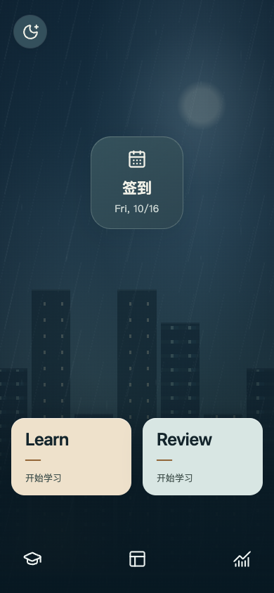
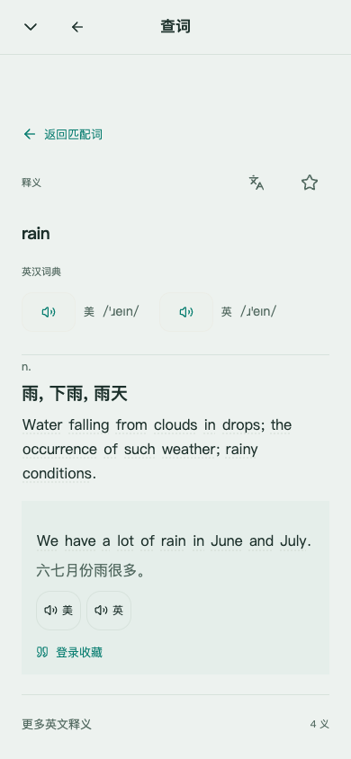
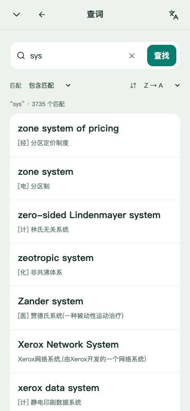
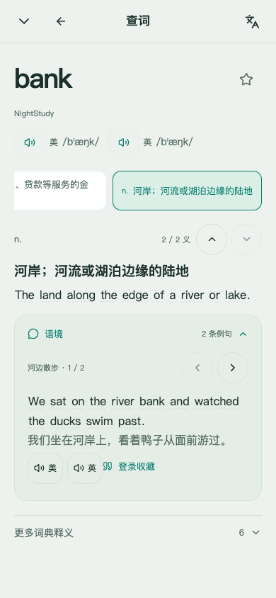

# NightStudy · 夜读英语

[](https://github.com/wudi000888-svg/nightstudy/actions/workflows/ci.yml)
[](LICENSE)

以移动 H5 应用体验学习英语。NightStudy 是可自行部署的多用户英语学习应用，支持语境词书、FSRS 复习、熟词测试、记忆曲线、用户中心与管理后台。

**在线使用：[english.minminlove.top](https://english.minminlove.top)**

 

0.10 线上匿名公开页面：雨夜首页与双语词卡。

[查看个人记忆页面](docs/media/memory-preview.png) · [开发路线与问题](https://github.com/wudi000888-svg/nightstudy/issues) · [部署指南](docs/DEPLOYMENT.md)

**当前发布：[0.11.0-alpha.3](https://github.com/wudi000888-svg/nightstudy/releases/tag/v0.11.0-alpha.3)。** 已在本机及 VPS 部署，修复切书后的旧任务、每日计数与迟到响应。97文件839项测试、完整 CI 与 Compose 冷安装通过；两端各338项公开接口及39项匿名手机浏览器检查通过。真实切书、同步冲突与返回验收见 [修复记录](docs/BOOK_SWITCH_TASKS_FIX.md)；逐义项内容的实际范围仍见 [0.11交付记录](docs/LOOKUP_SENSES_011.md#15-发行与保数据升级状态)。

查词支持智能、前缀、包含、精确匹配及显式错拼建议，公共查词与本人生词本独立，服务端全局排序和签名游标保证分页条件。原子学习义项各自绑定不同语境的双语例句；首包为35词、98义、196句和392条英美成品句音，其余18,732个内置词仍待逐义审核，不能把旧词级例句当作每个意思的配句。源码实现、内容边界和验证记录见 [查词与义项改造](docs/LOOKUP_SENSES_011.md)。

`0.12.0-alpha.1` 工作树已按真机方案增加可选新词辨义、就近简卡与独立详情、词形优先的词表和书内定位、紧凑计划与目标预览。辨义只采用已审且绑定来源的义项，选项不足时使用回忆；不把选择正确当作记住。实际发行与部署状态见 [本轮 H5 记录](docs/REAL_DEVICE_H5_ROADMAP.md#6-本轮实施与验收记录)，发布前线上仍以上方当前版本为准。

 

0.11 线上匿名真实页面：查词列表与 bank 河岸义项。

保留单屏H5首页、独立页面栈、Learn / Review、雨夜动态和管理员自定义壁纸，支持主屏幕安装与用户确认的安全更新。早期交付及来源说明见 [0.9记录](docs/CONTENT_AUDIO_PERFORMANCE_09.md)、[开放内容与代码复用](docs/OPEN_CONTENT_REUSE.md) 和 [雨夜外观](docs/RAIN_NIGHT_UI.md)。

每日目标按复习与新学的不同词总数计算，先复习，再分配新词。释义和例句支持英文点词卡；美式、英式各一个发音入口，星星和固定按钮有明确提示。词书支持标准 TXT、DOCX、PDF 导入，提供 [TXT](docs/templates/nightstudy-wordbook-template.txt)、[Word](docs/templates/nightstudy-wordbook-template.docx)、[PDF](docs/templates/nightstudy-wordbook-template.pdf) 模板。学习正文保持简洁，词典名称可以查看，来源与许可集中在独立说明。

后台支持 DeepSeek 官方及 CC Switch 自定义供应商，兼容 Chat Completions、Responses、Anthropic Messages 和 Gemini API。真实密钥由部署者配置，日常背词不调用付费模型；水平测试分析保持独立于客观成绩和复习证据。见 [AI配置](docs/AI_CONFIGURATION.md)。

首次安装自动创建 admin 与独立随机密码，凭据只写服务器私密文件。多站可独立部署或使用隔离数据库，群站通过一次性配对令牌授权；版本检测访问固定 GitHub Release。见 [部署指南](docs/DEPLOYMENT.md)、[每日任务](docs/DAILY_TASKS.md) 和 [版本记录](CHANGELOG.md)。

## 产品与边界

- 手机优先的完整应用壳：独立滚动、模块返回栈、安全区、短转场与统一音频生命周期；桌面保持同一应用构图。
- 普通用户拥有本站词书选择、学习进度、复习记录、熟词声明、生词本及设置。
- 桌面悬停英文释义或例句中的词立即打开词卡，移入保持、离开短延时关闭、点击固定；键盘和手机点击也可打开。卡片正文不递归生成另一张卡，来源与音源说明单独查看。精确查词未命中显示空态；已保存的词显示状态，未揭晓的学习内容保持遮蔽。
- 自定义词书只对本人可见。标准TXT、DOCX、纯文本PDF先预览合格/失败/重复行，再确认合格词；提供失败原因导出、词书选择、编辑及归档。
- 固定会话先回忆、再评价，按偏好安排拼写；动作去重与版本冲突保护避免重复评价。个人曲线使用真实 FSRS 状态，无数据时显示空态。
- 每日总目标为复习与新学的不同词数，先预留今日到期复习，再用余量学本书新词；复习覆盖本站全部已学词。未安排逾期、待巩固、待拼写与等待同步各自可见。
- 学习日按计划时区当地04:00交接，时区更改从下个学习日生效。切换词书会结束原来所有未完成任务，保留已学进度、复习记录与今日已练词数，并按新书重新安排；降低总目标或跨日仍保留有效任务。暂停、页面24小时延期、恢复与完成历史按本人账户保存，API延期上限七天。
- 同词巩固须等真实FSRS到期再评分，当天只计一个不同词，拼写不额外写FSRS。主动额外复习可超出主目标；七天负担明确假设后续尚未复习，不伪造完成预测。
- 生词本重复保存不新建条目。处于FSRS复习状态、stability至少14天且最近一次Again后已有3个不同学习日的真实Good/Easy复习时软毕业；至少90天、5个不同学习日时自动进入熟词本。再次Again撤回自动熟词并恢复生词本，自己标记的熟词保留；首学、拼写、同日重复及回执重试不凑复习天数。这是产品分层规则，不是掌握证书。
- 离线冲突可先读取服务器任务，再逐条确认放弃未接受的本地操作；不泛清队列，不删除服务器已接受记录。
- 管理员维护本站用户和学习内容；部署 operator 管理站点域名与数据库映射。
- 独立部署的站点可由各自管理员生成单次票据，授权另一站点管理；各站账号、数据库与学习记录仍独立，远端操作受明确scope和白名单限制。
- 同一份源码可独立部署多站，也可由共享后端按可信 host 选择每站独立 Postgres/认证 Realm。
- 真租户默认使用独立域名或子域名。同域子路径只用于同一信任域内的共存，不能作为浏览器强隔离。

统一技术栈：React + TypeScript + Vite、Fastify、Prisma 7、Better Auth、Postgres 17、Node.js 24 与 pnpm 11 workspace。同一 Node 容器提供 Web/API；默认学习体验无需付费 AI、OAuth 或对象存储。

完整初次安装下载固定版本的独立内容包，校验 SHA-256，再在各站数据库事务内发布。基础词典有 770,611 条词目、768,739 条上游中文释义和 160,884 条英文释义；原始中英字段可能来自独立义项。现代美音 IPA 匹配 83,424 个词、英音匹配 64,321 个词，至少一种匹配 104,261 个词；原词典地区 IPA 优先保留，五本基础词书的算法补缺另有来源标记。这些历史基础覆盖不是逐词专家审核，也不代表全词典已有成对双语释义、双语例句或双口音音频。

0.10 文本制作范围为 18 本默认词书的 18,775 个源词目，撤出 8 个待核源词形的自动书成员后为 18,767 个有效词目。本版文本包补充 17,983 个释义字段及缺失词性，新增 293 条纠错义项、9,546 条独立双语例句，并精确更正 17 条既有例句。原始义项和学习身份保留；这不是将 77 万词的所有义项全部重译。当前制作统计、公开语料归因与严格安装边界见 [0.10 说明](docs/CONTENT_BILINGUAL_POLISH_010.md)。

词书覆盖雅思、托福、大学四级/六级、专四/专八、考研、GRE、高考和日常英语。原有五本基础词书继续可用，0.9新增11本、48,162条成员关系，复用17,348个不同规范词目；另有四级、六级词组本。社区词表不等同当前官方完整大纲，未准入成员单独列入复核清单。具体每本条数、固定源版本、加工许可与未匹配原因见 [开放词书](docs/OPEN_CONTENT_REUSE.md)。早期演示词书保持归档，不重新展示为正式书。

当前精修目录含四级词组236项、六级词组201项、专四词组816项、专八词组1,074项，均可独立选用。词组继续使用规范学习身份，不建立第二套熟练度和复习历史。

发音采用发布前构建的独立内容包：单词优先匹配有明确口音和授权证据的现成真人录音，缺音单词及例句由Codex在本机离线生成、验证、编码后打包。英美各一个播放入口，句卡、句库和学堂可朗读；运行中的VPS不下载模型、不即时合成，不使用浏览器设备声音兜底。缺失或失败的文件保持不可播放，不伪称生成成功。类型、口音、来源、声线与SHA校验保留在内容记录中；真实覆盖数和限定范围见 [音标与音源](docs/PHONETICS.md)。

私有词书每批最多10,000项，TXT限UTF-8和256 KiB；DOCX/PDF限2 MiB，PDF最多250页。首行使用标准版本标记，之后每行一个词或短语；不做OCR，不支持旧版DOC、任意表格或释义拼接。缺中文释义、英美IPA或任一口音的就绪音源会列入失败清单。归档保留已学进度。详细格式、失败处理与来源许可见 [内容包](docs/CONTENT.md)、[音标与音源](docs/PHONETICS.md) 和 [API](docs/API.md)。

在线翻译保留Google官方网页入口与私密VPS备用网关，暂不接入收费Cloud API；原文不写数据库。网关使用非官方网页兼容接口，本机和目标VPS真实请求均遇到上游429，不能宣称站内翻译已可用或实现加速。错误显示给用户，并提供带原文的官方网页链接；Google网页不支持直接iframe。部署与验证范围见 [在线翻译](docs/TRANSLATION.md)。

## 构建与部署

Docker Compose首次安装可使用脚本生成私有配置并启动。已有 `.env` 会保留；自定义域名须先配置自己的HTTPS入口，并在首次执行前设置PUBLIC_URL：

```sh
bash scripts/install.sh
```

默认访问 `http://127.0.0.1:5198`。新站用户名为admin，密码为本站随机值；脚本将初始凭据从仅init挂载的私密卷导出到服务器 `.local/admin/credentials.json`（目录0700、文件0600），只由部署者读取和保管。文件不会通过Web下载，不放入Git。它记录创建时的初始密码，之后改密不会更新此明文记录。既有管理员继续使用原登录方式；`ADMIN_BOOTSTRAP=manual` 保留初始化口令/setup流程。`init` 负责迁移、种子、首次管理员与完整内容安装，PG/内容缓存/音频缓存/私密凭据分别持久化。当前源码的默认完整配置准备源词典、IPA、考试词书、词组、v1/v2双语文本、原子义项首包，以及词音和三代句音成品；公开 Release 按对应版本清单安装。升级已有站点先备份并审阅增量步骤，不用重新seed替代升级。安装和运行不下载语音模型或执行即时合成。`CONTENT_PACK=demo` 可显式选40词最小体验。完整变量、凭据备份、HTTPS与多站见 [部署文档](docs/DEPLOYMENT.md)。不要对需保留数据的安装使用 `down --volumes`。

Native 开发使用 Node 24、pnpm 11.25.0 和 Python 3.11 以上，并自行准备可访问的 PG 数据库。成品音包只需 Python 标准库进行受限解包，无需语音模型或推理依赖；Python 不在 PATH 中时可设置私有 `.env` 的 `AUDIO_PYTHON` 为解释器路径。在 `.env` 填入真实 DATABASE_URL 与两个随机密钥后：

```sh
pnpm install --frozen-lockfile
pnpm db:prepare
pnpm build
pnpm dev
```

Native的db:prepare也默认创建首次admin，将私密初始记录写到 `.local/admin/<siteId>.credentials.json`；已有账号不重置。Web开发地址 `http://127.0.0.1:5173`，API为 `http://127.0.0.1:5198`。生产同进程启动用 `pnpm start`；app自带PG lease维护，额外worker可用 `pnpm worker`。检查命令与隔离测试库要求见 [贡献指南](CONTRIBUTING.md)，测试准备显式manual/demo，不能指向生产库。

[在 Render 审阅部署配置](https://render.com/deploy?repo=https://github.com/wudi000888-svg/nightstudy) 使用 `render.yaml` 的首站Web/PG描述，采用付费规格。首次管理员密码由平台INITIAL_ADMIN_PASSWORD的generateValue独立生成，部署者从自己的Render私有环境保管；不是共用默认密码，也不依赖临时容器文件恢复。render-public仅适用于平台受控公网入口。Render实际创建、首装与恢复尚未实测，不自动创建无限租户。

架构约定见 [架构](docs/architecture/ARCHITECTURE.md)、[多站与并发方案](docs/architecture/MULTISITE_AND_SCALING.md)。PgBouncer、Redis provider、跨主机 HA 和实测高并发容量仍待完成。当前 API 契约见 [API.md](docs/API.md)。词典/词书分页和学习选词不再被前 500/1,000 词截断；熟词导出以游标分批流式输出全部记录。

## 验证记录

0.11.0-alpha.3 的97文件839项、类型/格式与冻结构建通过。[main CI](https://github.com/wudi000888-svg/nightstudy/actions/runs/38863609506) 和 [发行 CI](https://github.com/wudi000888-svg/nightstudy/actions/runs/38863835264) 均成功，包含完整Compose首装及Python/检查器自测。真实隔离 H5 验收保留两词完成数并重排新书四词，最终30项只读续验通过；两端均完成338项HTTP与39项匿名手机视口检查。应用升级保留原数据库和媒体，没有迁移、seed或生产测试评分；新备份仅核catalog。详见 [切书修复](docs/BOOK_SWITCH_TASKS_FIX.md)。

历史0.11.0-alpha.1 的93份测试文件/794项、155项Python及186项检查器自测、四组类型检查和隔离构建通过。[main CI](https://github.com/wudi000888-svg/nightstudy/actions/runs/38856139140) 与 [发行 CI](https://github.com/wudi000888-svg/nightstudy/actions/runs/38856132567) 完成完整Compose冷安装；固定linux/amd64镜像已匿名核验并部署。旧库备份在独立测试库实际恢复，四迁移增量和重放保护通过；Native与VPS各338项HTTP检查、39项匿名Chromium手机视口检查通过，未在生产创建测试用户或评分。实体手机、逐句专家审核及VPS并发容量仍未验收。范围与证据见 [对应记录](docs/LOOKUP_SENSES_011.md)。

0.10.0-alpha.3 的 85 份测试文件 / 734 项、Python 138 项、检查器 169 项，以及完整类型和格式检查均通过。[main CI](https://github.com/wudi000888-svg/nightstudy/actions/runs/38840374791) 与 [发行 CI](https://github.com/wudi000888-svg/nightstudy/actions/runs/38841110467) 均通过真实 Compose 冷安装、原始内容保护及三包音频检查。Native 与 VPS 已升级，各 43 次公开 HTTP 检查及匿名手机页面复核通过；47 表增量/重放保护、制作复现及实际范围见 [0.10 记录](docs/CONTENT_BILINGUAL_POLISH_010.md#最终发行与两端部署2026-10-16)。

书架接口在 25 并发的单次本机对照中，p95 从 3,175.37 ms 降至 180.20 ms；两次使用同一数据库内容和六个并行离线语音工作进程。测试没有 TCP/TLS，也未完全控制系统缓存；未改动的查词接口也变快，因此不将全部差值归因于 SQL，更不作为 VPS 容量承诺。测量方法及限制见 [性能对照](docs/CONTENT_BILINGUAL_POLISH_010.md#书架查询与本机性能对照)。

0.8 本机通过 75 份测试文件、642 项真实双 PostgreSQL 与前端回归，以及格式、类型检查和生产构建。独立测试站点完成手机视口的三词回忆、拼写、保存、签到和收藏；模块重开恢复分类，PWA 只在用户确认后更新。完整范围见 [H5 应用改造](docs/H5_APP_REDESIGN.md#本轮实现与验收)。运行源码为 [`1fc25da`](https://github.com/wudi000888-svg/nightstudy/commit/1fc25daf4a15322c2a3b445d4ed4fa4119f22dbf)，[main CI](https://github.com/wudi000888-svg/nightstudy/actions/runs/38769072734) 与 [发行 CI](https://github.com/wudi000888-svg/nightstudy/actions/runs/38769173777) 均通过 PostgreSQL 17 与完整 Compose 首装。本机 Native、VPS 已升级；两端各34项接口与静态资源检查通过，线上首页已在浏览器核对。VPS 新备份在独立测试库实际恢复，44表及14条迁移记录一致，测试库已清理。

历史 `0.7.0-alpha.1` 的运行源码为 [`1ff2986`](https://github.com/wudi000888-svg/nightstudy/commit/1ff298678355debf533433f5a61550b2bc98438a)，62 份测试文件、563 项测试及类型、格式、构建检查通过；[main CI](https://github.com/wudi000888-svg/nightstudy/actions/runs/38729429192) 与 [发行 CI](https://github.com/wudi000888-svg/nightstudy/actions/runs/38729521782) 均成功。本机 Native 与 VPS 已升级且健康，移动浏览器已核验首页、内容、学堂与偏好；隔离环境的学习、句子收藏和偏好检查见 [移动端学习体验](docs/MOBILE_REDESIGN.md#本机验证)。本轮 VPS 备份已在独立测试库恢复，40 张业务表的行与列、13 条迁移记录核对一致，测试库已清理；未向业务库执行恢复。

以下保留0.5及更早版本的历史验证范围。

0.5代码 `2918aa9` 的25文件162项测试、9项Python提取器回归及格式、类型、生产构建通过。[main CI](https://github.com/wudi000888-svg/nightstudy/actions/runs/38517645764) 与 [发行CI](https://github.com/wudi000888-svg/nightstudy/actions/runs/38517674566) 均通过双PG17和完整Compose安装。新增覆盖04:00/DST、首次设置8路并发、跨端任务、真实FSRS巩固去重、跨日旧组直接评分、延期不改到期时间，以及5项IndexedDB冲突隔离与单条恢复回归。

本机浏览器验证即时鼠标悬停、移入保持、离开关闭、清晰背景、词卡生词本和两种口音播放；390×844完成选书确认、三词目标、暂停恢复、回忆、拼写、两组完成及3/3去重进度。生产浏览器另验证rain英美真人录音、water悬停卡及两种服务器合成的实际播放完成事件。

历史0.5验收时，VPS运行 `nightstudy-english:0.5.0-alpha.2-2918aa9`，init退出0、app/PG/网关健康。完整词库770,611词及五书8798词/17596音源保留，8条媒体样本通过。165项真实HTTPS检查验证两账户隔离、私有书与确认幂等、共享任务额度、降目标/切书保留原组、暂停恢复、任务历史和7日负担；真实首学3词、评分4次含一次实际到期复习，仍只占3个不同词。2个临时用户、1书、1导入、2计划、3任务、4评分及相关回执已精确清理，其他用户和公共内容受事务保护。更新检测实际返回up-to-date及0.5.0-alpha.2链接。

生产HTTP验收未跨自然04:00边界，跨日与DST由隔离PG/单元回归覆盖；未实测高并发容量、异机灾备或逐词专家听辨。以下保留0.4及更早版本的对应证据。

0.4代码 `b784133` 的20文件133项测试、9项Python提取器回归及格式、类型、生产构建通过。[CI](https://github.com/wudi000888-svg/nightstudy/actions/runs/38508645895) 完成真实双PG17回归、完整Compose默认安装、随机管理员登录和闭合翻译网关检查；私有词书包含1001词确认不截断、真实损坏音频失败及账户隔离用例。

0.4本机浏览器实际完成Word模板上传、10词预览与确认、私有词书选择学习，以及390×844点词卡、生词本状态和英美合成播放。生产浏览器验证0.4查询、rain英美真人录音与water点词卡合成播放。实际播放事件和文件校验不等于逐条专家听辨。VPS运行 `nightstudy-english:0.4.0-alpha.1-b784133`，init退出0，app/PG/网关健康，770,611词及原管理员保留；5书8798词/17596音源完整性与8媒体样本检查通过。78项真实HTTPS断言验证三格式模板/上传、失败导出、确认幂等、精确生词本与私有词书权限和初始学习状态。临时用户、私有书、导入和会话精确清理，原管理员、其他用户和公共词库不变；实际更新检测返回up-to-date及0.4发布链接。以下0.3及更早记录保留为对应版本证据。

2026-10-14，0.3代码基线 `86afefa` 的13文件86项测试、格式/类型/生产构建通过。本机PG18.4与 [PG17/Compose CI](https://github.com/wudi000888-svg/nightstudy/actions/runs/38491439614) 分别执行真实双数据库回归，覆盖一次性票并发兑换、权限、撤销、幂等、离线解绑、本地忘记与重配、历史长昵称及更新缓存。CI另完成770,611词默认全量安装，实际用私密导出的随机密码登录admin，并验证网关健康/未鉴权401。

历史0.3 VPS运行 `nightstudy-english:0.3.0-alpha.1-86afefa`：init退出0、app/PG/网关健康、原770,611词和3包保留；自动生成admin的私密文件权限600。42项HTTPS检查使用真实公网TLS连接临时独立子站，验证管理员登录、配对/撤销、用户启停、注册开关、分页和公告去重；临时记录、子站、数据库与入口已清理。Release发布后另验证更新检测返回up-to-date及正确发布链接。本机桌面浏览器完成新版登录、系统信息/真实更新检测与群站界面检查；未执行新版手机或生产浏览器完整流程，也未进行容量压测。

以下表格为0.1/0.2历史基线，保留各版本原始验证范围。

| 验证项                | 结果与范围                                                                                                           |
| --------------------- | -------------------------------------------------------------------------------------------------------------------- |
| 格式与类型            | format:check、typecheck 全部通过，包含 API 测试与工具脚本                                                            |
| 真实数据库与 provider | PG18.4 核心集成、provider、网关和内容 parser 检查；包括 11,001 条熟词完整导出、学习跨过首 1,000 词、鉴权及错误处理   |
| 完整内容              | 实际安装 770,611 词、1,113,723 条新增源词义、五本源词书及独立英美音标包；原 40 词 ID 和学习历史保留                  |
| 首版桌面基线          | 0.1本机完成注册、管理员/普通用户、两组学习与拼写、刷新恢复、复习、生词本、熟词批次、目标报告/计划和个人曲线          |
| 0.2桌面实测           | 本机词典分页、完整词义/来源、英美设备语音播放事件和Google错误展示已验证；VPS另完成生产HTTP检查，不替代浏览器live验收 |
| 手机尺寸范围          | 0.1本机390×844布局与学习流程通过；0.2只完成静态CSS检查，尚未新版手机/生产live验收                                    |
| 断网恢复实测          | 揭晓动作本地暂存后恢复，PG 确认回执恰好 1 条，无 Review；只验证该场景                                                |
| PG17 / 容器 / Compose | 577f48b的CI55项通过；PG17/Compose完整安装，明确核对installedDictionary/declaredEntryCount=770611及网关健康/401       |
| 目标VPS               | 0.2镜像、独立PG17、私密网关与内容缓存运行；22项HTTPS生产HTTP检查通过，临时学习账号已删除                             |
| 发布与容器重建        | 577f48b含HEAD SPA修复，本机与CI55项通过；VPS镜像发布成功，app/gateway健康、init退出0、770,611词/3包保留              |
| 数据库备份/恢复       | 首份归档140,510,271字节，实际恢复到独立临时DB并核对770,611词/3包/SiteState一致；临时DB已清理，不代表完整灾备         |
| Google上游            | 本机和目标VPS真实请求均遇到429；保留官方网页入口和备用网关，暂不接入收费API，不宣称加速可用                          |
| Render                | Blueprint 已准备，实际创建/部署/恢复未执行                                                                           |
| 容量与正式镜像        | 尚无高并发基准与正式发行容器                                                                                         |

22项生产HTTP检查包括首页CSP/JS/CSS、770,611词及3包元数据、分页检索与rain完整词义/英美IPA、注册Secure/HttpOnly Cookie、客户端role字段无法提权、普通用户admin403、空曲线、词书选择/5词会话/reveal/rate、真实FSRS曲线记录、Google官方deep link及私密网关真实429错误、退出/重新登录。测试账号已清理；这份HTTP检查不等于新版手机或完整生产浏览器live验收。

0.2历史运行代码为 `577f48b`，当时尚未初始化；0.3起已由首次init自动创建管理员。容器重建与数据保留不等于主机断电恢复或跨机HA。数据库恢复的限定证据见 [部署文档](docs/DEPLOYMENT.md#备份与升级)，后续进展见公开 [Issues](https://github.com/wudi000888-svg/nightstudy/issues) 与 [Milestones](https://github.com/wudi000888-svg/nightstudy/milestones)。

## 内容与许可

本仓库公开新工程、原创演示内容，以及外部内容包的固定版本清单、校验与安装工具。大型词典、音标源和各自许可证作为独立数据下载，不复制原部署词库或打进应用镜像。原服务端快照、编译产物、账户库、密钥与运行数据不在公开仓库中。应用代码 MIT 不会改变英美音标等数据的原有许可。

新写代码采用 [MIT License](LICENSE)。Piper 1.8.0引擎是GPL-3.0-or-later；固定US/UK声学模型的发布者声明为MIT，保留模型卡与声明，不能用引擎许可替代模型授权。真人音频按各来源的CC-BY-SA-3.0或CC-BY-3.0-US逐条保留归属与许可。第三方依赖、内容、媒体与数据保留各自许可，见 [音源清单](data/audio-voices.manifest.json)、[PHONETICS.md](docs/PHONETICS.md) 和 [THIRD_PARTY_NOTICES.md](THIRD_PARTY_NOTICES.md)。

## 参与

贡献前请阅读 [CONTRIBUTING.md](CONTRIBUTING.md) 和 [CODE_OF_CONDUCT.md](CODE_OF_CONDUCT.md)。安全问题请按 [SECURITY.md](SECURITY.md) 私下报告，不在公开 issue 附上凭据或个人数据。
