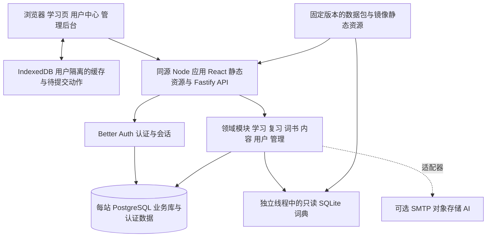
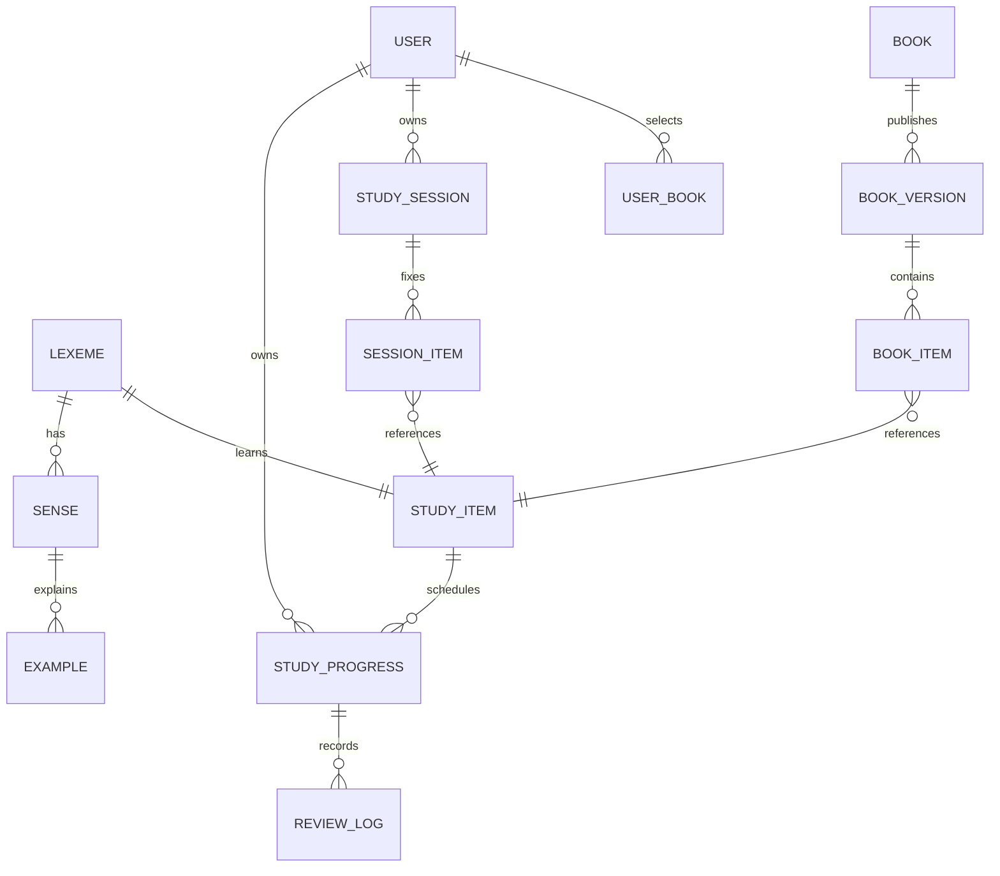
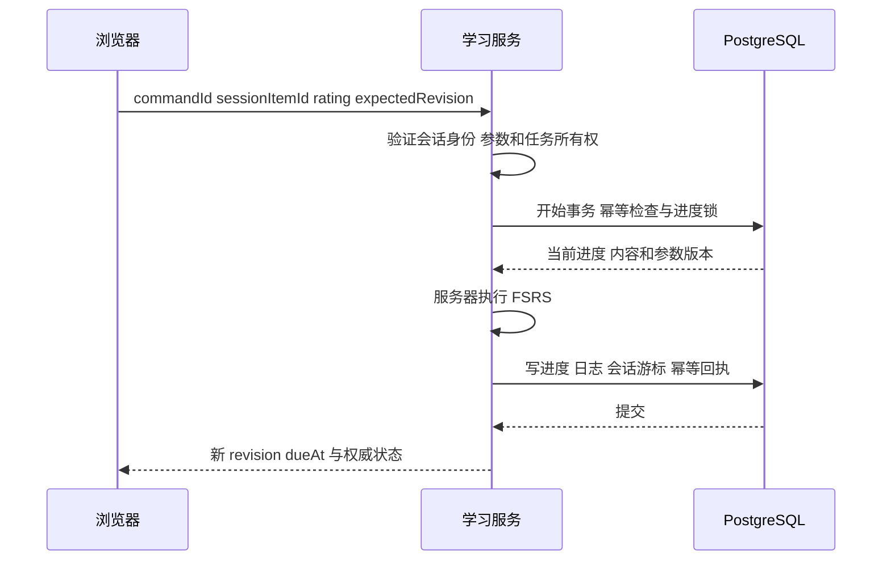

# 夜读英语开源网页版架构方案

本稿保留2026-10-14的架构设计与后续扩容方案。0.5.0-alpha.2已经实现并部署，实际模块、迁移与验收以 [API](../API.md)、[每日任务](../DAILY_TASKS.md)、[部署](../DEPLOYMENT.md) 和 [Prisma schema](../../prisma/schema.prisma) 为准；下文概念表不代表全部已实现。目标是在保留雨夜自习室视觉的基础上，建立以词书、语境学习、动态复习、拼写练习和熟练度计划为核心的多用户网页产品，提供用户中心、基础管理后台、熟词导入导出、目标水平测试与个人遗忘曲线。交付支持 GitHub 开源与一键后端平台部署、Docker Compose、自有服务器网站共存，以及独立多站部署和单后端多站隔离。

已经建立可构建的React前端源码与TypeScript模块化单体。单站最小部署为一个应用容器和 PostgreSQL；多站共用后端时，每站绑定独立业务数据库与认证 realm。高并发配置增加负载入口、应用副本、任务执行器和共享限流/缓存。学习页面、用户中心、后台和 API 在各站保持同源。现有提取包保留为视觉、内容和迁移对照，不在本次设计阶段改动。

## 关键架构决策

| 事项       | 本稿采用的方案                                                         |
| ---------- | ---------------------------------------------------------------------- |
| 视觉       | 保留雨夜、暖黑、琥珀、玻璃面板，重建可维护前端源码                     |
| 服务       | Fastify TypeScript 模块化单体，同一源码可运行 API 与独立 worker        |
| 多站       | 独立 Compose 部署；共享后端模式按可信域名选择独立数据库与认证 realm    |
| 并发       | 短事务、revision、幂等、数据库连接预算、有界队列、多副本共享限流与缓存 |
| 学习身份   | 每词一主学习对象，同站跨词书共享进度，跨站数据不自动共享               |
| 熟词       | 来源可追溯、可撤销的熟悉度证据；导入不伪造学习历史                     |
| 测试与计划 | 目标词表内分层测试，认知/拼写分开，薄弱词优先、熟词低频抽查            |
| 个人曲线   | 个人 FSRS 状态的预测与实际复习反馈分开；数据不足如实显示               |
| 兼容参考   | 仅借鉴广月的共存、配置边界、预检查与回滚通用思路                       |

## 产品目标与范围

不背单词公开功能强调语境例句、词根词缀、动态复习和拼写练习；官方商店介绍还包括词书、词形关系与搭配。我们对齐这些学习能力，页面和流程采用独立设计，保留夜读英语的现有视觉。[官网功能介绍](https://www.bbdc.cn/)，[开发者商店介绍](https://apps.apple.com/us/app/id698570469)。

| 范围       | 第一版必须完成                                                                             | 后续扩展                             |
| ---------- | ------------------------------------------------------------------------------------------ | ------------------------------------ |
| 学习       | 选词书、每日计划、稳定分组、先回忆再揭晓、多义项和例句、四档评价、组后拼写、断点继续       | 听写专项、词根关系图、个性化参数优化 |
| 复习       | 服务端 FSRS、到期队列、遗忘后重学、跨词书共享进度                                          | 高级筛选、按义项的独立训练模式       |
| 词汇       | 查词、生词收藏、笔记、词形、搭配、内容来源与状态                                           | 大规模可分发语境音频和完整派生关系   |
| 统计与记忆 | 新学/复习/有效时长、日历、词书进度、个人预测遗忘曲线和实际回忆统计                         | 参数优化、更精细的记忆分析           |
| 熟词与测试 | 熟词 CSV/文本/JSON 导入导出、批次预览与撤销、按目标测试、熟练度分层计划                    | 更多题型和适配格式                   |
| 用户中心   | 注册登录、资料、学习设置、密码、安全会话、数据导出、注销账号                               | OAuth、双因素验证等可选能力          |
| 后台       | 用户停用/恢复、会话撤销、词书管理、内容编辑发布、导入任务、公告、审计                      | 编辑者角色、审核协作、扩展运维报表   |
| 交付       | 开源源码、演示内容包、Render 一键入口、Compose、现有站点共存、独立与共享多站模式、扩容配置 | 其他平台模板与更多数据包             |

社群、组队、积分商城、订阅支付不进入第一版。AI 属于可插拔扩展，核心查词、学习、复习和后台运行不依赖付费模型。

## 保留的设计语言

保留当前暖黑底色、雨夜壁纸氛围、琥珀色操作、玻璃面板、大字号词汇、宽松留白和桌面侧栏。移动端沿用顶栏与底部导航，但学习模式集中展示一张词卡，减少操作干扰。

| 设计元素   | 本稿基准                                                   |
| ---------- | ---------------------------------------------------------- |
| 背景与文字 | `#101418` / `#f4eee5`                                      |
| 强调色     | `#e9b36d`，用于主按钮、进度和选择态                        |
| 布局       | 桌面约 238px 导航，内容区自适应；移动端单列                |
| 面板       | 半透明深色、柔和边框、约 18px 圆角                         |
| 学习页面   | 单词居中，音标/发音，揭晓后展开词义与语境，底部固定评价区  |
| 后台       | 同色系、增加密度的表格和编辑区；保留统一导航与组件规范     |
| 可访问性   | 足够的文字对比、键盘操作、可见焦点、减少动效、音频状态提示 |

样式提炼为独立 tokens 和 UI 组件。壁纸、封面、字体、音频分别登记来源；默认开源包采用权利明确的资源，现有壁纸在确认可分发后再收录。视觉风格可以保持，品牌和内容资产不需要复制竞品。

## 总体架构



对外只有一个应用入口。前端构建产物由 API 服务提供，认证使用同源 Cookie，后台在 `/admin`。部署到平台时监听 `0.0.0.0:$PORT`。业务记录进入 PostgreSQL，静态词典进入只读数据层；应用实例的临时文件系统不承担账号、进度或上传资源的持久化。

多站模式在入口加入 SiteRegistry 和 SiteContext，选择该站固定的认证/数据库客户端。租户默认使用独立域名或子域；basePath 用于同一可信站点的子路径挂载，不将同源不同路径当成浏览器强隔离。

单站基础配置采用模块化单体和 PostgreSQL 的持久任务。高并发配置将同一代码库的任务执行器分开运行，并使用 Redis 做跨副本限流/缓存与可替换的任务分发。任务、学习进度和幂等回执以 PostgreSQL 为事实来源；Redis 失效不能导致任务或学习记录丢失。

## 技术选型

| 层             | 建议选型                                   | 作用与边界                                               |
| -------------- | ------------------------------------------ | -------------------------------------------------------- |
| Web            | React、TypeScript、Vite、React Router      | 可构建页面工程，统一学习端和后台路由                     |
| 服务端数据状态 | TanStack Query                             | 请求缓存、失效刷新、错误与 pending 展示                  |
| 本地交互状态   | Zustand 或同等轻量状态层                   | 当前页面和操作状态；不作为持久学习真相                   |
| UI             | 自有 CSS tokens 和组件库，复用 Lucide 图标 | 保留设计风格，并让后台使用同一体系                       |
| API            | Fastify、TypeScript、运行时 schema 校验    | 模块路由、权限钩子、参数/响应约束、OpenAPI               |
| 认证           | Better Auth                                | 密码与会话生命周期；业务权限仍由项目明确约束             |
| ORM 与主库     | Prisma、PostgreSQL                         | 类型化查询、唯一约束、事务与版本迁移                     |
| 调度           | ts-fsrs 的服务端封装                       | 服务器计算下一次复习时间与状态，记录算法参数版本         |
| 离线存储       | IndexedDB，按 siteId/userId 命名空间       | 已缓存任务、题目和待提交动作；不保存明文密码或登录 token |
| 全量查词       | 可选只读 SQLite 适配器与 worker thread     | 大词典不进入浏览器，不阻塞 Node 主线程                   |
| 工程           | pnpm workspace、Vitest、Playwright         | 共享契约、业务回归、多用户和部署验收                     |

Better Auth 有官方 Fastify 集成和 Prisma/PostgreSQL 适配说明；同源方案也减少跨域 Cookie 的兼容问题。[Fastify 集成](https://better-auth.com/docs/integrations/fastify)，[Prisma 适配](https://better-auth.com/docs/adapters/prisma)，[Cookie 说明](https://better-auth.com/docs/concepts/cookies)。

FSRS 选型使用公开算法库，不能表述为复刻不背单词的内部算法。库提供四档评价和状态更新，本项目增加事务、版本、日志与重试协议。[ts-fsrs 文档](https://open-spaced-repetition.github.io/ts-fsrs/)。

施工时锁定受支持的 Node LTS、PostgreSQL 主版本，以及相互兼容的 Prisma/Better Auth/驱动版本。迁移和种子导入通过项目脚本契约执行，避免把不同主版本的 CLI 示例混用。第一版不为 SSR、SEO 或容器编排增加独立框架。

## 模块边界

| 模块             | 负责什么                                     | 不负责什么                       |
| ---------------- | -------------------------------------------- | -------------------------------- |
| auth             | 注册、登录、会话、密码与验证流程             | 学习进度与内容发布               |
| users            | 资料、时区、学习目标、个人设置、导出/注销    | 其他用户的状态写入               |
| catalog          | 词条、义项、例句、搭配、音频与来源查询       | 调度和每日学习计数               |
| books            | 词书、版本、排序、订阅与新词来源             | 拥有独立 FSRS 进度副本           |
| learning         | 每日计划、固定任务组、回忆/揭晓/练习状态机   | 接受客户端直接覆盖调度字段       |
| review           | FSRS、评价动作、进度版本、复习日志           | 内容编辑或登录身份判断           |
| wordbook         | 收藏、笔记、个人熟词/暂停状态                | 改写全站词典                     |
| statistics       | 日聚合、日历、趋势、连续天数、真实回忆分桶   | 每请求逐秒遍历全部历史           |
| mastery          | 熟词证据、导入导出、目标水平测试与熟练度分层 | 伪造复习历史或替代实际 FSRS 状态 |
| memory-analytics | 个人预测曲线、回忆统计、持久度与未来压力     | 把模板曲线当个人实测             |
| sites            | 可信入口识别、realm/数据库选择、站点配置     | 允许站内管理员操作其他站点       |
| content          | 草稿、校验、审核状态、版本发布、数据包映射   | 在运行时改写只读词典文件         |
| admin            | 管理用例、权限、公告、聚合看板与审计         | 无限制读取用户笔记或代用户登录   |
| jobs             | 持久任务、重试、进度、结果与清理             | 把进程内数组当作可靠队列         |
| integrations     | 邮件、存储、词典与 AI provider               | 成为核心业务的强制云依赖         |

模块内部按 route/schema → application service → domain → repository/adapter 分层。其他模块通过公开的服务接口调用，数据库表有明确归属；管理后台通过相同领域用例完成操作，避免出现独立的第二套发布或进度逻辑。

## 学习单位和计数

第一版以稳定词条为学习单位：一个规范化 `lexeme` 对应一张主 `study_item`。同词的多个义项和例句保留在内容模型中，任务可指定 `focus_sense_id`，但不为每个义项重复建立 FSRS 卡。拼写题记录为练习结果，不因做题再额外计算一次调度。

同一词出现在多个词书中时，复习状态由同一份 `(user_id, study_item_id)` 进度共享。词书切换改变新词来源，保留已有复习、收藏和历史。单词页可以同时展示主要义项与当前语境重点。

| 指标       | 固定口径                                                    |
| ---------- | ----------------------------------------------------------- |
| 今日新学   | 首次有效学习评价发生在该日的唯一词条数；测验/导入不计入     |
| 词书已学   | 当前词书中首次学习已完成的唯一词条数                        |
| 词书已覆盖 | 已学词与客观测验确认熟词的并集；自报导入熟词单独显示        |
| 复习次数   | 已接受的复习评价动作数，可与复习词数分开显示                |
| 拼写正确率 | 可判定题目首次作答正确数 / 首次作答题数；重试与跳过分别统计 |
| 有效时长   | 前台互动区间，经限额和重叠去重后的累计时间                  |
| 连续达标   | 按用户时区连续满足日目标的天数，不固定限制为 30 天          |

建议默认每天 20 个新词、每组 5 个词，组大小可设 1–20；这些是本稿默认值，可以调整。分组由服务器从稳定的词书版本中选取，跨数据库分页补齐，不轮转当前页凑词，不用数组下标作为学习身份。重复回忆和练习不会重复增加新学词数。

## 熟词测试与个人记忆

熟词导入支持文本、CSV、版本化 JSON，经过匹配/歧义/重复/冲突预览后提交。批次可撤销其来源声明，后续真实作答不回滚；用户可按当前目标或确认状态导出。导入和测验不虚增新学词数，也不直接改写已有 FSRS 历史。

水平测试固定目标词表和题目版本，分层抽取认知、语境与拼写题，混入熟词抽查。报告展示已实测结果、样本量和范围估计，不把少量样本等同于全词表逐词掌握。测试回答和后续复习逐渐更新熟练度；计划由到期、薄弱、新词、熟词抽查四个队列组成。熟词降低额外曝光，仍保留间隔复习；近期忘记会重新进入强化。

个人“艾宾浩斯遗忘曲线”页面参考墨墨的记忆统计思路，采用自己的 FSRS 预测和真实回忆反馈。预测明确未来不复习假设、冻结词集、参数版本与截至时间；实测图按复习间隔分桶并给样本量。只导入熟词或记录过少时不伪造个人曲线。详细规则、图表与验收见 [熟词测试与个人记忆方案](PERSONALIZATION.md)。

## 主要数据模型

下表保留领域模型概念设计；实际0.5数据库包含DailyPlan/DailyPlanWord、固定StudySession/SessionItem和ReviewLog计划归属，不能把概念表名直接当成migration。Better Auth 管理的认证表应由实际配置生成并纳入统一迁移。

| 数据组   | 主要实体                                              | 关键约束                                                                          |
| -------- | ----------------------------------------------------- | --------------------------------------------------------------------------------- |
| 身份     | users、auth_accounts、auth_sessions、verifications    | 注册角色固定 user；会话可撤销；账号唯一性由数据库保证                             |
| 用户配置 | user_profiles、user_settings                          | userId 唯一；IANA 时区、每日不同词总量、发音、组数、当前词书、配置版本            |
| 核心词汇 | lexemes、senses、examples、collocations、media_assets | 主键稳定；义项/例句关联明确；素材来源与版本可追溯                                 |
| 主学习卡 | study_items、content_revisions                        | 每词一张主卡；内容更新不改变 itemId；保留历史发布内容                             |
| 词书     | books、book_versions、book_items、user_books          | 词书发布版本不可变；bookItem 关联主卡；词书序号只负责排序                         |
| 个人词库 | user_words                                            | `(userId, studyItemId)` 唯一；收藏/笔记/暂停与全站内容分开                        |
| 调度进度 | study_progress、review_logs                           | `(userId, studyItemId)` 唯一；revision、dueAt、FSRS 状态/参数版本、firstLearnedAt |
| 学习任务 | study_sessions、session_items、session_actions        | 固定 itemId 与内容版本；项属于同一用户会话；会话有 revision 和 cursor             |
| 练习     | practice_attempts                                     | 引用题目与重点义项；题目版本、答题、结果与服务端判分可追溯                        |
| 同步     | command_receipts、sync_changes                        | `(userId, commandId)` 幂等；保存 request hash 与处理结果；按游标增量读取          |
| 统计     | activity_intervals、daily_stats                       | 时间区间去重；`(userId, localDate)` 唯一，记录时区与计算版本                      |
| 内容运维 | content_sources、data_releases、import_jobs           | 来源、许可证、checksum、外部 ID 映射、审核与发布状态                              |
| 平台运维 | site_settings、announcements、admin_audit_logs、jobs  | 设置白名单；敏感配置只在部署环境；管理动作记录操作者与变化                        |

新增熟词/测验实体包括 known_word_imports/claims、assessment_sessions/items/answers、mastery_profiles/evidence、plan_versions、memory_curve_snapshots。SiteRegistry 记录可信入口与 realm/数据库引用，站点配置和用户配置分层。每站独立业务库中的用户 ID 不能直接用于另一站；DTO、队列与缓存也绑定 siteId/userId。



到期查询使用 `(user_id, due_at)` 索引；复习日志和用户事件使用 `(user_id, occurred_at)` 索引；幂等 ID 和外部映射有唯一约束。数据库外键与 repository 作用域同时保证会话、动作和进度不会跨用户串联。公开分享如需加入，使用独立公开资源模型。

## 学习动作与多设备一致性

浏览器提交“我对这张词卡做了什么”，例如评价、练习回答或有效活动区间。客户端不能直接指定新的 dueAt、FSRS card、reviewCount、userId 或管理员角色。



同 commandId、同请求内容重试，返回既有结果；同 ID 改内容返回冲突。同一词的两台设备基于旧 revision 提交时，只允许一个有效推进，另一请求返回 `409` 和权威状态，提示重新确认，不做最后写入覆盖。任务步骤也使用 revision，不能靠客户端 currentIndex 替换服务器 itemId。

在线评价以服务端时间为准。MVP 提供网络波动时的持久重试和已保存任务恢复。完整连续离线学习作为后续启用能力，协议预留为：只继续已缓存的服务器任务，动作固定属于原 siteId/userId；联网后按依赖顺序提交。客户端时间必须在任务签发和离线窗口内，且不早于已接受的上一评价；超出范围或并发冲突要求确认。完整离线能力建议窗口上限 72 小时，启用前通过时区/时钟偏差用例验收。

IndexedDB 中的缓存、会话和队列按 siteId/userId 隔离。退出后当前账号的数据不可在游客或另一账号下读取/重放；账号到期时保留该账号的待提交动作并要求重新登录。访客只做有限本地演示，转账户时通过显式导入和去重，不通过猜测旧用户 ID 恢复数据。

## 用户中心与后台权限

各站第一版只有 `user` 和 `admin` 两种登录角色；访客是未登录状态。部署操作者负责站点注册表和数据库配置，不自动等同于可从公开站点登录的全局管理员。注册、资料修改和普通 API 都不能让用户自选 admin。

| 用户中心   | 行为                                                                                        |
| ---------- | ------------------------------------------------------------------------------------------- |
| 资料       | 昵称、头像策略、偏好语言；第一版可以只用内置头像，避免强制上传存储                          |
| 学习设置   | 当前词书、每天新词和分钟、每组大小、时区、发音和学习提醒                                    |
| 安全       | 修改密码、当前设备与其他会话注销；重置密码需要邮件 provider，否则明确提供管理员辅助重置路径 |
| 我的数据   | 同步状态、熟词导入导出、收藏与笔记、完整数据导出、注销账号及确认流程                        |
| 水平与记忆 | 目标测试、熟练度分层、计划解释、个人曲线、复习压力和数据充足度                              |
| 来源与关于 | 应用版本、内容包版本、来源署名、开源仓库与反馈入口                                          |

| 基础后台 | 第一版操作边界                                                                          |
| -------- | --------------------------------------------------------------------------------------- |
| 概览     | 注册/活跃/学习总量、任务状态与内容覆盖，默认使用聚合指标                                |
| 用户     | 搜索和分页、状态、停用/恢复、撤销会话；权限调整仅允许受控管理员操作并保护最后一位管理员 |
| 词书     | 创建草稿、排序/成员、发布版本、下架；历史学习引用仍保留                                 |
| 内容     | 编辑释义/例句/标签、来源和审核状态；预览、校验、发布与版本回退                          |
| 导入     | 上传大小限制、校验报告、重复/错误预览、确认后入库、任务进度和结果                       |
| 站点     | 注册开关、默认学习设置、公告、可用数据包与公开系统信息                                  |
| 审计     | 谁对哪个对象做了什么、时间、结果和必要的前后差异；不记录密码或 token                    |

认证插件的默认管理能力不能直接等同于本项目权限。项目层采用动作白名单，限制代登录、强制设置任意用户密码、直接硬删除等超出第一版的入口，且同时覆盖插件端点和业务端点。[Better Auth 管理与权限文档](https://better-auth.com/docs/plugins/admin)。

初始管理员通过一次性初始化流程创建：部署提供随机 setup token，首次进入 `/setup` 验证 token、创建管理员并原子锁定初始化状态。再次调用拒绝；不把默认账号密码放进源码。SMTP 未配置时，不能声称邮箱验证和自动找回密码可用；辅助重置应使用一次性、短期、仅展示一次的重置凭据，而不是让管理员知道用户新密码。

## API 设计方向

认证路由使用 `/api/auth/*`，业务使用新的 `/api/v2`。旧 `/api/v1` 与旧前端作为迁移阶段的对照；新版接口不再兼容“上传整个 FSRS 对象覆盖”写法。

| API 组     | 设计中的代表入口                                                                                            |
| ---------- | ----------------------------------------------------------------------------------------------------------- |
| 自己       | `/me`、`/me/settings`、`/me/sessions`、`/me/export`、`/me/deletion-request`                                 |
| 词书与内容 | `/books`、`/books/:id/versions/:version/items`、`/words/:id`、`/dictionary?q=`                              |
| 学习       | `/study/plan`、`/study/sessions`、`/study/sessions/:id`、`/study/commands`                                  |
| 复习       | `/review/due`、`/review/commands`，与学习共享评价用例                                                       |
| 生词本     | `/wordbook`、`/wordbook/:itemId`，收藏/笔记/暂停为独立操作                                                  |
| 同步与统计 | `/sync/changes?cursor=`、`/sync/commands`、`/stats?range=`                                                  |
| 熟词与水平 | `/known-words/imports`、`/known-words/exports`、`/assessments`、`/assessments/:id/answers`、`/mastery/plan` |
| 记忆可视化 | `/memory/curve`、`/memory/recall-bins`、`/memory/durability`、`/memory/workload`                            |
| 后台       | `/admin/users`、`/admin/books`、`/admin/content`、`/admin/imports`、`/admin/audit`                          |

API 对参数、枚举、时间、分页和响应进行运行时校验；统一 requestId、错误码和冲突详情。内容与词书使用版本/ETag 缓存，个人接口禁止共享缓存。学习题目的答案只在相应揭晓或判分阶段返回；schema 的类型共享不等于提前发送答案。

同源 Cookie 使用 HttpOnly、Secure 与合适的 SameSite；认证库的 Origin/CSRF 保护要配置到实际部署域名，业务写接口也要执行来源和 CSRF 校验。所有个人读写从已验证站点 realm 与 session 获取 siteId/userId，repository 不提供无作用域的个人数据查询。登录、注册、查词、导入和 AI 分别限制资源消耗。

## 内容和数据包

核心学习内容、词书和管理员编辑的发布版本放 PostgreSQL。全量查词可接可选的 ECDICT 只读包，优先查询已管理内容，再由词典适配器补足。查询到非核心词后，收藏动作在服务端把它物化为稳定词条和主卡，保存来源映射，再创建个人记录；原 SQLite 行号只作为来源引用。

代码仓库只带小型演示包，足以跑通完整学习流程。完整版包含当前 12,934 卡的可用子集或后续审核内容，以及约 770,611 词条的可选查词包。数目是已有提取资产的规模，不是尚未开发项目的发布承诺。

数据包独立于应用发布，manifest 至少记录包版本、schemaVersion、sourceVersion、资源摘要、许可证/署名、审核状态和旧 ID 映射。镜像构建时固定下载版本并校验，失败则构建失败；不能在生产每次启动随机拉最新词库。管理员编辑进入 PostgreSQL 的新内容版本，不修改镜像中的 SQLite。

例句区分来源句、原创、AI 辅助和未审核，发音区分源音频与设备合成。词源和语境音频缺失时显示真实状态，不补造。开源代码建议采用 MIT；第三方数据、图片、字体与音频各自保留许可，不随应用代码被统一改许可。完整原声语料和商业词典不作为默认开源包内容。

## 多站点兼容与高并发

用户明确两种模式都需要：源码独立部署到多个域名/子路径，以及一个后端承载隔离站点。独立模式用不同 Compose project、数据库/volume 与内部端口；共享模式用可信 Host 映射到每站独立业务数据库和 Better Auth realm。初始按钮部署创建首站，新增站点由部署操作者配置，不承诺一个按钮自动创建无限站点。站内管理员管理本产品内容和用户，不能更改全局路由与别站数据库。

参考 [guangyue-panel](https://github.com/wudi000888-svg/guangyue-panel) 的范围仅为已有站点共存、显式配置边界、只读预检查和回滚方法。本产品不采用它的主控/子站业务体系。域名、端口、Router/API/auth/SW 前缀、反向代理、Cookie 和媒体地址形成完整兼容契约，不能只改一个 PUBLIC_URL。

基础配置为 app + PostgreSQL。扩容配置增加 edge/LB、app 多副本、同源码独立 worker、可选 PgBouncer 与 Redis。认证会话、任务与幂等回执持久化；每站和全局有连接预算及公平限额。短事务保证评价不重复，曲线聚合/导入在后台执行，查词线程和任务队列有上限。多副本不会因为进程 Map 不共享而绕过限流。

容量数和响应时间属于施工压测目标，尚无实测承诺。先按固定硬件、完整内容、混合读写与后台任务测量，再确定发布的并发能力。具体边界、入口兼容和验收见 [多站点部署与高并发方案](MULTISITE_AND_SCALING.md)。

## GitHub 与部署设计

GitHub 承担源码、Issue、协作、Actions 和版本发布。README 提供 Deploy to Render 按钮，Blueprint 创建一个应用服务和一个托管 PostgreSQL。Render 官方支持依据仓库中的 Blueprint 提供这类部署入口；用户仍需要自己的平台账号、核对服务和确认部署。[一键按钮说明](https://render.com/docs/deploy-to-render)，[Blueprint 规格](https://render.com/docs/blueprint-spec)。

公共部署模板关闭上游自动部署，防止项目维护者一次推送自动更新所有自托管实例。用户可在自己的 fork 配置受控更新；数据库迁移、初始数据导入与运行分离。数据版本固定，应用重启不清空已有数据、不重新覆盖用户进度。

| 部署方式 | 服务组成                                              | 持久数据                                         |
| -------- | ----------------------------------------------------- | ------------------------------------------------ |
| 默认一键 | 一个同源 Web 容器 + 首站托管 PostgreSQL               | PG 保存账号/进度/核心内容；上传用可选对象存储    |
| 自托管   | Compose basic/shared-sites/scale 配置，TLS 由环境提供 | 数据库 named volume 或外部 PG；共享资源 provider |
| 开发     | Web dev server 经代理访问 API + 本地 PostgreSQL       | 独立开发库和小型 fixture                         |

默认不依赖 Render 持久磁盘。只读词典放镜像层，上传资源不能保存到临时容器目录；没有外部存储配置时，第一版只允许内置头像/封面和外链或内置音频。平台免费套餐、长期持久性和费用以部署时界面为准，不把免费演示服务当成生产数据库保障。

配置分为最小必需项（数据库地址、认证密钥、公开 URL、初始化 token）和可选项（注册模式、SMTP、对象存储、AI、内容包）。秘密值只在环境或密钥服务保存。后台显示 provider 是否配置，不回显秘密。

备份包括 PostgreSQL 和外部上传素材；只读包可以从固定版本和摘要重建。升级先备份、执行单实例迁移、完成种子差异更新和健康检查；回滚前确认数据库兼容，不能仅换回旧镜像就宣称已回滚。健康检查分进程存活与数据库/内容可用。

## 规划中的目录结构

以下是施工后的目录规划；本次没有创建这些工程文件。

```text
nightstudy/
  apps/
    web/                 学习页 用户中心 admin 页面
    api/                 Fastify 模块 认证适配和任务执行
  packages/
    contracts/           业务 DTO schema 与错误码
    ui/                  现有风格 tokens 与共用组件
    scheduler/           FSRS 封装 参数版本和纯函数
    data-tools/          来源转换 校验和数据包构建
    api-client/          类型化客户端
  prisma/                数据模型 迁移和版本化种子
  data-manifests/        数据包版本 checksum 和来源
  deploy/                Render 与自托管文档
  tests/                 集成 多用户 迁移和端到端用例
  docs/                  产品规则 架构 ADR 内容格式
  .github/workflows/     CI 镜像与版本发布
  Dockerfile
  compose.yaml
  render.yaml
  .env.example
  README.md
  LICENSE
  THIRD_PARTY_NOTICES.md
```

## 迁移与验收

后续施工采用新工程与新业务库，逐步导入经过确认的内容。原始文件和当前开发基线继续保留；当前源码包没有生产账户数据，因此不能现在承诺完整迁移线上用户。

旧词条/卡 ID 经 mapping 关联到规范化词条和主卡。旧 FSRS 由受控导入器验证后保存，重复卡不能简单覆盖；不兼容记录保留原快照和报告。浏览器旧状态经用户确认后导入，新系统 session 重新签发，不批量复用旧 Bearer；以后取得生产 store 时先 dry-run、统计差集、备份并隔离验证。

| 里程碑             | 可验收结果                                                                  |
| ------------------ | --------------------------------------------------------------------------- |
| 1 视觉与基础工程   | 原风格的可构建学习外壳，数据模型/认证/第一管理员、用户中心安全基本项        |
| 2 学习与复习闭环   | 词书/每日计划/主词卡/拼写/服务端 FSRS；两组以上、跨页和重复词正确           |
| 3 多设备与个人数据 | settings/任务/进度同步、冲突与幂等、统计、导出/注销和本地缓存隔离           |
| 3b 熟词与个人记忆  | 熟词导入导出、目标分层测试、分层计划、实际/预测曲线及不足数据状态           |
| 4 基本后台         | 用户、词书、内容、导入、公告与审计，所有权限在服务端生效                    |
| 5 开源与部署       | 从干净仓库部署、第一次初始化、持久性、备份恢复、升级回滚、README 与来源声明 |
| 5b 多站与扩容      | 独立部署/共享 realm 隔离、路径共存、多副本、连接预算、混合负载与故障验收    |

核心验收用例包括：两个用户同一个词的隔离；两台设备同一个词的冲突；重复请求不重复推进；第二组和跨页身份正确；切词书共享进度；未登录/普通用户不能进入管理 API；最后管理员保护；内容版本不破坏进行中的任务；跨用户登出队列不重放；离线恢复；跨时区和午夜统计；重启/重新部署不丢数据；导入失败可恢复；无 AI/SMTP/外部对象存储仍能完成基础学习。

架构设计不等于性能实测。施工阶段应以固定内容包测量查词、创建任务、评价事务和统计查询，在明确目标负载后决定连接池、线程队列、分页和扩容指标。

## 方案阅读入口

产品页面和状态机见 [产品设计](product-design-notes.md)，领域与同步见 [后端设计](backend-design-notes.md)，平台与发行见 [部署设计](deployment-design-notes.md)，熟练度规则见 [个人记忆方案](PERSONALIZATION.md)，多站与扩容见 [兼容及并发方案](MULTISITE_AND_SCALING.md)。以本稿确定的主词卡、站点独立 realm、同源部署和统一技术栈为准；附录中的逻辑实体最终应合并进实际 schema。
