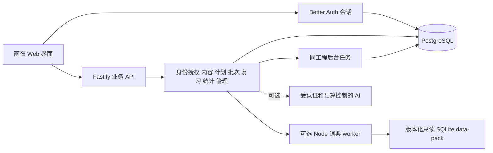

# NightStudy 后端重构设计草案

状态：**架构讨论草案，尚未实施，也不是对现有源码的修改说明。**本轮只做设计，不建立脚手架、不改变既有工程、不迁移真实用户数据。

目标：保留当前雨夜界面的视觉方向，重建适合多用户学习、用户中心、基本后台、多站点、Docker Compose和公开开源部署的服务端。增加熟词导入导出、目标词汇水平诊断、个性化选词以及每人的记忆预测曲线。学习流程按“语境理解、主动回忆、及时反馈、按计划复习”设计；本文不声称与某一商业产品的当前功能逐项相同，也不依赖其素材、词库或实现。

技术倾向：模块化单体，Fastify + TypeScript + PostgreSQL。根任务已核验 Better Auth 的 Fastify 集成、Prisma 适配器、Cookie 和 admin 插件；认证建议交由 Better Auth，数据库由 Prisma 统一迁移。具体版本、集成调用和库能力以根任务汇总的官方资料与实施时锁定的版本为准。本文不承诺尚未验证的插件行为。

## 1. 总体判断

没有强理由反对 Fastify + TypeScript + PostgreSQL。应用以学习内容读取、个人状态写入、事务和后台操作为主，模块化单体能保持一次部署、统一鉴权、明确事务边界，并且方便开源贡献者理解。此阶段没有必要先引入微服务、独立消息集群、Redis 或多套认证系统。

核心变化是：**服务端持有用户身份、学习批次和复习状态的权威版本，浏览器持有展示状态与可重试的离线命令。**前端不再上传一个任意修改过的 FSRS 对象来覆盖服务器，也不再用目录数组下标作为进度对象的身份。

MVP 使用同源前后端：Fastify 处理 API 并提供构建后的前端静态资源；需要独立 CDN 时再调整部署。每site独立PostgreSQL数据库，同时存该站Better Auth表、用户数据和可管理核心内容；同一个后端可按可信站点上下文选择固定Realm/Prisma客户端。每站初始导入现有12,934卡对应的词条、义项、例句、教学内容和词书，经映射后形成词条主学习对象。77万级完整查词是可选版本化只读SQLite data-pack，通过Node worker thread内的SQLite适配器查询，不延续Python子进程。具体Node版本和SQLite驱动由根任务核验。

只读data-pack可由部署镜像的只读层携带或以版本资产安装，不进入Git。其内容可重新获取，并不作为个人数据的持久存储；容器重建不能丢失PostgreSQL中的进度和已materialize内容。原有JSON store不作为新系统运行时依赖，原始大词库、导入文件和可选音频也不能放在临时容器目录后被误当成持久用户数据库。

## 2. 模块和责任

| 模块            | 拥有的数据和行为                                                 | 不承担的责任                                         |
| --------------- | ---------------------------------------------------------------- | ---------------------------------------------------- |
| sites           | 可信域名/basepath解析、站点上下文、站点配置、账户realm与角色边界 | 让客户端site_id或任意Host决定访问权限                |
| identity        | Better Auth 集成、当前用户、会话吊销、账号状态、受控管理员初始化 | 手写密码加密、匿名 ID 换取旧身份                     |
| authorization   | user/admin 角色映射、对象归属、管理员操作白名单                  | 根据客户端 role/userId 放行                          |
| profile         | 用户公开显示资料、学习偏好、目标、账户操作协调                   | 任意用户的管理员式资料修改                           |
| content         | 词条、义项、词形、例句、主学习对象、来源与发布版本               | 保存个人 FSRS 状态                                   |
| dictionary      | 统一查词、可选只读data-pack适配、可信外部词条materialize         | 将客户端snapshot当作词典事实，或在worker中写个人进度 |
| books           | 词书、集合、顺序、筛选维度、书版本、用户选择                     | 通过每次请求全量重排所有卡片                         |
| learning-plan   | 每日新词额度、复习优先级、当前词书、队列生成规则                 | 将“词书索引”当作用户已学进度                         |
| known-words     | 熟词文件预览、来源claims、映射、幂等导入、撤销和导出             | 将自述熟词伪装成真实FSRS复习历史                     |
| assessment      | 目标词表内分层抽样、认知/拼写评分、诊断可信度和版本              | 以少量题目把全部未测词标为已掌握，或声称等同考试分数 |
| mastery-profile | 汇总诊断证据、熟悉度先验和不确定性、个性化选词权重               | 直接改写历史reps、due和真实review                    |
| study-session   | 固定批次清单、批次条目、学习步骤、断点恢复                       | 自行判断一次操作属于哪个目录下标                     |
| review          | 权威 FSRS 调度、复习命令、卡状态版本、冲突和幂等                 | 接受客户端提供的完整权威调度状态                     |
| activity        | 查词、练习、有效时长事件、重试去重                               | 将任意客户端秒数直接计为在线学习                     |
| statistics      | 自然日计数、学习趋势、打卡、唯一词条与复习/练习次数              | 在请求内逐秒遍历全部历史事件                         |
| memory-curves   | 固定词集的记忆预测、真实review点、覆盖率、模型/状态追溯          | 把模型曲线说成对个人记忆的科学保证                   |
| administration  | 受控账户管理、内容编辑发布、导入任务、基础指标、审计             | 默认模拟用户登录、任意强制改密、读取所有个人笔记     |
| jobs            | 导入、导出、必要的汇总重建、账号删除、任务重试                   | 把大型工作放在常规 HTTP 请求内执行                   |
| optional-ai     | 基于已发布义项的辅助解释 / 练习、配额和上游抽象                  | 修改词典事实、改变复习评级、作为核心学习的必需依赖   |

模块的 HTTP handler 只做输入解析、会话获取和错误映射；应用服务拥有事务；领域函数表达业务规则；repository负责查询。模块间通过明确的应用服务接口调用，不随意直接改别的模块的表。可共享身份上下文、事务上下文、时间与ID工具，但避免建立包含所有业务的“万能服务”。

同一进程或同一部署镜像可运行轻量后台任务。任务队列先采用 PostgreSQL 任务表和租约；是否需要外部队列，要由吞吐量和部署平台能力决定。

## 3. 关系数据模型

以下表名是逻辑模型，不是已生成的 Prisma schema。认证库自己的实际表结构由其适配器和迁移管理。多站点补充采用每站独立数据库与认证realm，业务外键引用同站库认证用户，不另存密码凭据；接法与成本见第13节。

**下表所有个人数据均必须有site_id，唯一约束和对象归属至少包含site_id+user_id。**例如原先的user_id+study_item_id实际变为`(site_id,user_id,study_item_id)`，不能只在某些API附加site_id。后台任务、索引、导出文件查询和缓存也使用同一站点边界。共享只读data-pack不保存用户数据，核心内容每站seed；站点编辑采用overlay或版本化私有对象。即使每站库中只有一个site，也保留这套上下文，避免路由/缓存/任务选错站点。

### 3.1 身份与用户中心

| 实体                             | 关键字段 / 约束                                                                                                                                    |
| -------------------------------- | -------------------------------------------------------------------------------------------------------------------------------------------------- |
| 认证库用户、凭据、会话及验证记录 | 由 Better Auth 管理；所有业务 user_id 引用库用户；不在业务表另存明文密码或自行实现密码摘要                                                         |
| user_profiles                    | user_id 唯一；display_name、avatar_reference 可选、locale、created_at、updated_at                                                                  |
| user_preferences                 | user_id 唯一；daily_new_limit默认20、group_size默认5且限制1–20、review_limit、current_book_id、learning_goal、audio_preferences、settings_revision |
| user_scheduler_profiles          | id、user_id、目标保持率等经过校验的配置、配置版本、算法版本、created_at；历史版本不就地覆盖                                                        |
| account_operations               | 账号导出 / 删除任务，user_id、kind、status、created_at、finished_at、结果资产引用或失败原因                                                        |
| admin_audit_logs                 | actor_user_id、action、target_type/id、最小必要的变化摘要、request_id、created_at；不存密码、token或无关个人内容                                   |

MVP 采用邮箱和密码登录，display_name作为显示资料，不同时承担复杂的用户名登录语义。若将来增加用户名登录，再明确Unicode、大小写和唯一性规则。公开注册永远创建user，不能由请求体决定管理员角色。

### 3.2 共享内容

| 实体                 | 关键字段 / 约束                                                                                                                                        |
| -------------------- | ------------------------------------------------------------------------------------------------------------------------------------------------------ |
| content_sources      | source_id、名称、来源地址、声明的授权信息、版本 / digest、获取时间；授权是否适合分发需要独立核验                                                       |
| content_imports      | source_id、源digest、导入状态、条目数、错误报告、操作者；同源同digest唯一，避免重复导入                                                                |
| lexemes              | id、language、headword、normalized_headword、homograph_key；检索归一化值与展示词形分开                                                                 |
| senses               | id、lexeme_id、pos、释义、排序、status、current_revision；一个词可以有多个同词性的义项                                                                 |
| sense_revisions      | id、sense_id、revision、双语释义、变更摘要、来源映射；同sense_id+revision唯一                                                                          |
| sense_source_refs    | sense_id / revision、source_id、source_entry_key、source_sense_key；保留真实来源身份，不靠释义文本hash推断语义相等                                     |
| word_forms           | form_normalized、lexeme_id、relation；用于屈折形查找，不改变义项身份                                                                                   |
| examples             | id、sense_id、双语文本、来源、来源版本、审核状态；公开发布需满足项目的内容质量和授权规则                                                               |
| study_items          | id、lexeme_id唯一、status；MVP每个canonical lexeme只有一个主学习对象，不按义项拆FSRS                                                                   |
| teaching_units       | id、study_item_id、sense_id、教学步骤/题型、status；多个义项保留教学内容，练习不独立起FSRS状态                                                         |
| teaching_revisions   | teaching_unit_id、revision、显示内容 / 例句引用、source_revision；为历史会话和学习记录保留内容版本                                                     |
| books                | id、slug唯一、名称、说明、发布状态、current_version                                                                                                    |
| book_versions        | id、book_id、version、发布时刻；已发布版本不可就地改写                                                                                                 |
| book_items           | book_version_id、study_item_id、推荐focus_sense_id可选、ordinal、必要的filter/rank字段；同版本同主item唯一、排序稳定                                   |
| external_refs        | source_namespace、source_version/data_pack_digest、external_entry_key、lexeme_id、study_item_id；外部定位组合唯一，支持并发materialize和跨版本显式映射 |
| legacy_card_mappings | legacy_card_id唯一、study_item_id、focus_sense_id、迁移依据；旧多义项卡保留可追踪映射                                                                  |
| content_redirects    | 旧外部定位 / 旧内容ID到当前稳定对象的受控映射及原因；保留旧系统迁移依据                                                                                |

`normalized_headword`只是搜索键，不能简单设成全局唯一并把所有同形词合并。词性分段也不等于完整的语义拆分：原ECDICT按POS得到的摘要可以以“未精细拆义”的内容版本进入新系统，但不能伪称已具备逐义项人工审定。

发布后的lexeme_id、study_item_id和sense_id稳定；改释义、例句或词书顺序只新增版本。移除内容优先归档，已有学习记录仍可读到其引用的历史版本。这里的词条主study_item是相对原多义项card进度模型的拟变更，尚未施工。

查词时先返回PG中的已管理内容，再由可选data-pack提供扩展结果。用户收藏或加入学习的非核心词条，应由服务器根据可信的版本化external_ref重新读取pack内容，在PG事务中创建或复用稳定lexeme、senses、study_item和来源记录，之后才建立user wordbook/progress。前端不能直接提交任意snapshot完成materialize。external_ref唯一约束消除并发重复；已有核心内容的外部映射直接复用主item；跨词典版本不能仅按行号或lemma字符串猜测为同一个对象。

materialize只是把可信查词结果变为可学习结构，不自动把它发布到管理员维护的正式词书。词典包不可用时核心学习仍可运行，扩展查词返回明确降级；已materialize内容仍在PG，不因包移除而令用户进度失联。

### 3.3 用户学习数据

| 实体                     | 关键字段 / 约束                                                                                                                                                                                                                       |
| ------------------------ | ------------------------------------------------------------------------------------------------------------------------------------------------------------------------------------------------------------------------------------- |
| user_books               | user_id、book_id、selected_version、status、started_at；user_id+book_id唯一                                                                                                                                                           |
| user_wordbook_items      | user_id、study_item_id、note、favorite、source、added_at；user_id+study_item_id唯一                                                                                                                                                   |
| study_progress           | user_id、study_item_id、状态、due_at、last_review_at、reps/lapses等算法所需字段、revision、scheduler_profile_id、algorithm_version；user_id+study_item_id唯一                                                                         |
| study_sessions           | id、user_id、book_version_id、mode、status、session_revision、created_at、completed_at                                                                                                                                                |
| study_session_items      | id、session_id、user_id、study_item_id、focus_sense_id、teaching_revision_id、ordinal、step、status；session_id+ordinal唯一，manifest发布后身份不变；teaching_revision_id引用明确的历史内容对象                                       |
| review_attempts          | id、user_id、client_attempt_id、device_id、study_item_id、focus_sense_id可选、session_item_id可选、rating、occurred_at、received_at、expected_revision、result_status、applied_revision、算法/配置版本；user_id+client_attempt_id唯一 |
| review_state_transitions | attempt_id唯一、before_state、after_state、effective_review_time；仅真正改变计划的attempt产生，供追踪与重建                                                                                                                           |
| exercise_attempts        | user_id、client_attempt_id、session_item_id、focus_sense_id、题型、答案结果、内容版本、occurred_at；练习记录与真正的复习评级分开                                                                                                      |
| activity_events          | user_id、client_event_id、device_id、type、对象引用、occurred_at、received_at、经过校验的payload；user_id+client_event_id唯一                                                                                                         |
| study_intervals          | user_id、session_id、device_id、interval_id、start/end、validated_seconds、验证状态；用于时长计数和去重                                                                                                                               |
| user_daily_stats         | user_id、date_key、统计口径版本、lookups/new_lexemes/reviews/exercises/study_seconds等；user_id+date_key唯一                                                                                                                          |
| command_receipts         | user_id、command_id、command_type、payload_digest、result状态/必要响应、created_at；用于重试一致和同ID不同payload识别                                                                                                                 |
| outbox_events            | 事务中产生的后续汇总/任务通知，id、kind、payload、processed_at；任务消费者幂等                                                                                                                                                        |

`command_receipts`和`review_attempts`存在职责交叉，施工前可合并为一张通用命令日志再以外键关联领域记录；原则是每个写命令必须有唯一的幂等身份和可重放响应，不必为每个功能机械增加一张收据表。

用户隔离不能仅靠前端过滤。所有个人数据查询、修改和导出都必须带会话user_id；涉及子对象时同时验证其父对象归属。可为session item等子对象使用`(id,user_id)`候选键和复合外键，防止应用遗漏检查而把别人批次的item挂进当前用户attempt。

必要索引包括：study_progress的`(user_id,due_at)`、个人日志的`(user_id,received_at)`、幂等唯一键、book_items的`(book_version_id,ordinal)`、词条规范化值、external_ref和词形查询键。是否使用额外检索扩展，由实际数据规模和官方支持验证决定；MVP不依赖一个未经验证的全文搜索方案。

## 4. 多义项与学习批次

### 调度单元

MVP按canonical lexeme的主study_item调度，每用户每词一个study_progress；同词出现在两个词书中时复用同一个进度。此决策贴合“每天学多少词”的产品心智，但并不意味着同形字符串总是同一词条：canonical lexeme的确认依赖来源和受控映射，不能盲目按字符串合并。

所有Sense仍有稳定ID。session item和practice通过focus_sense_id决定当前语境与重点释义，不另起义项FSRS状态。解释、选择、填空、拼写是教学活动，不每答一题就增加reps；拼写练习和复习评价次数分别统计。未来若增加独立义项训练，应显式扩展学习目标和迁移口径，不在MVP同时存在两套模糊的调度单位。

今日新学、词书已学与词书总量按唯一lexeme计数；评级次数按真实review attempt计数。原12,934多义项card不等于12,934独立词；导入先建立legacy_card_id到主study_item及focus_sense_id的映射。同用户原来有多个义项进度时，保留原记录和迁移决策，不能取max/min后丢掉历史再宣称无损合并；有完整可信历史时可按定义重建词级计划，没有足够历史时采用明确的保守迁移规则并标记，而不是假装原义项FSRS状态天然可相加。

### 固定批次清单

服务端创建study_session并固定一份manifest：每个条目有`session_item_id、study_item_id、focus_sense_id、teaching_revision_id、ordinal`。前端展示、评分、收藏、note、FSRS提交都引用同一个主item；数组index只负责画面排列。focus_sense必须属于该item的lexeme，不能把另一词的语境传入评分。

默认每日20个新词、每组5词，组大小允许1–20；到期复习优先，计划规则可配置。服务端跨目录分页组队，不把单页条目数误当成整个学习组。固定manifest后，即使管理员发布新词书版本，当前批次也继续原清单；下一批才使用新版本。内容归档时优先允许已经开始的批次通过历史版本完成，并明确显示状态。

批次包含step和item完成状态；断点恢复从服务端读取，浏览器可保存快速恢复缓存。服务端对提交的session_item_id检查所属用户、所属session、study_item/focus_sense一致性和允许的状态转换，禁止把目录第二组的显示卡写回第一组。

新词入学、第一次评级、item完成之间的关系应成为显式状态机。例如“看过释义”不等于“完成一次复习”；只有指定的主动回忆评级会进入review调度。“跳过、稍后学、已认识”也应各有清晰业务含义，不共用一个模糊的complete开关。

## 5. 服务器权威 FSRS

### 责任边界

客户端只提交：稳定attempt_id、study_item_id、可选session_item_id/focus_sense_id、评级、客户端发生时间、设备ID、看到的state revision、必要的活动上下文。它不能指定新的due_at、stability、difficulty、reps或权威FSRS对象。

服务端从数据库读当前状态、固定算法版本和配置，校验评级，再计算下一状态。根任务可选择已经核验的FSRS实现；本文不自行承诺某个库版本的字段结构、训练器或并发能力。算法所需字段和序列化格式以锁定版本为准，业务协议不直接暴露库内部对象作为可写数据。

评级应明确对应Again/Hard/Good/Easy等有限枚举。AI解释和普通题目正确率不能直接替用户把一次回忆改成Easy。若产品选择根据练习结果自动建议评级，该建议仍需经过定义清楚的规则，且只生成一次真实review命令。

### 一次在线复习的事务

1. 取得已认证用户，校验study_item及可选session_item的可见性和归属，校验focus_sense与词条一致。
2. 检查`(user_id,attempt_id)`是否已处理；相同payload返回既有结果，不重新调度；不同payload返回明确冲突。
3. 按`(site_id,user_id,study_item_id)`唯一键确保存在状态行，对该行加事务锁；所有该站点用户的词级主item写入在此串行。
4. 比较expected_revision。符合才使用当前state及服务端允许的effective_review_time调用调度器。
5. 同事务写attempt、before/after transition、study_progress revision+1、session item步骤，以及必要outbox。
6. 提交后返回权威的新状态、due_at、revision和attempt结果。响应丢失后重发同attempt_id得到同一命令收据，不再次调度；若此后已发生其他review，额外返回最新current_progress，不能让旧收据把前端缓存倒退。前端只采纳不低于本地权威revision的状态。

不能只在请求开始检查revision、随后脱离事务计算和写回。首次无状态行的并发也必须由唯一约束解决，再进入同一锁定路径。数据库事务是正确性基础，单进程JavaScript队列不是多实例下的替代品。

在原系统导入的FSRS对象中，需验证字段、时间和算法兼容，记录其来源版本；不认识的字段不能当作“校验通过”。缺少必要信息时保留学习历史，明确重建计划的规则和用户可见影响。

### 算法升级

每个transition保留algorithm_version和配置版本。升级先验证固定样本，决定新算法只用于之后的review还是执行显式重算任务；不能在启动时无声重写所有due。优化模型参数若进入后续版本，也应有独立任务、最低数据要求、版本和回退方案，不默认宣称MVP具备个性化训练。

## 6. 离线、冲突与幂等

### 离线存储内容

浏览器本地队列保存的是用户做过的命令及读取到的内容版本，不是“整份个人数据库覆盖包”。队列按用户命名空间和设备隔离；登出或切换账号后不把旧账户队列提交到新账户。

敏感认证状态由同源HttpOnly Cookie持有，不放localStorage Bearer。离线页面可利用已下载的内容和进度缓存展示暂定结果；需要上网后凭有效会话才能提交。会话过期时提示重新登录到原账号，不能自动换guest再重放。

### 推荐的初版冲突策略

对会影响计划的review使用明确revision；同一device离线连续做同一卡时，在本地形成依赖链。同步按每卡顺序处理，尽量小批量；跨卡不需要全局串行。

| 条件                                                  | 建议结果                                                |
| ----------------------------------------------------- | ------------------------------------------------------- |
| 同attempt_id、同payload已处理                         | duplicate，返回原收据 / 权威结果                        |
| 同attempt_id、不同payload                             | rejected/idempotency_conflict，不更新计划               |
| expected_revision符合，时间可信且不倒退               | applied，服务器更新计划和revision                       |
| 有更新的其他设备review，或本次有效时间早于last_review | history_only/conflict，保留学习发生事实，不覆盖较新计划 |
| payload、卡引用或归属不合法                           | rejected，明确错误                                      |
| 同一卡前置命令冲突                                    | 后续依赖项停止应用，返回blocked_by_conflict和最新状态   |

这是一个保守而可解释的MVP政策：**离线学习历史不丢，最新权威计划不被旧快照倒写。**客户端显示“记录已同步，复习计划沿用较新进度”，刷新该卡状态；不盲目重发同rating直到成功。若希望每个离线评级都参与重新排程，需要另设计按可信时间重放完整review历史的算法和用户规则，不能把这种复杂合并藏在普通PUT里。

“history_only”不增加真正已应用的FSRS reps，但可以计入学习活动；统计区分实际学习次数和应用于计划的review次数。在线revision冲突应让前端立即取得新状态，再由产品规则决定是否需要用户重新回忆，避免静默接受但假装更新计划。

推荐批量同步返回每命令独立结果、server_time和必要的当前revision。每条命令独立事务，批次里成功部分不因某条失败全部回滚。HTTP是否使用200配结果数组、单命令使用409等属于协议细节，实施前统一，不让客户端只凭HTTP码猜命令是否已持久化。

服务器保留occurred_at与received_at；对未来时间、过长离线跨度及倒序做校验。有效调度时间由服务端规则决定，不能完全相信设备时钟。可以先约定可接受离线跨度，超界仍保留历史、不给它覆盖排程。

### 其他写入的并发

- note、偏好、批次步骤都有revision或明确的最后写语义，不能伪装成FSRS reviewCount冲突控制。
- 收藏和选择词书可设计成目标状态命令，例如setFavorite(true)，自然幂等。
- 管理员内容发布使用内容版本与乐观锁，避免编辑者覆盖其他发布操作。
- 学习事件以稳定client_event_id去重；重试必须复用ID，不由每次服务端接收重新生成。
- 用户级导出、统计重建、删除任务和outbox消费均有幂等任务ID与租约，服务重启可继续。

## 7. 多用户隔离与 RBAC

MVP只有站点内`user`和`admin`两种公开角色。对象所有权与角色是不同问题：user只能读写当前站点自己的学习资源；admin只有该站点明确允许的管理动作，不自动获得全部个人数据读写能力。平台operator仅由部署运维CLI持有，不出现在可公开授予的角色列表，也不能由site admin赋予。

| 能力                                   | user                 | admin                          |
| -------------------------------------- | -------------------- | ------------------------------ |
| 读取公开已发布词典 / 词书              | 允许                 | 允许                           |
| 自己的批次、单词本、进度、统计         | 允许                 | 仅自己的个人区                 |
| 用户中心设置、改密、注销设备           | 仅自己               | 仅自己；管理停用另走受审计接口 |
| 导出 / 注销自己的账号                  | 允许，必要的重新认证 | 允许，必要的重新认证           |
| 查看用户列表与账号状态                 | 不允许               | 允许最小必要字段               |
| 停用 / 恢复账户、撤销其会话            | 不允许               | 允许，审计并说明原因           |
| 发布 / 归档词书、编辑内容、管理导入    | 不允许               | 允许，版本化与审计             |
| 查看汇总运营指标 / 任务结果            | 不允许               | 允许                           |
| 默认读取别人的笔记、答案、全部私人记录 | 不允许               | 不提供MVP权限                  |
| 模拟用户、任意强制设置密码             | 不允许               | 禁用 / 不开放项目入口          |
| 自助提升为admin、批量抹掉用户进度      | 不允许               | 不提供日常管理入口             |

Better Auth的admin插件不能直接按其默认能力集等价于项目RBAC。应按根任务核验的API，显式配置/拦截允许动作，关闭或不公开超出MVP的impersonate、任意set-password等能力，并对绕过业务入口调用插件路由的情况做测试。插件操作也必须限定所解析站点的realm；站点管理员不能修改其他realm、站点hosts或平台共享数据包。

权限校验至少包含：已认证、账号可用、角色能力、对象归属、对象发布状态。后台路由不能只隐藏导航，必须在服务端拒绝非管理员。公开内容读接口和个人写接口分清缓存边界，个人响应不被公共CDN缓存。

管理员初始化：一次性init token或平台秘密触发受控初始化，成功创建首个admin后立即失效；不提供默认密码，不让普通register传role，不重复运行时生成新admin。实际token验证和认证创建流程交由已核验的库和部署配置实现，而非新写一套密码认证。

PostgreSQL行级安全可以作为后续防线，但MVP正确性必须由应用查询、外键和测试保证。如果使用连接池下的RLS，必须验证事务内用户上下文不会泄漏，不能仅开启RLS字样就声称已实现隔离。

## 8. 用户中心与基本后台

### 用户中心

包括个人显示资料、学习目标和日额度、当前词书、学习趋势、密码修改、当前设备和会话撤销、个人数据导出、账号注销。改密和会话操作调用Better Auth受支持的能力；敏感操作按库配置要求重新认证，不自建并行接口。

导出只包含当前用户的profile、偏好、单词本、学习状态、必要历史及稳定内容引用；格式带schema/version，避免把共享大词库和其他用户数据一起打包。账号注销由任务流程吊销会话、处理个人数据和个人导出资产；共享内容不因一个用户注销而删除。审计或安全日志的保留范围要有明确产品政策，不在此草案中臆定法律要求。

### 基本后台

建议首版只提供：

1. 账户列表、搜索、状态、注册时间；停用/恢复和会话撤销。
2. 词书和卡片的编辑、来源信息、预览、发布/归档；发布前引用与内容完整性校验。
3. 内容导入任务的预览、错误、差集和结果；避免“上传后立即覆盖线上”。
4. 平台总量和学习活跃汇总，不默认打开每个用户的个人学习内容。
5. 导出 / 导入 / 删除等任务状态、必要的系统健康信息和管理员审计。

MVP不做复杂组织、班级、教师、课程购买、社交、权限编辑器或代用户登录。若以后增加教师或机构，这会引入真正的tenant/member模型，应另行设计，不能把现有user_id的隔离解释成已经支持机构租户。

## 9. 时长与统计

服务端保留UTC时间；初版打卡日界限可继续明确为Asia/Shanghai，与原体验一致。若开放用户时区，必须明确改时区后的历史统计规则并保留口径版本，不能在前端随意传localDate作为权威日期。

查词、新词、已应用review和练习结果分别计数。新学和词书进度按稳定lexeme_id去重，跨书共享；不同focus_sense的呈现不重复算新词。streak不人为封顶30天；图表可以显示近7/30天，但连续天数由完整的日状态求得。打卡阈值可保留300秒，但它是产品规则，不是算法要求。

有效时长以经过验证的interval累计：在线心跳需会话、序号、页面活动上下文，服务端对单次贡献设合理上限并校验经过的实际时间；离线间隔区分claimed与validated。对同用户多设备重叠时段按规则去重，避免同时打开两页得到双倍时长。

跨日时用区间与日边界求交，一段跨午夜活动最多拆成有限日段，不逐秒格式化。汇总由幂等事件处理或可重建SQL生成；若缓存daily_stats，保留原始事件作为核对与修复来源。窗口查询只扫描相关日期和用户，不在每次stats请求读全部用户历史。

## 10. API形态建议

这里只建议业务边界，不要求在重构初期机械保留原路由。稳定的前端service层可逐步从旧协议迁到新协议。

| 边界      | 推荐形态                                                                                    |
| --------- | ------------------------------------------------------------------------------------------- |
| 认证      | `/api/auth/*`由Better Auth接管，项目不复制其认证合同                                        |
| 当前用户  | `/api/v1/me`、`/me/preferences`、`/me/exports`、`/me/deletion`                              |
| 公开内容  | `/dictionary/search`、`/lexemes/:id`、`/study-items/:id`、`/books`、`/books/:id/items`      |
| 加入学习  | 服务端materialize外部定位或复用核心study_item，再添加个人单词本；不用客户端snapshot伪造内容 |
| 学习计划  | `/me/books`、`/study/queue`                                                                 |
| 批次      | 创建/读取`/study/sessions`，明确的item step命令                                             |
| 复习      | `/review/attempts`；不提供随意PUT权威FSRS对象                                               |
| 离线同步  | `/sync/commands`；逐条收据与最新revision                                                    |
| 活动/统计 | `/activity/events`、`/activity/intervals`、`/me/stats`                                      |
| 管理      | `/admin/users`、`/admin/content/*`、`/admin/imports`、`/admin/jobs`、`/admin/audit`         |

响应错误采用项目统一代码与request_id；分页采用稳定版本和游标。认证cookie同源、HttpOnly、生产Secure，并按库官方集成设置可信来源和CSRF相关保护。不能将跨来源CORS `*`和Cookie会话一起当作完整方案；部署域名变化时明确trusted origin配置。

前后端共享API类型可通过schema生成或显式合同测试实现，但服务端必须运行时校验；TypeScript类型不会验证来自浏览器的JSON。

## 11. 开源和一键部署的后端要求

推荐一个应用镜像、一套PostgreSQL和可选资产存储即可运行核心学习。新系统不依赖Codex本机缓存路径、生产IP、历史Nginx入口或Python路径。平台模板只暴露必要配置，如数据库连接、认证秘密、公开来源地址、可选邮件/AI配置；实际变量名遵循核验后的集成。

数据库迁移必须有单次执行机制和失败阻断；多个实例启动时不能同时播种管理员或重复导入数据。初次部署快速进入可用状态，先在PG载入可分发的核心内容包；77万级完整词典不强制导入PG，而作为可选只读data-pack在镜像构建或明确安装步骤准备。包用source digest和固定版本追踪，默认readiness以核心PG内容可用为准，可选包状态单独报告。

核心内容导入策略：下载或接收源文件 → 校验摘要 → staging解析/校验 → 预览新增/修改/失配 → 事务发布新内容版本。保留lexeme/study_item/sense身份，不能重新生成所有ID导致用户进度失联。data-pack升级额外校验外部定位与现有materialize映射。源数据授权未核验前，不把“开源项目”自动解释成拥有词库、例句、音频的再分发权；根任务应确定可以随仓库和部署模板分发的资产范围。

容器镜像构建前端、后端；启动无需现场编译大型依赖或连接AI。基础健康接口区分live和ready；ready包括数据库与必要迁移状态。共享内容只读缓存与个人数据严格分开。后台任务、日志和导出资产要有体积与生命周期控制，避免一键部署首日就产生不可预期的外部服务费用。

MVP不要求Redis、外部队列或付费AI；备份使用部署平台的数据库能力或单独明确的备份作业。具体平台“一键部署”的数据库、持久存储和模板支持由根任务核验，本文不凭空承诺任意静态托管平台都能运行后端。

## 12. 验收原则与实施顺序

优先按纵向链路实施，不一次建立几十个空模块。

1. 认证、profile、权限与数据库迁移：两个用户、session失效、设备注销、管理员初始化/非管理员拒绝。
2. 发布内容和词书：稳定ID、来源、多个义项、书版本、按游标分页。
3. 第一条学习链路：服务端批次manifest → 显示同一卡 → review命令 → 权威state → 断点恢复。
4. 幂等与冲突：响应丢失重试、两设备同卡、同ID不同payload、离线依赖链、切换用户的队列隔离。
5. 用户中心、统计与基本后台：导出/注销、日界限、有效时长、受控内容发布和审计。
6. 部署与数据迁移：空环境一键启动、迁移失败、基础内容包、原数据映射、备份恢复。

必须覆盖的关键验收包括：

- 第二组、不同组大小、刷新和重新排序后，显示卡/写入卡/事件卡仍一致。
- 同用户不同书中的同lexeme复用词级主item进度；不同词条不因lemma字符串相同而误合并；多个focus_sense不另起FSRS。
- 相同attempt只应用一次；并发不会丢revision；旧离线事件不能倒写最新due。
- A不能读写B的session item、study_progress、note、导出或任务，即使知道对象ID。
- 管理员插件的非MVP接口不能绕过项目权限白名单。
- 禁用账号即失去新业务访问；会话撤销、改密和账号注销行为按明确定义生效。
- 内容更新、data-pack缺失和legacy card映射不使已学词条失联；历史批次仍可恢复其内容版本；并发materialize只产生一个主item。
- 统计处理大量历史时不阻塞请求；离线和重叠时长有确定的计数规则。
- 无AI和邮件配置时核心学习仍可运行；空数据库部署只产生预期的首管理员流程。

待产品确定的问题：是否允许匿名离线试学、review冲突的用户提示与可接受离线跨度、日界限是否开放用户时区、基本内容包的授权范围、邮箱验证是否为公开部署默认要求、旧多义项进度合并的保守规则。MVP一词主item、站点内跨书共享、focus_sense不独立调度和默认20词/组5已作为统一决策，不再保留两套并行方案。

## 13. 两种多站点部署与身份边界

用户要求同时兼容：各自独立的多实例domain/basepath，以及一个后端承载真正隔离的多个站点。建议用同一套site-aware业务代码实现两种部署；独立实例通常只启用一个site。**默认强隔离站点使用不同域名或子域，同时配置独立realm/DB；basepath作为可信站点的挂载兼容。**

### 默认推荐：站点账号完全隔离

账号、会话、角色和学习数据都属于一个站点。同一个人用相同邮箱在两个站点注册，也得到不同账号；进入另一站点需要在该站登录或注册，不自动共享密码关系、会话、已学词和测验。跨站迁移通过显式导出/导入，不以“切换站点”暗示身份或进度复用。

默认边界是每站一个固定Better Auth realm/实例及Prisma客户端，连接该站独立PG数据库；认证表和业务表处于同站同库，普通关系约束无需跨认证DB。单backend按部署operator管理的SiteRegistry分派。Compose单PG cluster可容纳多个database；各站也可配置独立托管PG。

**单Better Auth实例增加site_id字段，不能未经验证就宣称实现了同邮箱跨站独立、登录查询隔离和会话隔离。**本方案保留各库原有邮箱唯一语义，不做虚构内部邮箱，也不依赖动态Prisma schema过滤或不受控search_path。realm由operator预配置，不能由请求参数创建；所有适配器连接固定，realm实例缓存受控，连接预算见第17节。

site_memberships若保留，则只引用本站认证用户、站内role/status与当前site；它不是跨站global user关系。站点核心内容由同一已验证版本seed，用户、导入、测验、曲线、统计与后台编辑全部在站点数据库内；site-admin overlay不会修改共享data-pack或另一站seed版本。

成本是多库迁移/seed、多个池、跨站迁移需显式处理。小站数量下隔离容易验证，也适合独立托管；站点很多时应先限制activeRealm并做池预算，再评估新方案。shared-table+RLS、独立schema或global user+membership仅为后续替代设计，不是MVP默认，不混入当前合同。

### 新增站点实体

| 实体                         | 关键字段 / 约束                                                                                    |
| ---------------------------- | -------------------------------------------------------------------------------------------------- |
| SiteRegistry中的sites        | id、slug、status、固定database/realm配置引用；部署operator管理，秘密不经公开API读写                |
| SiteRegistry中的site_domains | site_id、规范化host、base_path、canonical_origin；host+base_path唯一，支持明确的路径匹配优先级     |
| site_settings                | site_id、版本化主题/功能配置、默认学习目标、计划规则；只允许已定义字段，不能写认证秘密或数据库地址 |
| site_memberships             | site_id、同站库auth user_id、role=user/admin、status；与认证角色变更一致，角色作用范围固定为site   |
| site_content_overlays        | site_id、seed源内容ID、版本、站点覆写内容/可见性；共享data-pack底层源不被站点编辑直接改写          |
| 站点自有books/lexemes等      | 位于站点数据库，site_id明确；个人自定义词书再附owner_user_id；seed/overlay/个人对象可见性统一检查  |

入口先从配置允许的Host/basepath解析site，再认证该站点realm，随后生成不可由客户端覆盖的`{site_id,user_id,role}`上下文。信任代理链和Forwarded Host的方式必须明确配置，未知host拒绝，不能从任意Header拿一个site_id。后台任务携带同样上下文；共享内容读取与overlay选择也必须知道当前站点。

Cookie按站点设置唯一名称、host-only与正确Path，禁止上级Domain共享，生产Secure/HttpOnly，可信origin按站点列举；服务端还必须验证当前realm，不把Cookie Path当成安全授权。basepath涉及前端资源、API、认证回调、service worker和manifest，不能只改页面路由；代理是否剥离prefix必须只发生一次并有验收。

同一origin下不同basepath不是浏览器安全隔离：站B页面脚本可以向站A路径发请求，Cookie Path和只按Origin的CSRF检查都不能消除这一事实。如果允许同源多realm，必须标为同一信任域，不能宣传强浏览器租户隔离；品牌配置只允许受校验的颜色、文本和资产，不开放任意HTML/JS。独立域名下的站点也按可信代理peer与入口覆写规则处理forwarded headers，不信任任意客户端伪造。

site admin只管理本站用户/overlay/导入/设置；operator通过部署CLI创建站点、绑定host、配置realm和共享数据包。普通公开后台没有平台operator能力。不同站点间缓存key、导出资产路径、任务ID/索引和限流计数都带site；旧站点导出的site_id仅为来源信息，不能由导入文件选择目标站点。

## 14. 熟词导入导出与可撤销证据

熟词导入创建熟悉度声明，不伪造新学事件、review、reps或“已掌握”的历史。JSON优先保留明确格式版本，CSV供普通用户使用；JSON可附稳定lexeme/study_item ID、来源external_ref和语言，CSV至少提供word列，可选来源定位、词性提示和用户备注。

### 流程和协议

1. 上传后校验文件大小、行数、格式版本，创建当前site/user的import batch；大文件进入后台任务。
2. 规范化搜索词形但不据此强行合并同形词。优先稳定ID，其次版本化external_ref，再用词形检索形成候选；目标站点看不到的私有ID不能直接复用。
3. 返回预览：确定映射、歧义、未找到、重复、已有claim，以及match_reason、mapping_version和match_confidence。置信标签代表匹配证据，不代表用户真的记得该词。
4. 用户确认可接受映射；有歧义的行选择具体lexeme，或跳过。引用扩展词典时由服务器可信materialize，不把上传释义作为权威词典。
5. 确认后用幂等批次任务分块写入claims。可采用claims先draft、全部成功后batch置applied才对计划生效，避免失败一半就悄悄影响选词。
6. 展示批次结果、行级错误和去重计数。撤销批次只撤该来源claims，不删除其它来源证据、真实review、note或用户FSRS状态。

重发确认请求必须复用batch/command ID；同ID不同payload拒绝。每批每lexeme唯一，重复行、多个旧sense card指向同主item均只生成一个claim。用户手动“这个词不熟了”与“撤销本次导入”是不同动作：前者追加否定/失效证据，后者取消一个来源。

### 新增实体

| 实体                   | 关键字段 / 约束                                                                                                                  |
| ---------------------- | -------------------------------------------------------------------------------------------------------------------------------- |
| known_word_batches     | site_id、user_id、format_version、file_digest、mapping_version、status、counts、confirmed_at、revoked_at；来源和可追踪状态       |
| known_word_import_rows | batch_id、row_number、原始必要字段、候选/确定lexeme_id、匹配状态/依据、行错误；保留预览与确认决策                                |
| known_word_claims      | site_id、user_id、lexeme_id、source_type、source_id/batch_id、claimed_at、validity/revoked_at、evidence_strength；同来源同词唯一 |
| known_word_exports     | site_id、user_id、schema_version、导出范围、created_at、结果引用；受所有权校验和生命周期控制                                     |

导出区分claimed_known、抽样测过的verified_known和真实学过状态，并带来源、版本和时间，不把它们压成一个无解释的known=true。同站重导入可用ID准确映射；跨站把这些ID作为来源提示，目标站重新校验可见性和canonical映射。可编辑文件中的verified_known仅是来源声明，不能直接变成目标站已验证成绩；默认作为claim保留来源，可信完整进度迁移另走有明确证明的协议。熟词导出不是完整进度备份，不能用它恢复不存在的FSRS历史。

仅claimed_known降低选词权重，不计“新学”和“复习”，也不自动计入词书已覆盖。词书“已覆盖”建议为首学完成词与本次可用客观测验确认熟词的并集，子项分开显示“学过/确认熟词/声明熟词”。测验只确认实际抽到的词，不能把该层全部未测词批量标成已会。

## 15. 学习目标测验与 MasteryProfile

### 分层样本

测验范围是选择目标对应的、版本固定的canonical lexeme集合，来源是相关词书/内容发布版本，不把它称为完整考试能力。按词频/目标难度标签等可解释规则划分strata，记录每层总体N、抽样n、抽样概率、seed和sampler_version。

初版适合固定分层随机样本和可停止的测验，而非先建不可校验的黑箱自适应题库。例如总40–60词、各层至少若干题是待试测的产品参数，不是经过校准的测量保证。优先每词抽一套认知+拼写题，避免同词多个sense重复占总体样本。

可以为声明熟词保留小比例核验题，但它们应独立标记为known-audit strata；若采样概率与普通层不同，汇总必须按设计权重处理，不能把偏采样准确率直接当作目标全词表覆盖。后续自适应题目也需记录选择概率与算法版本，否则只报告该次样本表现。

### 评分与不确定性

认知和拼写分别评分、分别保存。认知可采用语境理解/释义识别；拼写采用可解释的规范化及拼写判断规则，词形/大小写/允许答案按题目版本定义。识别答案后立即看见正确单词会污染同题拼写，因此题序和答案揭示时机必须统一并版本化。

score_version记录两维权重、容错和是否处理选择题猜测；保留原始必要回答、题目版本、grader_version、发生时间、耗时/异常信号。混合总分只能解释为这个版本的诊断指数，不映射雅思分数或保证真实词汇量。两维低高差异分别给建议，不能只展示一个看似精确的总数。

目标词表覆盖估计可以按`Σ(N_h × p_h) / ΣN_h`表达认知和拼写两个维度；小样本、缺失层、非随机样本应降低可信度或停止外推。区间方法需明确模型假设和版本，未校准前只标“不确定范围/样本覆盖”，不能伪称经科学验证的95%个人能力保证。

### 新增实体和诊断先验

| 实体                  | 关键字段 / 约束                                                                                                 |
| --------------------- | --------------------------------------------------------------------------------------------------------------- |
| assessment_blueprints | goal、scope/book_version、strata定义、sampler/scorer版本、题型与停止规则                                        |
| assessment_sessions   | site_id、user_id、blueprint_id、seed、status、样本计划、created/completed_at                                    |
| assessment_items      | session_id、lexeme/study_item、focus_sense、题目/内容版本、stratum、inclusion_probability、ordinal              |
| assessment_answers    | session/item、client_attempt_id、响应、识别/拼写结果、grader_version、received_at；幂等唯一                     |
| mastery_profiles      | site_id、user_id、goal/scope_version、profile_version、认知/拼写指标、各层样本、覆盖/不确定性、生成时间、有效性 |
| mastery_evidence      | site_id、user_id、lexeme_id、source/assessment item、维度结果、强度、freshness、version；解释词级先验来源       |
| plan_versions         | site_id、user_id、plan_version、目标/词书、profile/known_claim版本、策略参数、selection原因与生效时间           |

MasteryProfile是诊断先验，不是review历史。初版只影响新词采样权重、适合的词书层级、每日建议量和核验题，不写入虚假的reps、last_review_at或成功review点。对没有真实复习的新词，第一次真正评级按新词的服务器调度规则建立FSRS状态。

熟词降低正常新学曝光，保留非零的定期抽查与证据衰减；导入时间久、拼写弱或测验不一致的词优先核验。真正FSRS已学词的熟练程度首先由真实review体现，不能因为一次批量声明就清空到期计划。合理的熟词低频来自FSRS间隔及选词权重，不是永久排除。

如果未来要用诊断模型初始化FSRS状态，必须单独校验算法/库允许的初始化规则并记录initialized_from；即便如此reps和真实review仍不能凭空增加。MVP不依赖这项未验证能力。计划更新只影响以后新建批次，不无声替换进行中的manifest。

## 16. 每人的遗忘曲线：预测与观察分开

产品可以使用“个人遗忘曲线”的通俗入口，但服务端返回的是**基于用户词汇集合和真实状态的记忆保持预测**。它不是把通用艾宾浩斯图套到每个人，也不是科学保证。采用已核验调度模型版本提供的可追溯retention/retrievability计算；不另写一个指数公式再冒充当前FSRS算法。

### 预测口径

选择当前站点用户的全部已学词或指定词书，按唯一study_item/lexeme去重。冻结snapshot_at、scope、权重、每词progress_revision与算法/配置版本。只纳入具有兼容真实review状态的词；导入声明、未测词和没有真实记忆状态的词归入“证据不足”，不虚构100%起点或过去的记忆曲线。

对未来h的默认预测假设为“snapshot后不再复习”：`C(h)=Σ[w_i × R_i(snapshot_at+h-last_review_i)] / Σw_i`。R_i取该模型及状态的正式计算；默认按词等权，词书重叠不重复计数。当前各词的记忆年龄不同，所以集合曲线C(0)不必等于100%。如果另画“按计划复习情景”，必须单独命名并展示假设，不混入无复习曲线。

可显示不同词预测值的分位范围，标签应为“不同词的预测范围”；这表达词集差异，不是模型真实准确率的置信区间。只有经过真实校准的模型不确定区间才可用更强的概率含义。数据少、参数默认或迁移状态不完整时，返回coverage_count/total_count、样本量与证据级别。

### 真实点和追溯

review点来自真实attempt/transition，记录当时预测值、评级和是否召回；Again与非Again如何映射为回忆结果需版本化并承认用户自评性质。拼写测验是另一维的观察，不当成同一条回忆成功点。聚合的实际召回比例必须显示n，n=0不画0%成功率。

每次真实review可能重置该词状态，因此历史曲线由当时state和真实review节点分段，而不是用今天的state反推过去。服务端返回“模型预测线、真实观察点、样本/覆盖信息”，前端不能连成一条看似全部实测的平滑曲线。

| 实体                         | 关键字段 / 约束                                                                                                   |
| ---------------------------- | ----------------------------------------------------------------------------------------------------------------- |
| memory_curve_snapshots       | site_id、user_id、scope/hash、snapshot_at、model_version、config_version、coverage、forecast_assumption、结果版本 |
| memory_curve_snapshot_items  | snapshot_id、study_item_id、progress_revision/transition引用、weight；需要历史重现时保留冻结成员                  |
| memory_curve_points          | snapshot_id、horizon、预测聚合值、词间分位范围与口径；可计算或缓存，不冒充观测                                    |
| review_state_transitions扩展 | review前的模型预测值、真实rating/outcome解释版本；支持校准与可追溯观察                                            |

交互查询不为每次hover保存大快照；可缓存按scope/version的有限时间网格，显式保存历史报告时再固化成员。新review或词集变化后失效/生成新版本；不改写旧报告。全部查询带site/user归属，不能按全平台词集生成一个“每人都相同”的曲线。

## 17. Docker Compose与高并发约束

### 部署拓扑

Compose首版建议app、worker、PostgreSQL三类服务；TLS/reverse proxy根据VPS入口配置。app提供构建后的Web与API，可以增加无状态副本；worker使用同一版本镜像承担导入、评测汇总、导出和曲线计算。单PG集群中按site创建独立完整数据库；新站点库迁移、seed及固定Realm配置由operator流程完成，不在公开注册时动态创建库。

PostgreSQL使用持久volume；只读data-pack mount或构建层只读。迁移作为单独一次性任务，在app readiness前完成；多副本不能各执行一次初始化。管理员/站点初始化由受控CLI和单次token协调，worker租约只让一个执行者发布同一批次。secrets由部署环境提供，镜像与Git不带真实值。

Docker Compose用于本地与单主机部署，不自动等价于跨主机高可用。跨主机需要外部数据库与负载入口；一键部署平台不一定运行Compose本身，仍可使用同应用镜像和相同环境合同。不能把“有Compose”宣传成已经通过高并发验收。

### 热路径与事务

review只锁一个`(site,user,item)`状态，幂等唯一键和锁内revision检查必须由PG完成；应用水平扩容后仍正确。序列化/死锁等可重试数据库失败使用有界退避，并继续同command ID，不能把重试变成第二次review。不同卡、不同用户无需全局锁。

导入、materialize、首次state/profile创建、任务消费都有数据库唯一约束。外部SQLite查询放worker thread、只读连接、有限在途队列与超时；请求超时应能取消/丢弃结果，不无限堆积。资料包与曲线CPU工作不占用Fastify请求主线程。

批量命令限定文件/行数、批次数、单次payload和单用户在途量；recognized/spelling测验和已知词解析也限资源。限流至少区分site/user/IP/操作与全局预算；多个app副本共享限流状态或使用统一入口，不能每进程Map自称全平台限流。是否引入Redis取决于所需吞吐，不作为低成本部署必需项。

### 连接、查询与验收

PG连接预算计算所有app副本、worker、站点Realm/Prisma池、迁移与运维预留：`同PG cluster内总池上限 < max_connections - 预留`。每站一个无限池会随站点数耗尽数据库，因此设置activeRealm LRU、单realm池上限、闲置回收、全局连接预算和排队超时；不能回收仍有事务/请求使用的realm。使用连接代理时先验证Prisma/认证/事务模式兼容，不假定任意transaction pooling都无差别支持。

热查询有site/user复合索引，词书/日志用游标分页，禁止个人统计全表扫描和深offset。共享静态内容可缓存，site overlay缓存含site和发布版本；个人进度缓存含site/user/revision，会话吊销必须及时反映。worker任务配有限并发、租约、超时和死信/失败状态，大导入不饿死复习请求。

架构不承诺一个无证据的并发数字。实施验收应固定硬件、数据规模、app副本和池预算，分别压测查词/书目录读取、review写入、导入任务同时运行，以及热点同一卡和多site负载；记录P50/P95/P99、错误率、吞吐、PG等待/锁冲突、队列长度和内存。达到目标后才在开源说明中公布数字。

新增必要回归：独立origin下同邮箱两个site账号/会话不互通；伪造Host/site参数和其它站私有ID拒绝；同host不同basepath只验挂载兼容，不把它验收为强浏览器隔离；导入重试/撤销不删真实进度；分层测验重试不重复评分；熟词不被完全排除；曲线预测和观察能追溯到真实版本；多副本并发命令只应用一次且池不超预算。
