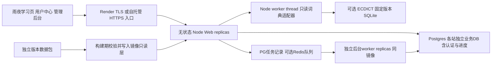

# GitHub 开源与部署方案

核验日期：2026-10-14（Asia/Shanghai）。本文是施工方案，尚未创建 GitHub 仓库、配置云资源、生成可运行部署文件或改变旧工程。技术事实来自下文链接的官方文档；资源规格、数据分层和发布流程是针对本项目的设计选择。

用户指定的 guangyue-panel 仅用于参考已有站点共存、显式配置、预检查、固定版本和回滚等通用工程原则，简短证据见 [多站兼容参考](multisite-reference.md)。NightStudy 的站点 Realm、数据库隔离和并发方案由本项目设计，不沿用参考产品的主控/子站或代理业务模型。

## 1. 推荐交付形态

提供一个公开代码仓库、一个统一 Docker 应用镜像、两种站点部署模式和两条安装路径：

- Render Blueprint：创建一个 Web 服务和一个托管 Postgres，作为面向普通使用者的主入口。
- Docker Compose：作为必须交付的自托管入口，相同镜像连接固定版本 Postgres；提供 minimal 与 scale 两种配置档。

统一栈为 React + TypeScript + Vite、Fastify + TypeScript、Prisma、Better Auth、Postgres。一个 Web 应用实例提供学习前端、`/api` 和 `/admin`，可运行多个无状态 replica；耗时任务使用同一代码库和镜像的独立 worker/job 入口。保留原雨夜视觉、专注学习、用户中心和基本管理后台；渲染效果属于前端构建产物，不增加部署服务。

minimal 配置不要求 Redis、微服务、付费 AI、OAuth、外部对象存储或邮件服务才能完成注册、登录、选择词书、学习、复习、统计和基本后台管理。scale 配置预留 PgBouncer、共享 Redis/queue、多 Web/worker replica 和负载入口，用于高并发施工与压测。后端用户数据与可管理核心内容进入 Postgres；770,611 条 ECDICT 全量词典是可选的固定版本 SQLite 数据包，由有界 Node worker thread 的只读适配器查询，替换原 Python 子进程。

### 两种站点模式都交付

| 模式              | 数据/进程布局                                                                                                               | 域名与子路径                                               | 用途                             |
| ----------------- | --------------------------------------------------------------------------------------------------------------------------- | ---------------------------------------------------------- | -------------------------------- |
| 独立 installation | 每个 installation 有独立 Compose project、PG 数据库/volume、密钥、备份和管理员；代码与固定镜像可复用                        | 不同 domain/subdomain；同域 base path 共存仅用于同一信任域 | 各运营者独立升级、故障与管理边界 |
| 共享 tenant       | 一个 installation、多 Web/worker replica；每个 site 有独立 PG 业务 DB，含完整 Better Auth 与学习业务表；通过固定 Realm 访问 | 真租户默认不同 domain/subdomain 映射到 site/Realm          | 一个运营方集中承载多个隔离站点   |

两种模式采用同一数据契约；独立单站也是一条默认 site 记录，私有动作与 DTO 仍绑定 `(site_id, user_id)`，不另造无 scope 的单站捷径。默认真多站隔离是每 site 独立完整业务 DB，而非把认证表混在一个库后只加 `site_id`。跨站点部署 operator、站点管理员、普通用户分别授权，站点管理员不能创建、绑定或接管其他站点。

独立 domain/subdomain 提供不同浏览器 origin，是真多租户的默认入口。同一 origin 不同 base path 仅用于同一可信运营方与其他项目共存；即使选择不同 Realm/DB，也只能称为同信任域内的数据和配置划分，不能声称浏览器强隔离。站点品牌/内容配置不接受任意 JS/HTML 注入；相同 origin 下脚本、存储、Service Worker 与漏洞影响仍需按共享信任域评估。

独立 installations 可以共享公网 edge，但不共享彼此账户库、密钥或运行 volume。共享 backend 默认在一个固定版本 PG cluster 中为每 site 建独立 DB/role，也支持 site 指向独立托管 PG。认证、核心内容 seed、词书发布、overlay、进度、设置与审计全部在各自 DB；同名/email 账户可以独立存在。只有不可变镜像资源/只读 SQLite 包可共享；缓存、任务、DTO、幂等键和媒体对象仍使用明确 site scope。

### 站点配置与 host/base path 解析

规划 operator 管理的 `SiteRegistry` 与初始化配置契约；registry 与业务 DB 分开，敏感连接使用私有 secret reference，不在公开站点 DTO 中返回。站点至少记录 `site_id`、显示名、启用状态、规范 `public_origin`、`base_path`、固定 DB/Realm 连接引用、认证配置版本、cookie prefix、数据包版本及媒体 provider。路由记录保存已验证 host 与规范路径，约束映射无歧义；路径允许 `/` 或 `/school-a/` 等前缀。新增/修改全局 host、数据库凭据和连接映射仅由部署 operator CLI 处理，site-admin 只能改本站业务设置。

请求先验证 host，再按路径分段边界做最长前缀匹配，得到 `SiteContext`，从 registry 选择固定 Realm/Prisma client/Better Auth 配置，然后执行认证和业务路由。不根据请求临时拼 DSN、schema 或数据库名。未知 host、停用站点、歧义/未匹配路径应拒绝，不退回默认 site。客户端 body、query 或 `X-Site-ID` 不能决定授权 scope。独立安装也只允许初始化登记的 host；内部 ready 检查另走受控探针路径。

代理默认保留完整路径，由应用统一解析和移除 base path 一次。路由器、API/auth URL、回调、静态资产、manifest、Service Worker scope/start URL 均从 site 配置构建。浏览器 localStorage/outbox/cache key 同时带 installation/site/user scope，避免同域子路径站点共享旧会话与学习状态。新增域名需要验证控制权并完成入口 TLS/DNS 配置，不能只写一行 PG 路由就宣称已可公网使用。[Render：Custom domains](https://render.com/docs/custom-domains)

### 代理信任与 Cookie 隔离

edge/ALB 只转发已配置域名，覆写来源 host/proto 元数据并限制 app origin 只能从可信入口访问。Fastify 仅对明确代理 IP/CIDR 或校验直接 peer 的函数启用 `trustProxy`；不能把所有来源头当可信，也不采用只按跳数信任的策略。认证库的 forwarded headers 开关只在相同信任条件成立时开启；不满足条件就按已验证 site 的规范 URL 构造地址。[Fastify：trustProxy](https://fastify.dev/docs/latest/Reference/Server/#trustproxy)

Better Auth 支持动态 allowed hosts、base path 与自定义 Cookie，但这些能力不自动实现租户数据隔离。本方案每 Realm 使用自身完整 PG DB 的 identity/session/account/verification 表、固定 Prisma client 和对应认证配置；注册、登录、恢复及撤销都在选定 Realm 内。不得把不同站点的 token 当同一全局身份，也不得把认证库的域名支持写成 SaaS 隔离已经完成。[Better Auth：Options](https://better-auth.com/docs/reference/options)

域名站点使用 host-only Cookie，不设置可跨站点的父域 `Domain`；同域子路径使用不同 cookie prefix 与规范 Cookie Path，作为兼容和防止无意混用的机制。服务端校验 session 与 SiteContext，并保持 CSRF/Origin 检查；但同源脚本仍可发起携带另一路径 Cookie 的请求，不能由 Path/prefix 或服务端 site 标记推导出浏览器强隔离。默认不启用跨子域 SSO；不互信租户应使用独立 origin。[RFC 6265：Cookie Path](https://www.rfc-editor.org/rfc/rfc6265#section-4.1.2.4)

初始化任务先迁移首站独立 DB 并创建默认 site；独立 installation 的 setup token 只初始化自身站点。共享模式由部署 operator CLI 准备新 PG DB/role 或外部连接、跑迁移/核心 seed、登记 host/base path 并发放 site setup token，验证就绪后发布 registry 新版本。所有 token 与 installation/site/用途绑定、只消费一次；site-admin 不开放全局域名或数据库管理。

## 2. 数据与代码分离

| 资产                                                    | 分发位置                                    | 运行时位置                                  | 版本与持久化                            |
| ------------------------------------------------------- | ------------------------------------------- | ------------------------------------------- | --------------------------------------- |
| 前后端源码、迁移文件、部署描述、少量测试夹具            | Git 仓库                                    | 编译后进入应用镜像                          | Git tag、commit、镜像 digest            |
| 核心数据包：词书、12,934 学习卡、来源声明、教学包、摘要 | GitHub Release 资产                         | 构建期校验；部署任务导入 Postgres           | 独立数据版本；导入记录和内容版本留在 PG |
| 可选 ECDICT SQLite：770,611 词条、188,080 词形关系      | 独立数据 Release 资产                       | 镜像 `/opt/nightstudy/data-packs/` 只读目录 | 单独锁定版本、SHA-256、行数及许可声明   |
| ECDICT CSV 等原始大文件                                 | 数据 Release 或来源档案                     | 通常不进入生产运行镜像                      | 用于重建及核验，不塞入源码 Git          |
| 用户、会话、生词、FSRS、事件、设置、管理修改、审计日志  | 不公开分发                                  | Postgres                                    | 事务持久化与独立备份                    |
| 雨夜背景、雨声、公开音频                                | 已确认可分发的静态资源或可选 media provider | 默认镜像静态资产；扩展资源使用 provider     | 分别保留来源与权利摘要                  |

GitHub Release 支持附加二进制资产，官方当前规定单文件小于 2 GiB。当前约 146 MiB 的 SQLite 可作为 Release 资产分发，无需把它写入 Git 历史或让安装者先配置 Git LFS。[GitHub：About releases](https://docs.github.com/en/repositories/releasing-projects-on-github/about-releases)

建议仓库保存一个小型 `datasets.lock.json`，记录 release 版本、确定的下载 URL、每个文件 SHA-256、字节数、数据 schema 版本、来源/许可摘要、预计实体数和所需应用版本。该文件属于计划中的契约，尚未生成。下载、解压和校验在构建期完成，失败即构建失败；禁止悄悄切换到样例数据，也不要在每次启动时获取“最新版词典”。

镜像可以包含数据包的只读层，同时保持源码仓库与数据发布生命周期分离。核心包导入 PG 后，通过版本记录保持稳定 `cardId`、`senseId`、`entryId`；升级基线内容不覆盖管理员的 PG overlay。新增来源及内容经过后台发布流程，不能原地改写镜像内 SQLite。

默认 `core` 发行配置足以完成整套学习与复习链路；其查词覆盖为已导入的核心学习内容。`full-dictionary` 发行配置增加全量 ECDICT。切换到 full 时需要重新构建对应镜像，仅改变运行时环境变量不会让缺失文件凭空出现。界面和健康报告应显示当前覆盖范围，避免宣称未安装的完整词典已经启用。

当前快照的结构检查通过，但 8,339 张卡有启发式复核信号；100 个教学包中 33 complete、67 partial。数据发布应保留这些质量标记。现有来源清单缺少部分原始快照和追加流水线声明；公开发行前要补齐该次 release 实际包含数据的来源、署名、许可摘要与校验记录，不把缺失资料写成已核验事实。

## 3. Render 一键部署

仓库根目录规划 `render.yaml`。README 的 Deploy to Render 按钮明确携带最终真实仓库 URL 的 `repo` 参数，避免依赖浏览器 Referer。点击后，使用者在自己的 Render 账户审阅资源和费用、确认创建，再完成首次管理员设置。公开模板默认 `autoDeployTrigger: off`，由实例所有者选择升级版本；这是官方对公共按钮模板的建议。[Render：Deploy to Render Button](https://render.com/docs/deploy-to-render)

### Blueprint 字段契约

以下是要写进部署描述的字段设计，不是已经生成或通过平台验证的 YAML：

| 资源/字段      | 设计值与理由                                                                                                                     |
| -------------- | -------------------------------------------------------------------------------------------------------------------------------- |
| Web 服务       | `type: web`、`runtime: docker`；构建仓库根 Dockerfile                                                                            |
| Web 自动部署   | `autoDeployTrigger: off`；用户 fork 后可自行改为 `checksPass`                                                                    |
| Web 规格       | minimal 初始单实例至少 512 MiB；当前 plan 名可用 `0.5c-512mb`；scale 根据压测调整规格与 replica 数，不把此最低规格称为高并发容量 |
| Postgres 规格  | 生产模板使用付费 plan；当前可选择 `0.5c-1g`，初始 `diskSizeGB: 5`，根据人数、事件量和预算调整                                    |
| 区域           | Web 与 PG 同一区域；发行模板可默认 `singapore`，使用者在创建前选择                                                               |
| PG 主版本      | 施工时固定 Render 与自托管共同支持的主版本；镜像、CI 和备份客户端使用同一版本线                                                  |
| PG 公网访问    | `ipAllowList: []`，应用通过内部网络连接；运维需要临时受限访问或从内部运行备份任务                                                |
| 首站连接串     | `DATABASE_URL` 由 `fromDatabase` 引用首站数据库 `connectionString`；作为默认 Realm                                               |
| 认证密钥       | `BETTER_AUTH_SECRET` 使用 `generateValue: true`；不在仓库写值                                                                    |
| 初始管理员设置 | `BOOTSTRAP_TOKEN` 使用平台生成随机值；数据库记录一次性消费状态                                                                   |
| 迁移与核心导入 | `preDeployCommand` 调用统一的发布前任务，先迁移，再幂等导入该发行版核心包                                                        |
| 健康检查       | `healthCheckPath: /health/ready`，确认 PG/schema/core 数据集已就绪                                                               |
| 应用磁盘       | 默认不挂载 persistent disk；所有用户与后台修改在 PG 中                                                                           |
| 高并发扩展     | 同镜像 Web 多 replica、独立 background worker、可选共享 Redis 与连接池；由额外 Blueprint 配置档启用                              |
| 站点初始化     | 创建默认 site/host/base path；新增站点由 operator 准备新 DB 连接并登记，不由按钮自动无限创建                                     |

上述 plan、环境引用、健康检查和部署字段均来自当前 Blueprint 规范。规范使用 `autoDeployTrigger`，旧 `autoDeploy` 已废弃；正式模板不要混用新旧字段或假定旧 starter/basic 别名长期有效。Blueprint 不支持变量插值，URL 的默认推导应由应用配置层完成。[Render：Blueprint YAML Reference](https://render.com/docs/blueprint-spec)

付费资源是生产模板的基线。官方当前的免费 Postgres 30 天过期且不提供托管备份，不适合长期保存学习记录；免费 Web 也不支持 persistent disk。可另外提供明确标为限时体验的配置，但不能把它作为默认数据持久化方案。[Render：Free instances](https://render.com/docs/free)

默认 Render 按钮创建首站的一个 Web 服务与一个 PG DB。多站使用者后续由 operator 配置新站独立 PG 连接、资源规格和费用；模板不承诺一个按钮提供无限数据库/租户。独立 installation 重复部署各自资源；共享 backend 接入多个已准备好的 DB，由 registry 选择 Realm。

### 构建与启动

采用多阶段 Docker 构建：锁文件安装 → 前端/API 构建 → 固定数据包下载及验证 → 复制最小运行依赖和产物。Render 支持从 Dockerfile 构建或从 registry 拉取镜像；初版按钮优先采用源码 Dockerfile 路径，方便用户 fork，GHCR 镜像用于自托管快速启动和明确版本升级。[Render：Docker on Render](https://render.com/docs/docker)

新 Fastify 服务必须监听 `0.0.0.0` 并读取 `PORT`，不沿用旧服务固定 `127.0.0.1` 的监听方式。TLS 由 Render 终止，后端同源提供页面和 API；不搬入旧 10443 + PROXY protocol 的 Nginx 配置。[Render：Web Services](https://render.com/docs/web-services)

独立单站初始化可让 `BETTER_AUTH_URL` 显式值优先，未设置时从 Render 官方 `RENDER_EXTERNAL_URL` 建立默认 site 的 public origin，无需提前猜测 `.onrender.com` 域名。共享多站模式每次按 site 配置使用规范 URL 和 trusted origins，不能对所有站点复用一个全局 base URL。自定义域名先验证并登记映射，配置版本变更需要各 replica 同步。[Render：Default Environment Variables](https://render.com/docs/environment-variables)

Render 的 pre-deploy 任务可用于付费服务数据库迁移，但运行在单独实例，文件变化不会进入正式实例，也不能读写应用 persistent disk。因此核心数据包必须已经存在于该镜像，导入结果写入 PG；不能试图在 pre-deploy 把词典下载到运行盘。[Render：Deploys / Pre-deploy command](https://render.com/docs/deploys#pre-deploy-command)

应用收到 SIGTERM 后停止新任务、完成当前事务、关闭数据库连接和 worker。旧新版本短暂并行时都要兼容当前数据库结构，进度写入依靠 PG revision/唯一约束，而不是进程内锁。

### 首次初始化

初始数据库与默认 site 建立成功且核心包导入完成后，该 site 的 setup 路径接收一次性 `BOOTSTRAP_TOKEN` 和管理员注册信息。事务创建首位管理员并把对应 installation/site 初始化状态标为已完成，之后禁用该入口；普通注册永远创建普通用户。令牌从部署者控制的 Render 配置获取，不打印到公开应用日志，也不采用“第一个匿名访问者自动成为管理员”的逻辑。

Better Auth 密钥和 base URL 按官方配置使用；Fastify 集成负责保留认证响应头和 Cookie，生产 trusted origins 仅允许当前站点。普通业务请求仍须检查用户身份和管理员角色，不能因为挂载了认证 handler 就认为全部业务路由自动被保护。[Better Auth：Installation](https://better-auth.com/docs/installation)、[Fastify integration](https://better-auth.com/docs/integrations/fastify)

## 4. Docker Compose 自托管

Compose 是必须实现与验收的交付，不只提供示意。规划 minimal、scale 两套可复用配置以及 ops job profile；应用镜像相同，通过 `web`、`worker`、`job` entrypoint 区分角色。PG 主版本固定，独立 installations 使用不同 Compose project 名和独立数据资源。

| 配置档  | 拓扑与职责                                                                                                                                   |
| ------- | -------------------------------------------------------------------------------------------------------------------------------------------- |
| minimal | `app + postgres + init/job`；init/job 独立进程负责迁移、建默认 site、核心导入及明确运行的运维任务，结束后退出；基本学习请求不需要 Redis      |
| scale   | `edge + app replicas + worker replicas + postgres cluster`；每 site 独立 DB；加入可选 `pgbouncer` 与 `redis/queue` 或连接到等价共享 provider |
| ops     | 使用同镜像独立 job 运行备份、恢复、站点创建、数据包导入、迁移预览；不让每个 Web replica 自行执行                                             |

minimal 的 app 可只映射主机 localhost 端口，公网通过已有 HTTPS 入口或可选 edge 接入。scale 中只有 edge 发布 80/443，app/worker/PG/PgBouncer/Redis 均留在内部网络。后台导入、导出、批量内容检查由独立 job/worker 执行；Web 负责校验、提交和查询状态，不能在请求线程等待大型任务完成。

可伸缩服务不写静态 `container_name`，也不让每个 app replica 绑定相同主机端口。Docker 官方明确 `container_name` 会阻止多容器扩容，CLI 的 `--scale` 可调整同服务 replica 数。[Docker：Compose services](https://docs.docker.com/reference/compose-file/services/#container_name)、[compose up](https://docs.docker.com/reference/cli/docker/compose/up/)

edge 必须发现健康 app 副本并在扩缩容后更新 upstream；可用 Caddy 的动态 A/AAAA upstream 结合 Compose 服务 DNS 和被动故障处理，或现有 ALB/入口的等价发现机制。不能配置一个固定容器 IP 并假定 `--scale` 自动带来流量分发。Caddy 动态 upstream 不执行主动健康检查，因此还须验收 DNS 刷新、就绪移除、失败重试和实例摘除机制。单台主机 Compose 扩容提升并行处理，不意味着主机/PG/edge 已获得跨机器高可用。[Caddy：Reverse proxy](https://caddyserver.com/docs/caddyfile/directives/reverse_proxy#dynamic-upstreams)

### 已有网站与广月入口的兼容配置

另提供规划中的 `coexist` 入口配置档：已有 Nginx/Caddy/ALB 保持公网 80/443，NightStudy 只绑定明确空闲的 `127.0.0.1:<port>` 或内部网络服务地址，不启动第二个抢占公网端口的 edge。安装预检查清点站点、监听、证书、路径和 include 上下文，生成待审阅片段与回滚计划；已有配置冲突就停止，不覆盖别的站。

若服务器已有广月 Nginx stream SNI 入口，则保持其 TCP 443 分流和原路由，只将明确的学习站点域名加入受管路由，并通过现有 `127.0.0.1:10443` HTTPS 虚拟主机转发到 NightStudy。PROXY protocol 只在既有 stream → TLS listener 链中匹配；Nginx → Fastify 使用普通 HTTP 与受信来源头，不能把 PROXY 前缀直接发给未实现该协议的 Node listener。同域子路径由解密后的 HTTP 路由和 SiteRegistry 解析，SNI 不能识别 URL 路径。详细证据与采用范围见 [兼容参考](multisite-reference.md)。

这一配置档不安装或管理参考产品的代理协议、子站配对、网络优化或支付能力；也不复用它的安装器。共存验收覆盖已有站点前后 HTTP/TLS/路径行为与配置摘要，不只检查 NightStudy 新首页是否打开。

持久化分配：PG 数据进入 named volume；静态数据包随镜像或以校验过的只读 bind mount 提供；临时文件只进容器临时目录；应用不得把用户上传和后台修改写到镜像目录。自托管 PG volume 是运行数据，备份必须另外存放，不能用另一个同盘目录冒充灾难恢复。

部署过程规划为：准备配置/密钥 → 启动 PG 并等待健康 → 运行一次性的迁移与核心数据导入任务 → 确认任务成功 → 启动应用 → 完成管理员 setup。可用 Compose 的 `service_healthy` 与 `service_completed_successfully` 表达依赖；仅靠短格式 `depends_on` 不能保证数据库已经可查询。[Docker：Startup order](https://docs.docker.com/compose/how-tos/startup-order/)

首次部署和升级从统一 operator 运维入口进入；不要让每个 app 副本自行建表或重新 seed。共享模式对每站 DB 分别迁移与导入，以 registry/migration 版本记录发布状态；失败站点不回退到别站 DB。可控并发地处理各站升级，不一次开出与站点数等量的迁移连接。应用仍须实现断线重连与就绪失败处理，因为初始依赖顺序不代替运行时可靠性。

自托管敏感配置使用未提交的 `.env` 或 Compose secrets 文件。secrets 只授予需要的服务；应用配置层提供读取 `/run/secrets/` 的接口，把数据库与认证配置交给框架，不把秘密写入构建 ARG、镜像层或日志。Compose secrets 的挂载能力有官方支持，具体 `_FILE` 配置兼容由本项目实现，不假定任意库天然识别。[Docker：Manage secrets](https://docs.docker.com/compose/how-tos/use-secrets/)

## 5. 持久化与媒体边界

每 site 的独立 PG 业务 DB 是本站写入事实来源，包含认证、词书、核心学习内容、版本/overlay、进度、事件、设置和审计。SiteRegistry 是 operator 控制的部署映射，不成为站点管理员的跨站业务入口。镜像包是可重新取得的发行资产；各站 seed 相同基线，管理员修订留在本站 DB。只读 SQLite 镜像包共享，不提供原地写入接口。

默认不要给 Render Web 挂 disk。官方限制包括磁盘只能供一个服务实例使用、不能横向扩容、build/pre-deploy 访问不到，且挂盘后无法执行无中断实例切换。这些约束与本方案的可升级单体不匹配。[Render：Persistent disks](https://render.com/docs/disks)

MVP 媒体使用已许可的内置背景/雨声和公开音频引用；不要求管理员开通对象存储。需要新增媒体时通过 `StorageProvider` 契约接入：URL 引用或共享对象存储。多 replica 的上传对象必须由共享 provider 提供，object key、访问权限及导出都带 installation/site scope，不能落到单个 app 容器本地。没有配置持久 provider 时，后台不接受会丢失的本地文件上传。完整音频下载包为可选扩展，媒体可用性与来源权利必须单独检查。

跨实例一致性用 PG 事务、site scoped 唯一约束、revision 和持久任务记录实现。Web 与后台 worker 使用同一镜像、迁移和发布版本，保持模块化单体；二者进程分离不要求拆成微服务。每个 Web 副本内的 SQLite thread pool 和查询等待队列都有上限，超限返回可重试响应，不无限创建 thread 或堆积 Promise。

### 连接池、分布式限流与有界队列

多 DB 的 Realm/Prisma client 使用 bounded LRU：限制活动 Realm 数、每 Realm 连接池和整个进程的总连接数；仅回收没有在途事务/任务的空闲客户端，不能每请求新建 client。满额时对新 Realm 做有界等待或过载拒绝，不无限增长。全 cluster 连接预算为 `Σ各Web副本Σ其活动site(P_web) + Σ各worker副本Σ其活动site(P_worker) + registry与ops预留`；独立托管 DB 还分别验算自身上限。

scale 配置可加入 PgBouncer transaction pooling。其 pool 通常按 `(database, user)` 分配，不能把每 DB 的 pool 默认值误认为全 cluster 总额；限制 `max_client_conn`、各 DB server pool、汇总 server connections 和 `query_wait_timeout`。扩大 replica 或活动站点数时必须重新审核预算。池化减小连接压力，不增加单条 SQL 的执行能力；等待时间和队列长度必须有界。[PgBouncer：Configuration](https://www.pgbouncer.org/config.html)

业务请求走 pooled URL；迁移、关键维护任务使用独立 direct URL。Prisma/PgBouncer 的 prepared statements 和版本兼容在发行测试中锁定，不能机械附加旧版参数。租户上下文不能存放在跨事务复用的 session-level `SET`；若使用 RLS 辅助隔离，只允许事务内 `SET LOCAL` 与明确 scope，并验证连接回收后不会污染下一请求。[Prisma ORM 7：PgBouncer](https://www.prisma.io/docs/orm/v7/prisma-client/setup-and-configuration/databases-connections/pgbouncer)

minimal 用 PG 持久任务记录和有界领取执行器即可；scale 可启用 Redis/BullMQ provider。任务 payload、job ID、outbox、缓存与限流 key 都带 installation/site scope；全局并发、每站点并发、公平领取、重试次数、超时及最大待处理量分别设置。PG 保存提交/状态事实，入队与业务写入通过 outbox 衔接；worker 重试采用幂等任务，不宣称 exactly-once。BullMQ 提供跨 worker 的 global concurrency，但每站点公平性/上限和任务 admission 仍需本项目实现，不能误用单 worker `concurrency` 当全局上限。[BullMQ：Global concurrency](https://docs.bullmq.io/guide/queues/global-concurrency)、[Idempotent jobs](https://docs.bullmq.io/patterns/idempotent-jobs)

认证与业务敏感端点的全局限流使用 PG 或共享 Redis 原子计数；Better Auth 默认 memory storage 只能覆盖单进程，不能作为多 replica 的全局限流。[Better Auth：Rate-limit options](https://better-auth.com/docs/reference/options#ratelimit) 设置明确的故障策略：高风险写入/登录在限流依赖不可用时限量或拒绝，静态页与公开只读允许受控降级。队列满、连接池等待超时、过载分别返回 429/503 等明确信号和可用的重试提示；不以无限排队隐藏容量不足。

可选 Redis 用作队列时需明确持久化、恢复和 eviction 配置；作为缓存时可丢失并重建。不要把可丢的缓存与需要恢复的任务状态混为一体，恢复以 PG job/outbox 记录重新核对任务。Redis persistence 是可配置能力，不是只启动一个容器就已经实现持久恢复。[Redis：Persistence](https://redis.io/docs/latest/operate/oss_and_stack/management/persistence/)

## 6. 迁移、核心导入与版本升级

设立以下命令契约，名称可在施工时调整：

| 契约               | 责任                                                                                               |
| ------------------ | -------------------------------------------------------------------------------------------------- |
| `db:deploy`        | 应用已提交、已审阅的数据库迁移；不在生产临时生成 schema                                            |
| `data:import-core` | 向明确站点独立 DB 校验并导入 dataset/version；有断点/幂等检查，不覆盖用户或管理员修订              |
| `site:init`        | operator 准备/验证独立 DB/role、固定 Realm 与默认 site；登记 host/base path、发放 site setup token |
| `legacy:import`    | 单独读取旧 store 或浏览器导出，dry-run 后迁移到新实例；不在每次部署自动执行                        |

施工时固定 Prisma 主版本及依赖锁。官方当前新版文档使用 `prisma db migrate`，而 ORM 7 使用 `prisma migrate deploy`；版本差异应封装在统一契约内，不把某个 CLI 拼法散落到所有平台配置。Better Auth ORM schema 也必须通过已提交的迁移统一管理，而不是在应用启动时调用不固定版本的 CLI。[Prisma：Applying a migration](https://www.prisma.io/docs/orm/migrations/applying-a-migration)

核心导入明确调用，与数据库 schema 迁移分开。旧版本 seed 可能有不同触发行为；ORM 7 官方说明 seed 只在显式调用时执行。迁移完成不能被误报成 12,934 张学习卡已经导入成功。[Prisma ORM 7：Seeding](https://www.prisma.io/docs/orm/v7/prisma-migrate/workflows/seeding)

升级按 expand → 数据回填 → 新代码切换 → 后续版本收缩处理。应用回滚不自动撤销数据库迁移。涉及删除字段、改变稳定 ID 或清空内容的升级必须有专门升级说明、事前备份和在副本上演练的恢复路径；普通自动 pre-deploy 只允许已审阅的兼容升级。

旧工程没有提供生产账户 store，因此当前能准备迁移器和映射规则，不能宣称已有生产用户成功迁入。后续输入必须是部署者授权提供的备份或用户自己的导出。迁移应：

1. 只读检查 JSON/schema、身份冲突、孤立进度、日期和 ID；报表尽量输出计数和内部 ID。
2. 保留卡片稳定 ID，先指定目标 installation/site，建立旧身份到新用户的明确映射，不开放凭 legacy guest ID 领取身份的接口。
3. 把旧账户密码 hash 迁移、登录时升级或重设密码的策略单独验收；不把旧会话复制成新有效会话。
4. 在 staging/新实例事务导入，检查用户/进度/事件计数、幂等性及跨账号隔离；失败不改旧文件。
5. 设置切换窗口、只读旧实例和最终增量核对，保留可恢复旧备份。

## 7. 备份与恢复

建议初版运维目标为业务数据 RPO ≤ 24 小时、演练 RTO ≤ 2 小时；这是待验收目标，不是已经达到的保证。词典 Release 可重新下载，重点备份 PG 业务内容、管理员 overlay、版本记录与必要部署配置/密钥。

Render 付费 Postgres 有 PITR；官方当前恢复窗口为 Hobby 3 天、Pro 及以上 7 天，逻辑导出保留 7 天。长期留存要另做独立逻辑导出，不只依赖云账户中的恢复能力。恢复到新数据库验证后再切换连接串，不直接覆盖正在服务的库。[Render：Postgres recovery and backups](https://render.com/docs/postgresql-backups)

自托管使用与固定 PG 版本匹配的备份客户端，定时执行 `pg_dump` custom-format 逻辑备份，保存校验摘要、schema/app/dataset 版本与时间。`pg_dump` 的导出是数据库一致性快照，非文本格式使用 `pg_restore` 恢复；named volume 的文件拷贝不能自动替代一致备份。[PostgreSQL：SQL dump](https://www.postgresql.org/docs/current/backup-dump.html)

备份任务通过运维 profile 或主机定时任务调用同一备份契约；备份保留建议 7 个日版本、4 个周版本、3 个月版本，并复制到另一台机器或可替换的备份 storage provider。Render 的内部数据库不开放给公网 CI：如需自动异地导出，另选可访问内部网的受控运维任务；该扩展的存储和调度由实例运营者配置，基础一键部署仍可使用平台 PITR 和手动导出。

至少每月在空库恢复一次，验收站点路由、登录、site/user 隔离、词书、进度 revision、统计、后台任务与管理员编辑版本。共享 backend 按站 DB 独立 dump/restore，并另备份 registry 与 secret mapping；恢复一站不能恢复整 cluster 覆盖别站 DB。registry 切换到恢复 DB 前校验目标 site/实例身份与凭据。OAuth/AI 等可选凭证不进入用户导出，密钥备份分开保管；成功报告包含实际恢复测试与最近可用恢复点。

## 8. README 与开源仓库的发布契约

README 先给出截图、学习体验和最低部署步骤，再列明以下内容：

- Render 按钮、资源清单、付费/限时体验边界、首次 setup 方式和默认关闭自动更新。
- Compose 路径、配置准备、HTTPS 入口、完整启动/升级/备份/恢复步骤。
- 独立 installation 与共享 tenant 的选择、domain/base path 配置、默认 site 初始化、站点管理员与实例所有者权限。
- minimal/scale/ops 配置档、Web/worker replica 扩容、共享媒体、连接预算、队列容量与限流 provider 配置。
- coexist 配置档、已有 443/SNI/TLS 入口接入、只读 preflight、待审阅配置片段和不覆盖其他站点的回滚步骤。
- 核心与全量词典的覆盖范围、安装 full 包的方法、数据版本/许可/质量说明。
- 普通用户与管理员的能力边界，账户注册策略及无邮件服务时的恢复说明。
- 当前发布版本、兼容 PG/Node/Prisma 主版本、镜像 digest 和数据库升级要求。
- `.env.example` 只给变量名/非秘密默认值；`.gitignore` 和 `.dockerignore` 排除密钥、运行数据库、备份、大型原始文件和本地缓存。
- 可选 OAuth/AI/storage 的配置放后面；默认关闭时核心体验仍完整。

正式仓库的代码许可与第三方数据/媒体来源分别列出。Release 中附 changelog、升级说明、数据锁与已知问题。此架构阶段尚无真实 repo URL，不展示可点击的虚构部署按钮，也不把计划中的命令标成已经可运行。

## 9. GitHub Actions CI 与发行

PR 流水线无生产密钥：锁文件安装、lint/typecheck、前后端构建、Postgres 集成测试、tiny SQLite 数据夹具测试、浏览器主链路、minimal/scale Compose 配置检查和 Docker build。关键回归覆盖旧项目已经复现的身份恢复、同名注册竞态、第二组学习卡读写错位、分钟统计和账户隔离；新平台增加首位管理员 setup、跨 site/session 权限、host/路径/forwarded header、Cookie/CSRF、进度 revision、队列重试幂等与多 replica 限流检查。

数据发行流水线独立执行核心包解析/来源校验、SQLite integrity、引用完整性、ID 差集、内容质量标记和导入/恢复测试。默认 PR 使用合法的小夹具；正式发行必须对完整数据包再测，不能用夹具测试冒充全量资产验证。

版本发行计划：固定 commit/tag → CI 通过 → 构建 amd64/arm64 镜像 → 发布 GHCR 的版本 tag 和 digest → 附 SBOM/构建来源 → 发布 Release 与升级说明。架构和原生 SQLite 依赖必须在两种目标架构实际运行检查后再宣称 multi-arch 支持。

GitHub 官方流程支持 Actions 构建并发布 GHCR，使用受限 `GITHUB_TOKEN` 权限；外部 Action 固定 commit SHA。镜像发布任务需要 `packages: write`，启用构建证明时再授予相应权限；普通测试 job 不需要这些写权限。[GitHub：Publishing Docker images](https://docs.github.com/en/actions/tutorials/publish-packages/publish-docker-images)

发布镜像和 Release 不自动部署任何使用者实例。Render 用户根据版本说明手动选择升级；fork 维护者可明确开启 `checksPass`。部署 hook/API token 仅属于选择自动部署的实例，不放在公共默认工作流中。升级仍依赖已备份、兼容迁移和 ready 验收。

## 10. 施工验收

完成实现后，以下证据全部具备才能把 README 写成“支持一键部署”：

1. 从全新 GitHub fork 点击按钮，在全新 Render workspace 创建资源成功；普通注册、管理员 setup、学习/复习/统计均可操作。
2. 从空机器按 Compose 文档启动成功，PG 重启、app 重建/升级后账户与进度不丢失。
3. 数据下载不可用或 checksum 错误时构建失败；核心包导入可重复，管理员 overlay 和用户数据不被 seed 覆盖。
4. core 和 full 两个发行配置分别验证，full 词条数与校验摘要一致；默认无 Python、Redis、AI/OAuth/object-storage 依赖。
5. 新实例恢复 PG 备份成功；应用回滚与数据库兼容、长期数据包可取得均有证据。
6. 两账号权限隔离、管理员接口、首次 setup 并发、第二组进度更新和离线重放通过真实回归。
7. 浏览器手机与桌面雨夜画面、背景/音量偏好、词书与卡片状态保持正确；可选音频缺失时能完成学习，不把媒体错误当学习成功。
8. 同源码独立部署至少两个 installation，分别挂不同域名及同域子路径；重启/升级其中一个不改另一份数据库、密钥、Cookie 或进度。
9. 共享后端建立多个 site；跨站 token/session、相同 email/名称、管理员操作、缓存、任务、媒体、导出和 localStorage/SW 都通过隔离测试。未知 host 和伪造 forwarded/site headers 被拒绝。
10. scale 档至少运行两份 Web 与两份后台 worker，入口能发现并摘除副本；单实例退出后请求和任务可恢复，队列/连接池上限及全局限流跨副本有效。

### 高并发压测里程碑

高并发是本次施工要求，容量数字必须由实际拓扑、数据量和负载模型验证后发布。512 MiB 的 minimal 资源、开启 PgBouncer、增加 replica 或添加 Redis 都不是已达到吞吐的证据。

第一阶段固定单站和多站数据量，记录词书分页/查词/复习写入/事件批量/登录/后台导入的比例、payload、think time 和认证状态；分别测试冷缓存、热缓存和 full SQLite。第二阶段以 open-loop 逐级加压，记录吞吐、p95/p99、错误率、event-loop lag、CPU/RSS、DB 查询/连接等待、队列深度与站点公平性，辨识最先达到的瓶颈。第三阶段对两份及更多 Web/worker 做扩缩容、PG/Redis 降级、重试风暴、重复提交和长时间 soak，确认进度无丢失、跨站隔离保持成立。

版本验收要明确目标并发、请求速率、延迟/错误阈值、测试时长和资源规格；这些目标在实现后的容量基线评审中确定。发布报告同时给出失败/饱和点和限制，不只报最好的峰值。不经过该里程碑，文案只能写“具备多 replica、限流与有界队列的高并发设计”，不能写已支持某个未经测量的 QPS 或在线人数。

文档核验已完成；Render 创建、真实 Docker 构建、数据库迁移、备份恢复、性能与内容发布审核仍是施工阶段的验收工作。
