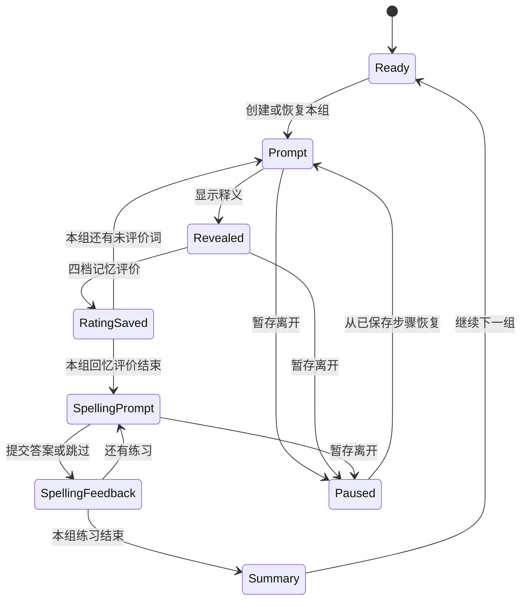

# 夜读英语产品与界面方案

本文件保留最初产品依据与后续页面方案。0.5.0-alpha.2已完成施工；当前已实现范围和验收见 [每日任务](../DAILY_TASKS.md) 与 [README](../../README.md)，下文其他扩展不自动视为已实现。目标是保留“雨夜自习室”的独立视觉，重建可维护的 React + TypeScript + Vite 网页前端，支持多用户学习、熟词导入导出、目标水平测验、个人遗忘曲线、用户中心、基础后台及 GitHub 开源部署，并兼容独立部署与同后端多站点。后台默认作为同一应用内的 `/admin` 区域；前后台共用设计 tokens，权限由服务端独立执行。

## 1. 公开能力依据与设计边界

不背单词官网公开介绍了真实语境原声例句、词根词缀、动态复习安排、拼写测试和正版词典。[官方功能说明](https://www.bbdc.cn/)

官方 App Store 描述还包含词组搭配、派生关系、阶段词库与词书、近反义词/词形变化和考试义项重点。[官方 App Store 页面](https://apps.apple.com/us/app/id698570469)

墨墨官方公开描述遗忘曲线（各阶段忘记比例）、学习情况（每日复习与未来压力）及记忆持久度（熟知度）三类图表。这支持本项目设计个人记忆与复习看板；本项目仍使用自己的FSRS状态与预测规则，不声称采用墨墨的私有算法或已观察其内部布局。[墨墨官方 App Store 页面](https://apps.apple.com/us/app/id888483369)

这里对齐的是这些公开学习能力。下文的导航、页面、状态机、计数和界面细节是本项目的独立方案，不代表已经观察或掌握不背单词每一屏的内部流程。品牌、布局、壁纸、图标和内容资产使用本项目自己的实现；公开功能描述也不构成对其词典、原声音频或例句素材的使用授权。

本项目的主流程设计为：**词书 → 今日计划 → 回忆 → 揭晓与语境 → 记忆评价 → 拼写 → 到期复习 → 统计**。MVP 不包含社群、酷币、会员和付费内容系统。

## 2. 固定的产品口径

### 2.1 一词一主学习单位

- `study_item` 以稳定 `word_id/lexeme_id` 表示一个学习词条，MVP 一个词只有一份 FSRS 状态，不按每个义项另建复习卡。
- 一个词可以展示多个词性、多个释义与例句。`focus_sense_id` 标记本轮教学或练习重点，不改变该词的全局学习身份。
- 词书通过成员关系引用同一个 study_item。同一站点、同一用户的同词出现在两本词书中时共享掌握进度和到期时间；切换词书不会产生一份全新 FSRS 卡。
- 拼写属于练习记录，不额外生成一张 FSRS 卡。记忆评价与拼写结果分别记录。
- 既有源码中的 legacy card/entry/sense ID 要保留映射。迁移前生成可核对的差异预览，不凭相同词面就直接删除旧记录；多张旧卡的进度合并由专门迁移策略处理。

### 2.2 默认计划与计数

当前默认每天 **20 个不同词（复习+新学）**、每组 **5 个词**；总目标可设 **1–100**，每组 **1–20**。先预留当天到期复习，再分配本书新词；同日巩固和拼写不重复占目标。选书先确认计划，学习日按当地04:00交接，切书/降目标保留已签任务。组数与目录分页解耦，由服务端跨分页组成学习组。以下单项统计不能直接相加当作每日不同词数，实际计数见每日任务文档。

| 指标         | 固定含义                                                                                                   |
| ------------ | ---------------------------------------------------------------------------------------------------------- |
| 今日新学词   | 今天首次完成记忆评价的唯一 study_item 数；同词重复出现、多义项展开、跨词书学习都不重复计数                 |
| 今日复习词   | 当天完成评分且首次归类为复习的唯一词数；当天先新学再巩固保留新学归属，复评次数另记                         |
| 复习评价次数 | 已学词的有效评分操作数，可能大于复习词数；一个词反复回忆多次保留每次操作                                   |
| 今日拼写     | 已作答的题数、首次作答正确率及错词数分别记录；跳过单列，不算正确                                           |
| 词书总词数   | 词书成员中的唯一 study_item 数，不按义项数或例句数扩张                                                     |
| 词书已学     | 此词书中已经首次完成正常学习记忆评价的唯一词数，包含从本站其他词书学过的同词；导入与基线测验不伪造首学事件 |
| 词书确认熟词 | 在本站经过客观测验/有效抽查确认的熟词数；单纯自报或导入不算已确认                                          |
| 词书已覆盖   | 已学词 ∪ 测验确认熟词的去重并集；页面分列两种来源及它们的重叠，不把两列直接相加                            |
| 词书覆盖率   | 已覆盖 / 词书总词数，显示分子与分母；覆盖不等同于长期掌握，单纯自报熟词不提高覆盖率                        |
| 到期数量     | 指定范围内 due_at 到期的唯一 study_item 数，卡片重复、反复打开页面不增加数量                               |
| 学习时长     | 前台有效学习交互累计的时间；隐藏页面、退出学习和长时间无交互暂停计时                                       |

目标分数不统一显示“6.5”。MVP 计划以词数和复习安排为核心；雅思分数、考试日期等可以作为目标备注，后续提供分考试目标模型。

## 3. 功能矩阵

“MVP”表示第一版交付应包含的能力；“后续”表示不影响第一版完整闭环的扩展。所有条目目前都是方案。

| 功能           | MVP                                                                                | 后续                                                   |
| -------------- | ---------------------------------------------------------------------------------- | ------------------------------------------------------ |
| 多用户         | 注册、登录、退出、会话失效提示、用户间数据隔离、注册开关                           | 第三方登录、更多身份提供方、设备会话管理               |
| 游客体验       | 浏览词书、查词、体验少量示例；保存长期学习记录时登录                               | 完整游客学习与有冲突预览的账户迁移                     |
| 词书           | 分类/搜索、详情、词数与许可、加入/切换、停学/恢复                                  | 自定义词书、用户共享、更多考试阶段、订阅内容更新       |
| 今日计划       | 默认新词20/组5、计划设置、新词与到期分开、继续未完成组；按水平基线与熟悉度分配任务 | 按考试日期安排进度、周计划、可选提醒                   |
| 熟词管理       | 熟词列表、CSV/JSON导入与导出、匹配置信度、冲突预览、批次撤销、自报熟词抽查         | 更多外部工具格式、定期增量迁移                         |
| 目标水平测验   | 选定目标后提供分层词汇基线、客观题和熟词抽查、结果与计划解释                       | 更多题型、已校准的自适应测验、长期水平复测             |
| 个人遗忘曲线   | 按个人历史与词状态生成预测带、实测抽样点、数据不足状态；词/词书/时间范围切换       | 用户级参数优化、经过校准的置信区间与长期复盘           |
| 新词学习       | 按服务端任务顺序回忆、揭晓、四档评价、组内进度、暂存、下一组                       | 听音辨词、中文提示模式、不同学习模式组合               |
| 动态复习       | FSRS 到期队列、先回忆再揭晓、四档评价、遗忘词再练、全词书/当前词书范围             | 自定义复习偏好、个性化参数、额外强化模式               |
| 释义           | 主义项突出、多义项展开、词性、音标、来源、考试重点标签                             | 更丰富的词根词缀、近反义词及派生关系网络               |
| 语境例句       | 来源例句或已审核教学例句、翻译可展开、重点词高亮、缺失状态                         | 更多开放原声语境、字幕跟读、句子听写                   |
| 发音           | 有权分发的来源音频优先、单词/例句播放按钮、无音频时设备合成且明确标识              | 多口音、跟读录音、发音对比、可选环境雨声               |
| 搭配与词形     | 有数据时展示搭配、变形和派生关系；缺失时隐藏空模块                                 | 关系数据覆盖扩展、按搭配单独练习                       |
| 拼写           | 组末拼写题、即时反馈、重试/跳过、错词汇总，不重复改 FSRS                           | 独立拼写薄弱队列、听写、更多词形题                     |
| 生词本         | 查词收藏、来源/备注、加入复习、检索、移除或暂停及可撤销操作                        | 标签、批量管理、个人例句                               |
| 查词           | 单词/短语查询、完整义项、词形关系、例句、收藏                                      | 浏览器扩展、划词、可靠的句子解析服务                   |
| 统计           | 今日新学/复习/拼写/有效时长、7/30天趋势、独立30天日历、词书进度                    | 更长历史、长期保留率、个性化复盘                       |
| 同步           | 服务器保存计划、词书、学习组步骤、评价与练习；网络写入持久重试、错误可见且可恢复   | 完整缓存离线持续学习（P2）；独立设计多设备离线冲突处理 |
| 用户中心       | 个人信息、学习设置、同步状态、数据导出、密码修改、账户注销                         | 学习徽章、更多个人目标、设备和通知管理                 |
| 基础后台       | 运行概览、用户列表、词书/内容管理、审核与发布、来源许可、站点设置、操作日志        | 多级编辑/审核角色、版本比较、批量内容生产              |
| 多站点         | 独立部署与同后端站点域隔离；本站账号、内容、计划和管理权限独立                     | 跨站显式迁移向导、更多运营模板                         |
| 开源与部署体验 | 有明确许可的默认演示词书、文档、部署入口、首个管理员初始化流程                     | 插件式词库提供方、多语言界面、更多托管平台             |

MVP 的“有数据时展示”不代表可以留出一个永远为空的功能壳。首批正式演示词书应至少有一批人工核验的释义、例句与拼写题，能完成完整学习体验；覆盖范围在词书详情中如实显示。

## 4. 信息架构与导航

### 4.1 页面与路径

| 路径                            | 页面         | 主要内容                                                         |
| ------------------------------- | ------------ | ---------------------------------------------------------------- |
| `/`                             | 雨夜自习室   | 当前词书、今晚计划、新学剩余、全站到期数、继续本组、今日小结     |
| `/books`                        | 词书大厅     | 雅思/四六级/高中/日常分类、搜索、已加入、内容覆盖与版本          |
| `/books/:bookId`                | 词书详情     | 介绍、总词数、阶段、已学进度、预览、来源许可、加入/设为当前/停学 |
| `/learn`                        | 今日学习     | 当前任务、本组词序、回忆与揭晓、评价、组末拼写、总结             |
| `/review`                       | 到期复习     | 默认所有在学词书的到期词；可筛当前词书，显示筛选范围             |
| `/wordbook`                     | 我的生词本   | 收藏与自添加词、备注、状态、检索、加入/暂停复习                  |
| `/known`                        | 熟词管理     | 自报/测验确认/复习稳固词、导入预览、匹配冲突、批次撤销、导出     |
| `/assessment`                   | 目标水平测验 | 目标确认、分层基线、熟词抽查、结果与计划预览                     |
| `/memory`                       | 个人遗忘曲线 | 预测带、实测点、词/词书范围、时间范围、样本与模型说明            |
| `/lookup`                       | 查词         | 词条搜索、释义、例句、音频、搭配、收藏                           |
| `/stats`                        | 学习记录     | 今日、趋势、固定30天日历、词书进度、拼写错词                     |
| `/me`                           | 我的         | 用户信息、当前计划、学习设置、同步/导出/安全、管理员入口         |
| `/auth/login`、`/auth/register` | 账户         | 完整登录注册，保留成功后返回原学习页面的位置                     |
| `/admin`、`/admin/*`            | 管理区       | 基础后台；普通用户不可访问数据或执行操作                         |

公开页面可预览内容。学习记录、个人词书、统计和用户中心需要登录。管理员导航只在有管理角色时展示；隐藏入口只是界面安排，服务端仍必须检查每个管理操作的权限。

### 4.2 桌面与移动

桌面保留238px侧栏、自有夜读品牌和底部账户区域。主要导航为自习室、词书、学习、复习、生词本/查词、统计；“我的”放在固定底部。学习页压缩装饰，将词卡居中，保证主操作不需要滚动才能找到。

移动端保留轻量顶栏与底部导航：自习室、学习、词书、查词、我的。学习入口内提供“新词 / 到期复习”切换并显示到期数量；统计与生词本可从自习室和“我的”直达。每种设备都能到达同一功能，不把重要任务藏在仅桌面可见的菜单中。

首页继续使用大面积雨夜壁纸、暖色一句话与计划卡。学习页、用户中心和后台提高面板不透明度，减少壁纸对文字与数据表格的干扰。

## 5. 词书、计划与切换行为

1. 首次登录后选择目标与词书，进入水平测验介绍，完成分层基线和可选熟词导入；随后确认个性化计划。建议默认新词20/组5，用户可立即改动；“每天多久”作为估计提示，不代替词数目标。暂后测验时使用明确标注的默认基线，不宣称已经测得水平。
2. 今日任务同时列出“全词书到期复习”和“当前词书新词”，优先提供复习入口，不把旧词书的到期词静默隐藏。
3. 服务端按词书顺序/阶段选出尚未学过的词，排除同词重复，跨目录分页补足一组。词书只剩3词时明确显示“最后一组3词”。
4. 从词书详情切换当前词书时，先持久保存正在进行的组。新词来源从下一组改为新词书；旧组留在“继续学习”列表，原进度和复习计划保留。
5. 更改每组数量从下一组生效。更改每日目标影响今日剩余量，但不抹除已完成数量；已学超过新目标时显示今日已完成，不生成负数。
6. “停学词书”不删除全局词进度；默认不再提供该书的新词，用户明确选择是否仍复习这本书专有的已学词。同词在本站另一在学词书中出现时仍参与复习。已通过熟词验证的词以较低频率抽查，不能因为导入一份熟词文件就永久免于复习。
7. 词书版本更新先展示增加/移除/释义更新的数量，保持稳定word ID及历史记录；词条暂时下架仍能解释旧学习记录。

## 6. 学习状态机

### 6.1 会话层与页面步骤分离

会话层：`created → in_progress → completed`，可进入 `paused`，内容失效时进入 `needs_attention`。页面步骤：`prompt → revealed → rated → spelling_prompt → spelling_feedback → summary`。页面离开或登录过期不是“本组已完成”。

图中 Paused 返回 Prompt 是流程概览；实现必须恢复原来的实际步骤、词 ID、揭晓状态和练习索引，不能把所有暂停会话重置为第一词。

### 6.2 回忆与揭晓

Prompt 只显示词形、音标、词性提示、播放按钮和本组进度，释义与中文翻译隐藏。主操作“显示释义”；文字提示让用户先回忆，不在揭晓前要求猜测一个无法核对的分数。

Revealed 展示本轮重点义项、多义项展开、例句、来源、搭配/变形（有数据时），并提供四档评分：忘记、困难、记住、轻松。评级后保存一次调度结果；按钮进入提交中状态，重复点击不得增加事件或改变第二次 due_at。用户需要修正误点时提供短暂“撤销上次评价”，通过明确的版本与撤销操作处理，不直接修改任意历史记录。

界面显示的词、提交的 study_item、focus_sense_id、例句与练习必须来自同一个会话项。所有步骤都使用稳定项 ID，不用“当前页第几个”代替“本组这一个词”。服务端返回任务顺序与当前位置，确保第二组、跨页和刷新后的身份一致。

### 6.3 拼写

本组记忆评价后进入简短拼写练习，题量默认与本组词数一致。题干用中文释义/词性，或已审核例句留空；需要词形变化的例句必须明确给出合法答案，不能使用统一“加-ed”规则生成。

输入允许提交按钮和 Enter；反馈明确展示本次结果、正确拼写、音频与例句。错误可重试，统计保留首次结果和重试次数；“跳过”单独记录。移动端输入框不依赖桌面快捷键，不强制要求关闭用户的输入法或辅助功能。

拼写不再次写入同一次 FSRS 评分，不把同词错误当成又新学一个词。错词进入拼写薄弱记录，用于下一次练习建议；未来如将拼写纳入调度，应单独定义并迁移算法。

### 6.4 本组总结

显示本组首次学过的词数、评分分布、拼写首次正确率/跳过数、有效时长、尚未同步的操作和预计复习安排。CTA 为“继续下一组”“先复习到期词”“回自习室”。达到每日目标后仍可主动继续，但清楚显示“额外学习”。

## 7. 到期复习状态机

服务端根据当前用户与范围生成到期队列：`loading → ready → prompt → revealed → rating_pending → next → summary`。没有到期项时展示下次安排，以及查词/新词入口，不捏造一张卡填满页面。

- 默认复习所有在学词书的到期词，可筛当前词书；范围名称与数字同时更新。
- 先回忆、揭晓、四档评价，语境与来源结构复用学习页。
- 遗忘词可以在本轮后段再练，但首次新词计数不增加；当日复习词数按去重，评价次数保留多次操作。
- 暂停后从原队列恢复，不因刷新重新随机排序或丢失已完成评分。
- 用户可以复习未到期词，但界面明确是“额外复习”，统计与调度记录保留此原因。
- 会话过期时保留页面和待提交操作，提示重新登录；原账户的操作不能改用游客或其他账户身份重放。

## 8. 音频、释义与内容质量

单词音频和例句音频分别提供按钮；自动播放由用户设置，首次体验给出简洁启用操作，避免进入首页就发出声音。没有真人/来源音频时可使用设备语音，并标注“设备合成”；没有例句音频时只显示文字，不能把合成语音伪装成原声语境。

每张卡的内容区包含：词形、音标、词性、重点义项、中英释义、例句与翻译、搭配/词形关系、来源。考试重点是可核对的数据标签，不能因为用户选了雅思词书就自动把任意义项标记成雅思高频。

正式学习内容与词典查询内容使用不同的质量门槛。查词可以返回来源中已有的缺项并提示；发布到演示学习词书的主卡必须具备可理解的释义和稳定来源，练习答案经过检查。来源例句、人工教学例句和AI草稿使用不同标记；未经审核的AI草稿不能直接作为“已核验原声例句”发布。

开源仓库只内置许可明确、可再分发的演示词书和音频。未打包的外部词库可由部署者按照适用许可导入。词书详情可显示来源、许可、版本、音频与例句覆盖率；生产界面无需出现环境变量名、数据库表名或内容生成脚本路径。

## 9. 用户中心

“我的”分为四个平行区块，不做复杂个人主页：

| 区块           | MVP 内容与交互                                                                                      |
| -------------- | --------------------------------------------------------------------------------------------------- |
| 个人信息       | 昵称、头像/首字母头像、本站注册邮箱；MVP以邮箱/密码登录，显示名不承担登录唯一性，不在学习页暴露邮箱 |
| 学习设置       | 当前词书、每天新词目标、每组词数、自动发音、音频类型、例句翻译默认折叠、减少动画                    |
| 学习记录与数据 | 已加入词书、历史会话、拼写错词、熟词管理、水平基线、个人遗忘曲线、同步状态、导出个人学习数据        |
| 账户安全       | 修改密码、退出、账户注销；邮件功能未配置时准确解释可用的找回方式                                    |

同步状态优先安静工作，仅在 pending、失败或冲突时显示清晰状态：“已保存，等待同步”“同步失败，可重试”“另一设备已更新，请恢复最新进度”。不把“已登录”永久等同于“全部数据同步成功”。

设置、词书、组内步骤和拼写结果都属于用户数据，必须与词状态一起支持换设备继续；不再只同步生词与事件。退出后原账户缓存按身份保留或按设置清理，另一账号无法看到或提交它。导出包含计划、词书关系、词状态与学习/练习记录，不包含密码或会话令牌。

账户注销使用单独确认页面，说明数据处理结果；管理员不能删除或降级最后一个有效管理员。具体删除保留与恢复政策由部署者明确配置，界面显示本站实际政策。

## 10. 基础后台 UI

后台保持自有夜读主题，但使用更不透明的面板、紧凑表格和清晰筛选；不在管理表格后铺高亮文字干扰。管理员与学习者共用登录入口，成功后显示角色并可切换“学习区 / 管理区”。

| 页面                    | MVP 能力                                                  | 操作反馈                                          |
| ----------------------- | --------------------------------------------------------- | ------------------------------------------------- |
| `/admin` 概览           | 用户/词书/待审核内容数量、最近学习活动汇总、后台服务状态  | 聚合统计；链接直达异常或待办，不展示用户密码/令牌 |
| `/admin/users` 用户     | 搜索、角色/状态、创建时间、启用/停用、授权/撤销管理角色   | 每次变更显示影响与结果，敏感变更记录日志          |
| `/admin/books` 词书     | 草稿/发布状态、分类、成员数、覆盖率、排序、发布/停学展示  | 变更预览；内容不足或许可不明时不能直接发布        |
| `/admin/books/:id` 编辑 | 标题/简介/阶段、词成员、主卡与重点义项、来源、版本        | 校验重复词与缺项，预览学习卡                      |
| `/admin/content` 内容   | 查询词条、编辑释义/例句/合法答案、审核状态、音频来源      | 学习卡预览，明确保存草稿与发布的区别              |
| `/admin/imports` 导入   | 按公开 schema 导入小型词书/内容文件，预览错误、重复与差异 | 先校验再确认导入；失败保留现有已发布版本          |
| `/admin/sources` 来源   | 来源名称、URL、许可、版本、署名方式、资产使用范围         | 已发布词书可以追溯其来源记录                      |
| `/admin/settings` 站点  | 站点名称/介绍、注册开关、默认计划、可用功能信息           | 只展示可管理设置，不返回密钥明文                  |
| `/admin/audit` 操作记录 | 谁、何时、对哪个对象、做了什么、结果                      | 分页/筛选；保护记录免于普通用户访问               |

第一版只有 user/admin 两类角色。后续如加入内容编辑和审核者，采用明确能力列表拆分权限，不把所有管理操作都授予编辑角色。备份恢复、生产密钥和托管平台账户仍由部署流程管理，MVP 不在浏览器中提供任意命令执行器。

## 11. 雨夜视觉 tokens 与组件规则

### 11.1 保留的视觉基础

以下来自现有应用的实际颜色与节奏，用于新前端设计系统。tokens 是方案命名，可在实现时映射到 CSS 变量，不要求延续旧压缩类名。

| Token                              | 建议值/规则                   | 用途                                 |
| ---------------------------------- | ----------------------------- | ------------------------------------ |
| `color.bg.canvas`                  | `#101418`                     | 页面背景                             |
| `color.text.primary`               | `#F4EEE5`                     | 主文字                               |
| `color.text.secondary`             | `#B7B4AE`                     | 辅助文字                             |
| `color.text.dim`                   | `#A19C93`                     | 次要描述；小字号仍需检查壁纸下可读性 |
| `color.accent`                     | `#E9B36D`                     | 主CTA、当前导航、焦点                |
| `color.accent.soft`                | `#F4D4A4`                     | 轻强调文字与焦点边框                 |
| `color.sage/blue/rose`             | `#A8C2A9 / #9FBAD0 / #D7A7A0` | 分类与提示，不单独承担正确/错误语义  |
| `surface.panel`                    | `rgba(23,28,31,.72)`          | 首页玻璃面板                         |
| `surface.panel.strong`             | `rgba(22,26,29,.90)`          | 学习卡、表单、后台                   |
| `border.default`                   | `rgba(255,244,225,.14)`       | 面板分隔                             |
| `radius.panel/control`             | `18px / 10–12px`              | 卡片与控件                           |
| `layout.sidebar`                   | `238px`                       | 桌面侧栏                             |
| `motion.fast/page/reveal/progress` | `150 / 220 / 200 / 360 ms`    | 保留原来的克制节奏                   |
| `motion.ease`                      | `cubic-bezier(.22,1,.36,1)`   | 页面与进度过渡                       |

壁纸继续使用安静雨夜的构图与暗色遮罩。公开发布前确认壁纸的可分发来源；必要时用具有明确许可的同风格资产替换，保持布局、色调与氛围。雨滴动画和环境声属于可选增强，默认不增加持续运动或自动声音。

### 11.2 核心组件

统一实现 AppShell、NightPanel、PrimaryButton、QuietButton、WordCard、MeaningStack、ContextExample、AudioButton、RatingBar、SpellingInput、StudyProgress、SessionSummary、BookCard、SyncNotice、EmptyState、ErrorState、NightDialog、AdminTable。学习与复习共用词卡内容和评分组件，避免两套字段与行为分叉。

词形保持大字号，主释义在揭晓后形成第二视觉层；来源与质量状态放在次级区域。评分按钮有文字，不只用颜色。新词数、到期数、拼写正确率不共用同一个无说明的进度条。

## 12. 可访问性与输入体验

- 键盘能够完成搜索、揭晓、评分、拼写、继续、导航和弹窗；按键提示可在首次学习时展开，快捷键不在输入框聚焦时抢走数字或空格。
- 按钮与输入控件给出明显 focus-visible。揭晓后读屏能感知新增释义，评分成功和同步异常使用适度的状态播报，不反复打断朗读。
- 弹窗具备名称、焦点限制、Escape 关闭、关闭后返回原触发按钮。移动端组词数设置保留这些行为。
- 主要点击目标设计为至少44px，高密度后台也保持足够触控间距。底栏尊重设备安全区域，不遮住拼写提交按钮。
- 动画响应系统减少动态效果偏好，并提供用户设置；完全关闭动画时状态仍然可辨认。
- 信息同时由文字/图标表达。正确与错误、待同步与已同步、到期与未到期不单靠绿红色。
- 面板在壁纸最亮区域仍保证正文可读；正式验收覆盖放大文字、窄屏、低亮度和高对比设置，不在方案阶段宣称已经通过无障碍认证。
- 例句翻译允许折叠，但读屏语义完整。外部音频不可用时有文字解释和替代发音，不把播放失败当作用户设备故障。

## 13. 失败、恢复与空状态

| 情况                | 用户看到的行为                                                         |
| ------------------- | ---------------------------------------------------------------------- |
| 网络请求中的学习组  | 保留外壳与计划，显示正在准备；不能用另一词书的卡悄悄填充               |
| 词书没有可用新词    | 显示首学已完成，建议到期复习或选择下一词书                             |
| 评分暂未同步        | 当前操作保存在所属用户的重试队列，显示待同步；不能发送到下一位登录用户 |
| 两台设备同时更新    | 显示已存在更新，恢复最新步骤；评分幂等，服务端拒绝覆盖不匹配的版本     |
| 内容被下架/版本变化 | 保留历史词名与记录，说明当前内容状态，允许退出本组或恢复可用版本       |
| 会话失效            | 保留学习现场，登录后回到原任务；不会静默变为游客身份                   |
| 查词无结果          | 给拼写建议/重新查询入口，不编造释义                                    |
| 音频或例句缺失      | 对应区域显示真实缺失或合成替代，其他学习步骤可以继续                   |
| 没有学习记录        | 显示可行动的空态与开始入口，不绘制假的历史柱状图或连续天数             |

MVP 以服务器状态为准，提供对失败写入的持久重试和已保存会话恢复；完整缓存离线持续学习、离线查询、离线新词组与多设备离线冲突属于P2后续扩展。界面应准确显示现阶段可用范围。

## 14. MVP 验收场景

这些是后续实现的验收要求，当前没有执行对应测试。

1. 新用户选词书与计划后，完成一组5词的回忆、评级和拼写，回首页看到准确的新学/复习/练习计数。
2. 第二、第四组及跨目录分页组的显示词、提交词、例句重点词与FSRS状态完全一致；设置7、20词/组也不重复或漏词。
3. 同词出现在两本词书时共享进度，切换词书不会再计为新词；多义项展开不会新增一张调度卡。
4. 学到一半刷新、退出页面、重新登录或换设备后恢复保存步骤，不回到第一词，也不丢失已提交评价。
5. A账号退出后B账号的计划、生词、会话与统计独立；A的待同步操作不向B重放。
6. 一张遗忘词在当天复习两次时，唯一复习词数为1，评价次数为2；新词数量不增加。
7. 拼写答错、重试和跳过有不同记录，错题不会偷偷二次改变已提交的FSRS评分。
8. 统计的7/30天趋势切换不改变固定30天日历；跨上海午夜的统计归属明确。
9. 到期会话引导重新登录并恢复现场；管理接口对普通用户拒绝访问，最后管理员无法误删。
10. 使用键盘和读屏能完成核心流程；窄屏、放大文字、减少动画下主按钮与输入反馈仍可操作。
11. 在一个全新部署中，启用演示词书、创建首个管理员和普通用户后即可完成学习闭环，未配置的外部服务不会表现为“已启用”。
12. 演示词书中的来源、许可与质量状态可核对，默认公开资产足够完成第一组真实内容学习。

本方案优先建立完整且一致的学习闭环。更丰富的词根关系、原声音频、听写和个性化能力，在来源与产品口径明确后扩展，不用未经核验的生成内容填补公开能力承诺。

## 15. 熟词管理、导入与导出

### 15.1 熟词页

`/known` 与生词本平行，提供“自报熟词 / 测验确认 / 复习稳固 / 最近遗忘”筛选、词书与来源筛选、搜索、最近验证时间和下一次抽查/复习。列表逐词显示来源：手动标记、导入批次、基线测验、正常学习或复习历史。数据状态不只用一个勾选框表达。

“熟词少出现”是降低初学权重并按证据安排低频抽查，不是永久移除复习。正常复习数据优先于一次自报；最近明确遗忘时，词会重新进入强化安排。用户主动暂停某词时单独标记为暂停，记录保留，与“熟悉度高”分开。

### 15.2 CSV/JSON格式与导出

CSV用于便于检查的熟词清单，JSON用于保留版本、来源和更完整的个人状态。导出可选择全部熟词、当前词书、指定来源/阶段，并给出条目数。默认只导出当前站点自己的数据，不包含认证凭据、管理员权限或其他用户信息。

| 内容     | CSV清单                                                           | JSON归档                                                                   |
| -------- | ----------------------------------------------------------------- | -------------------------------------------------------------------------- |
| 必需数据 | 正式导出列 lemma；导入兼容 headword，缺 language 使用本站词库语言 | format_version、exported_at、内容命名空间、items                           |
| 匹配提示 | canonical_key可选、词性/来源词条键可选                            | 稳定study_item/lexeme引用、内容版本与来源映射                              |
| 熟悉度   | 声明阶段、标记来源、备注                                          | 自报证据、测验确认与其时间、有效练习/复习历史引用                          |
| 调度信息 | 可选最近评价/到期的展示字段                                       | 可选完整学习归档，用于受控兼容迁移；不是任意新站点可直接接受的FSRS覆盖对象 |
| 站点信息 | 来源站点名称可选                                                  | source_site作为迁移提示，不能决定导入后的所属站点                          |

导出时提供字段说明和格式版本。跨站导入必须在目标站点的当前账户下重新匹配；源站点ID、user ID或管理员角色不能让文件获得目标站权限。熟词清单导入与完整历史迁移是两种操作，页面不能把一个CSV清单描述成“完整恢复复习历史”。

### 15.3 导入流程与匹配置信度

流程：**选文件 → 格式检查 → 词条匹配预览 → 冲突与影响预览 → 用户确认 → 批次结果**。确认前不改熟悉度、计划或旧进度。大批次显示后台处理进度，允许离开后查看结果，不在浏览器保持一个无期限阻塞提交。预览显示总行数、唯一词数、重复、匹配、待确认、未匹配、冲突和预计变化数；错误行可下载，失败不会造成半份文件悄悄生效。

| 置信度  | 匹配依据                                                   | 默认处理                                                 |
| ------- | ---------------------------------------------------------- | -------------------------------------------------------- |
| 高      | 同一内容命名空间的稳定ID及版本映射，或可靠来源定位唯一对应 | 可批量选择，但仍显示目标词条与来源                       |
| 中      | 语言、归一化词形和必要的同形词/词性信息对应一个候选        | 展示候选，用户核对后确认                                 |
| 低/歧义 | 只有近似词面、屈折形、多个同形词或来源定位失效             | 不自动应用；用户选择正确词条或跳过                       |
| 未匹配  | 当前内容没有可靠对应                                       | 保留在未匹配清单，允许后续补充匹配或导出；不编造正式词条 |

搜索归一化不等于语义相等；例如同形词、词性或来源差异不能仅靠小写词面强行合并。置信度是匹配证据标签，不伪装成已经校准的概率百分比。

### 15.4 冲突、证据与批次撤销

- 导入默认生成 `claimed_known` 自报熟悉度证据，不伪造学习日期、reps、stability或一次真实复习；不直接写“已验证长期掌握”。
- 同一词已经有近期错误或有效FSRS历史时，预览“已有实际学习记录，保留原调度”；自报熟词可作为附加标签，不覆盖事实。
- 同一文件的重复词合并为一条候选，展示重复来源；同ID不同声明、备注或版本的冲突由用户确认，不静默取最大熟度。
- 导入批次有名称、时间、来源、逐行结果和实际应用的变化。批次页可撤销本批的熟词标记、来源和计划偏好变化。
- 撤销采用补偿操作，只恢复仍然由本批改变、且之后没有新变化的字段；后来的测验、学习、复习和另一批导入保留。存在后续变化时先预览跳过/保留项目，不删除真实历史。
- 被撤销的自报证据不再影响队列权重，但词典内容、来源映射和后来建立的有效进度不会一并消失。系统保留批次与撤销日志供核对。

## 16. 目标水平测验与熟词抽查

### 16.1 入口与目标

首次选择雅思、四六级、高中或日常目标后进入 `/assessment` 的介绍页；词书切换可以复用已有基线，但跨目标时提供目标词汇复测。用户中心可查看上次结果并主动复测，熟词导入完成后提供抽查入口。

页面介绍预计时间、题量、测试维度和计划用途。草案标准基线约30–50个词，每词可以有一项以上验证题，词数与题数分别显示，体验后确定最终上限。从目标相关的基础、常见、核心和挑战四层采样，根据结果可追加少量辨别题。简短模式可减少题量，但结果标记证据不足。用户暂后测验时使用默认计划并显示“尚未测量”，不能自动给出一个精确水平值。

这是词汇熟悉度与计划基线，不把少量词汇题换算成雅思分数、考试通过概率或正式能力认证。题目层级来自可审计的词频、词书阶段和内容标签；缺乏覆盖的层级不会被模型假装测过。

### 16.2 题型与状态机

| 维度     | 题型                                | 用途                                              |
| -------- | ----------------------------------- | ------------------------------------------------- |
| 识义     | 英文词形选择合理释义                | 判断是否识别基础含义；选择题结果需考虑猜测可能    |
| 语境     | 已审核例句选择重点义项或搭配        | 区分认得词面与能在句子中理解                      |
| 主动拼写 | 中文/词性或明确语境提示，输入目标词 | 对高熟度声明作更强验证；合法答案来自题目数据      |
| 听音识别 | 有合规音频时的可选等价题            | 后续扩展；音频不可用时不给用户记失败              |
| 自我判断 | “熟悉/模糊/没见过”及可选信心        | 只作为自报证据与后续抽样依据，不单独判定confirmed |

测验步骤为 `intro → baseline_questions → optional_extra_probes → claimed_known_checks → result → plan_preview → accepted`，支持中断恢复和重做。结果不是FSRS评分序列，不自动增加今日复习次数；重复点击与恢复重发不增加题目样本数。

### 16.3 分层基线与熟词抽查

分层采样覆盖多个难度段，避免只测当前词书最前几个词。题型和词序适度打散，题目来源与版本固定，答案依据明确。标准模式使用识义与主动题的组合；只靠一道选择题答对不能确认整个词书“都熟悉”。MVP的逐词确认规则至少要求识义和一项主动/语境验证均达到该题的客观标准，自报或单题猜对只形成待验证证据；回答前不泄露后续验证题的答案，即时重答不作为第二份独立确认。拼写薄弱与识义稳定分维度保留，不把拼写错误一概解释为完全不认识该词。

熟词抽查从导入或手动声明的词中选择样本，兼顾高/中置信匹配、不同词书阶段和声明来源。对“识义正确但拼写/语境不稳定”的词保留分维度结果，并安排后续低负担验证。第一次测验只确认实际涉及且满足验证规则的词；对其他未测词仅调整选择权重，不批量生成confirmed标签。

之后在合理间隔抽取少量熟词做回忆或语境题，查看记忆是否持续。抽查日期、样本比例和重新验证条件由本项目计划策略制定与版本化，不复制墨墨或不背单词的私有安排。即刻连续重答不能充当“隔了一段时间仍记得”的证据。

### 16.4 结果与计划解释

结果页按层级展示覆盖题数、正确/模糊/错误、主动题表现、已确认熟词、自报待抽查词与数据不足部分。可以显示“基础词熟悉，目标核心词需强化”一类范围描述，不给未经校准的小数能力分。

计划预览说明本轮如何分配：新词多少、到期复习多少、薄弱词强化多少、熟词抽查多少。逐项给出理由，例如“最近遗忘”“语境题不稳定”“自报熟词尚未验证”“近期稳定，减少出现”。用户能调整每天任务量，但调整不会删除已有历史或把未测词改成已确认。

## 17. 熟悉度阶段与个性化计划

熟悉度是有来源与置信度的知识证据，FSRS是复习调度状态，两者关联但不共用一个任意数字。页面用有限阶段表达，不把年龄、考试类别或导入标签推断成能力。

| 阶段     | 证据与含义                         | 对任务的影响                             |
| -------- | ---------------------------------- | ---------------------------------------- |
| 未知     | 无足够测试或学习证据               | 根据目标与词书阶段进入基线或初学         |
| 自报熟词 | 手动/文件声明，尚未客观验证        | 降低重复初学权重，安排抽查；不永久免复习 |
| 待强化   | 有明确错误、模糊语境或主动拼写薄弱 | 提高相关训练优先级，保留维度差异         |
| 初识     | 已完成正常首学，尚未有足够间隔验证 | 按调度进行早期回忆与练习                 |
| 熟悉     | 客观题与一定间隔回忆有可信证据     | 减少初学重复，保留到期复习与少量验证     |
| 稳固     | 更长间隔的成功回忆及充分历史       | 较低频率出现，仍有到期或抽样检查         |

“到期”“最近遗忘”“暂停”是附加状态，不与上述阶段混为一列。稳固词仍然可以到期，熟悉词也可能在一次有效回忆后转入待强化。阈值与证据规则需要版本化、验证与后续校准；MVP不宣称已经完成个人参数训练。

计划先处理实际到期与近期遗忘，再分配目标相关的新词、薄弱维度练习和少量熟词抽查。不能为了展示“个性化”把新词额度耗在反复展示已确认熟词上，也不能让自报熟词永不再出现。任务构建保存策略版本及选择理由，便于解释与复核。

计数继续按本站唯一lexeme：导入熟词不增加今日新学，水平测验不伪造复习，词书“已覆盖”使用学过与测验确认熟词的去重并集。页面始终展示“学过 / 测验确认 / 自报待确认”和总词数分母；重叠来源不能简单相加。

## 18. 个人遗忘曲线与复习压力页

`/memory` 设计三个相邻但分开的视图：**记忆预测、学习与未来压力、熟悉度分布**。这对应墨墨官方公开的三类图表方向；曲线、数据与交互由本项目实现，使用自己的FSRS版本和本站个人记录。

### 18.1 预测带与实测点

主图显示预计回忆概率随时间的变化、预测范围和实际验证点。预测来自该用户、该词的有效学习状态与算法版本，不给所有人绘制同一条标准艾宾浩斯曲线后称为“你的真实曲线”。MVP可使用固定的公共模型参数加个人每词状态；数据充分后的用户级参数优化属于P2扩展。

MVP 聚合图的带表示固定词集中各词预测值的分位范围，明确标记“词间分布”，不是个人准确率置信区间。单词图不画词间分布带；参数不确定范围与正式置信区间属于独立的后续视图，不共用图例。未来部分默认采用“若不新增复习”的条件，用淡色标出预测；不能把假定未来都答对画成已发生的事实。

实测点来自有效的实际作答：客观测验点与用户自评回忆点使用不同图例。一个词的一次结果不代表整本词书的真实保留率；不同题型、重复即时作答和间隔后的回忆也不能无说明混成一个正确率。

### 18.2 范围切换与聚合

| 控件     | 行为与说明                                                                                   |
| -------- | -------------------------------------------------------------------------------------------- |
| 范围     | 当前词 / 当前词书 / 全部在学词；只取本站当前用户数据                                         |
| 时间     | 历史7/30/90天与未来7/30天；无历史的时段留空，不补造点                                        |
| 单词图   | 使用该词历史状态变化，复习时标记新的记忆锚点，实际作答点落在对应时间；每次复习后的预测段分开 |
| 词书图   | 按固定词书版本中的已覆盖且有有效模型状态的词聚合，显示参与词数/总词数及排除原因              |
| 实测聚合 | 以明确时间桶和可比较题型聚合，显示样本数；小样本用离散点，不强行连成平滑实测线               |
| 明细     | 点击点/范围显示实际日期、题型、样本或词ID、结果来源；预测显示版本、条件与范围依据            |

词书聚合不能对每个词的“第几次复习”简单平均后伪装成同一时间曲线。不同最后学习时间、稳定度与样本覆盖需要通过明确的时间轴和权重计算；展示口径由后端读模型定义，并提供参与分母。

### 18.3 数据不足与压力视图

没有有效历史时显示“尚无个人曲线”，给出开始学习与基线入口；只有少量证据时显示参考预测、较宽预测范围和样本不足标签。自报熟词文件不能直接生成密集的实测点。

学习情况视图分列每天新学、实际复习、有效时长与未来到期压力；未来只显示按当前状态预计到期的词数，并标记“计划可能随新评价变化”。记忆持久度视图用第17节熟悉度阶段与证据来源分布表达，不把一个未经校准的“记忆年龄”作为事实。

这些图表帮助用户理解什么时候该复习、哪些词需要验证，并可从图表直达相应复习或抽查任务。页面不承诺百分之百记住，也不通过看似精密的曲线掩盖数据不足。

## 19. 多站点体验与配置继承

用户要求同时支持两种部署形态。产品层把每个站点视为独立的学习空间和认证域；不引入代理、支付、流量售卖等无关功能。

| 形态           | 用户感知                                        | 身份与数据                                                                                |
| -------------- | ----------------------------------------------- | ----------------------------------------------------------------------------------------- |
| 独立部署       | 不同域名/地址是不同夜读站点，可有不同品牌与词书 | 各站独立登录注册、账户与数据；没有天然跨站单点登录                                        |
| 同后端真多站点 | 不同入口域名或可信站点上下文进入对应站点        | 本站账号、内容可见性、管理权限、个人进度、导入与统计均site-scoped；共用后端不等于共用账户 |

账号按站点独立：同邮箱在不同站点可以对应不同账号。后端定案为每站独立完整业务数据库与认证表；同后端运行可以共享只读词典包，但核心内容、用户记录、熟词与测验数据各站独立。进入另一站点要在目标站登录/注册，不能自动展示原站词书或熟词。站点切换入口若启用，只列出允许访问的站点或公开入口；切换完成前明确显示目标名称与域名，学习中的组先保存在原站。站点选择不能信任一个文件或客户端参数决定数据所属。

跨站转移由用户主动导出，再在目标站导入预览和匹配完成；原账号不因此删除，目标站不接受源站权限或盲目覆盖已有FSRS。站点、用户、设备与内容版本共同限定缓存和重试队列，旧站命令不能在新站重放。

配置继承顺序是 **平台默认模板 → 本站已发布配置 → 本站用户个人偏好**。适用层级必须明确：

| 层级      | 负责的设置                                                       | 管理入口                           |
| --------- | ---------------------------------------------------------------- | ---------------------------------- |
| 平台/部署 | 可用功能、运营边界、默认模板、允许的配置范围                     | 运维或平台操作区，不在普通个人中心 |
| 本站      | 名称/壁纸许可/品牌、公开词书、注册策略、默认计划、启用功能和上限 | `/admin/settings`，仅本站管理员    |
| 本站个人  | 当前词书、任务量、组词数、发音、翻译折叠、减少动画               | `/me`，只能在本站允许范围内调整    |

站点设置页显示值来源与“继承默认 / 本站覆盖”，并允许预览影响后发布；个人设置只显示用户可修改项。修改本站默认计划不强制覆盖已存在的个人计划，除非是必须执行的功能边界变更且界面有明确解释。

基本后台中的用户列表、词书、内容、导入批次、日志和汇总全部限于当前站点；页面顶部持续显示正在管理的站点。普通站点管理员不能查看其他站点用户或编辑平台密钥。技术上如何路由认证域、数据库/schema与Host校验，由后端和部署稿核验，产品稿不宣称某个认证库已自动提供完整多租户隔离。

## 20. 扩展后的阶段与验收补充

MVP保持网络写入的持久重试、命令幂等、站点与账号隔离、会话恢复。**完整cached离线持续学习明确为P2**：包括提前下载足够内容、离线继续生成/执行学习组、离线曲线与统计、跨设备离线冲突；第一版不把短暂断网保住一次答案描述成全面离线学习。

在第14节基础上，新增后续实施验收：

1. CSV与JSON导出后可以在本站或另站的明确登录账户下导入；匹配歧义、未匹配、重复、现有历史冲突都有预览，确认前不改变计划。
2. 撤销导入批次移除其自报影响，但保留后来有效测验/学习/复习；存在后续变化的词显示保留原因。
3. 自报熟词降低初学重复并接受抽查；抽查失败后进入待强化；不增加虚假新学、复习或confirmed计数。
4. 分层基线只确认实际测试且满足规则的词；样本不足和未覆盖层级明确标示，结果可解释地影响计划。
5. 词书“已覆盖”是学过与测验确认熟词的去重并集；来源分列、交集与分母正确，多义项和跨词书同词不扩张计数。
6. 个人曲线有预测条件、预测范围依据、实际样本来源与数量；无数据、少样本、没有个体参数优化时不伪装成充分校准的曲线。
7. 切换词/词书/时间范围后参与数据与分母正确；客观实测和自评分列，未来压力不是已发生学习量。
8. 独立部署与同后端多站点中，同邮箱账号也不自动共享学习数据；切站需目标站认证，缓存、导入、队列和后台权限隔离。
9. 平台默认、本站覆盖与个人设置来源可解释；改变站点默认不无声改写既有个人计划。

本次仍只更新产品设计，不增加UI代码、接口实现、真实数据迁移或部署操作。
